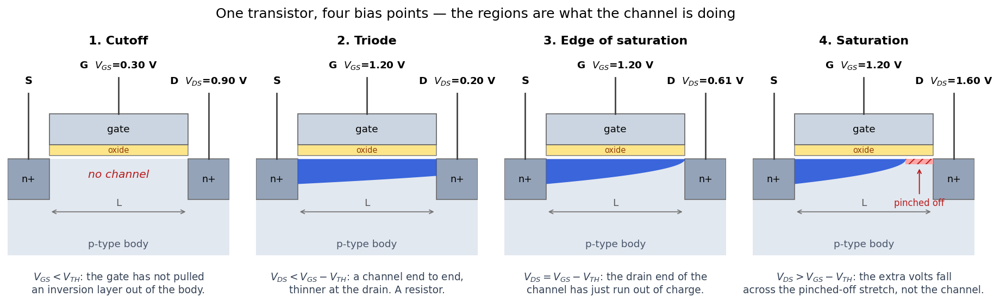

# How a MOSFET works

Everyone says a transistor is a switch, and yet your textbook gives you three different equations
for it. The reason is that a MOSFET is a switch you can **squeeze**, and this page explains what
that means.

Think of a garden hose with your hand around it. If you squeeze hard, nothing gets through. If
you let go completely, water flows freely, limited only by the tap. In between, which is where
every amplifier works, the hose acts as a resistor whose value your hand sets. So one device gives
you three behaviours, depending on how hard you squeeze and how hard the tap pushes, and the
three textbook equations describe one channel in three different states rather than three
different devices.

## The four terminals

A MOSFET has four terminals, and only one of them is the hand:

| Terminal | What it does | In the hose picture |
|---|---|---|
| **Gate** (G) | sets how open the channel is | your hand on the hose |
| **Source** (S) | where the carriers come from | the tap end |
| **Drain** (D) | where they go | the open end |
| **Body** / bulk (B) | the silicon everything is built in | the ground the hose lies on |

The most important thing to know about the gate is what it's made of. **MOS** stands for
**Metal–Oxide–Semiconductor**, and the middle word is an insulator. The gate is a plate of
conductor sitting on a few nanometres of silicon dioxide (glass) on top of the silicon, so it
forms a capacitor with the silicon rather than making an electrical connection to it. ngspice
will tell you how big that capacitor is: for the W = 5 µm, L = 1 µm device this course measures,
`@m.xm1.msky130_fd_pr__nfet_01v8[cgg]` comes back as **30.56 fF** at $V_{GS} = V_{DS} = 1.8$ V.

This means that **no steady current flows into the gate.** You aren't injecting anything into
the silicon. You are putting charge on a plate, and the electric field from that charge reaches
through the glass and pulls mobile electrons up to the surface of the silicon underneath, out of
a p-type body that had few to spare. Those electrons are the **channel**.

That is why the terminal is called a gate rather than an input: moving it costs charge, but
holding it where it is costs nothing. Whenever you've read that the gate is high impedance, this
one fact is the reason.

> **The body is a terminal too.** In this course the body is wired to the source on every NMOS,
> which makes the four-terminal device behave like the three-terminal one in your textbook.
> [What moves the threshold](../guide/threshold-is-not-a-constant.md) is about what happens when
> the two are at different voltages.

## The channel at four bias points

Here is the same transistor at four bias points. Nothing changes from one panel to the next
except the two voltages, so watch what happens to the blue layer.



*Produced by `src/channel_picture.py` in the Lab 03 package. The thickness of the blue layer is
proportional to the local inversion charge, and the red hatch marks the pinched-off stretch where
there is no channel left at all.*

Read the panels from left to right:

1. **Not squeezing hard enough** (panel 1). The gate voltage is too low to pull a channel out of
   the body, so there is no conducting path from source to drain. This is **cutoff**.
2. **Squeezing, with a small push** (panel 2). A channel runs from end to end. It is a little
   thinner at the drain, because the drain voltage partly cancels the gate's pull there, and the
   current is proportional to the push. This is **triode**, where the device acts as a resistor.
3. **The drain end runs out** (panel 3). If you push harder, the channel gets thinner at the
   drain end until, at one particular drain voltage, it has exactly zero charge there.
4. **Push harder still** (panel 4). The zero-charge point moves back from the drain, and all
   the extra volts you added fall across that pinched-off stretch instead of across the channel.
   The channel itself sees the *same* voltage it did in panel 3, so it carries the *same*
   current. This is **saturation**, where the device acts as a current source.

The last panel is the one worth understanding properly. In saturation the current stops
increasing because **the part of the device that sets the current no longer sees your extra
voltage**, not because an equation says so.

<!-- The Manim animation of this page's central idea. Renders to
     dist/MosfetChannel.web.mp4 from tooling/manim/scenes/ad103_mosfet_channel.py;
     deploy copies it here alongside its poster frame. -->
<video controls loop muted playsinline preload="none"
       poster="../assets/img/ad103-mosfet-channel.poster.png"
       style="width:100%;max-width:820px;border-radius:8px">
  <source src="../assets/img/ad103-mosfet-channel.web.mp4" type="video/mp4">
  Your browser will not play embedded video —
  <a href="../assets/img/ad103-mosfet-channel.web.mp4">download the clip</a>.
</video>

*The four panels above, animated: $V_{GS}$ and $V_{DS}$ move continuously while the $I_D$–$V_{DS}$
curve traces itself out alongside them. The source is the `MosfetChannel` scene in
[`tooling/manim/scenes/ad103_mosfet_channel.py`](https://github.com/uoftasic/ad103). It's worth
watching once before Lab 03 and again after it.*

## The squeeze, in numbers

Lab 03 sweeps a W = 5 µm, L = 1 µm `nfet_01v8` at five gate voltages, and this is the first table
it prints:

```
== I_D vs V_DS   (W=5, L=1)
   gate voltages read from spice/id_vds.spice: 0.6 0.9 1.2 1.5 1.8
     V_GS  I_D at V_DS=1.8   knee V_DS   channel R at V_DS=10 mV
     0.60         2.005 uA       0.09 V              26648.3 ohm
     0.90        63.876 uA       0.29 V               2529.2 ohm
     1.20       217.505 uA       0.50 V               1288.0 ohm
     1.50       436.080 uA       0.70 V                907.7 ohm
     1.80       696.275 uA       0.89 V                736.9 ohm
```

Look at the last column first. It is the resistance of the channel, measured with only 10 mV
across it, which is small enough that the transistor is unambiguously behaving as a resistor. The
resistance goes from **26.6 kΩ** to **737 Ω** as the gate goes from 0.6 V to 1.8 V, a 36-fold
change with no moving parts, controlled by a voltage on a plate of glass, which makes the
transistor a dial rather than an on/off switch.

The current at the off end isn't zero either. With the gate at 0 V and 1.8 V across the device,
the same lab measures

```
== below threshold   (V_DS = 1.8 V)
   V_GS = 0.00 V   I_D = 2.1853e-12 A
```

That is **2.19 picoamps**, 320 million times less than the 696 µA the device passes when it is
wide open, but still not zero. Much of [The four regions](../guide/four-regions-not-three.md) is
about that number.

Both numbers matter, for different reasons. The 737 Ω is why a digital gate can charge the next
gate's input in picoseconds, and that sets your clock speed. The 2.19 pA is why a phone's battery
drains while it sits on the table doing nothing. That current is called **leakage**, and on a chip
with ten million transistors it has been the dominant design constraint of the last twenty years.

> **On-resistance and off-current.** If someone hands you a transistor and calls it a switch, ask
> them what its on-resistance and its off-current are. Both are finite, you can measure both in an
> afternoon, and the word "switch" tells you neither.

You'll produce this table yourself in Lab 03, Part 3.

## Units on `W` and `L` {#units-w5-never-w5u}

The units mistake described in [Getting started](../guide/getting-started.md#units-on-w-and-l)
applies to every deck from here on. In SKY130, **`W` and `L` are plain numbers in microns, with
no unit suffix**, so `W=5` means five micrometres. `W=5u` asks for a width that falls outside
every model bin, and ngspice stops with `could not find a valid modelname`, a message that
mentions neither `W` nor units. In Lab 03, Part 7 we have you trigger this error once on a
MOSFET deck.

## What a MOSFET is used for

The regions map onto two jobs:

- **Switching.** You drive the gate all the way to 1.8 V or all the way to 0 V and never linger in
  between. That uses cutoff and triode, and the numbers you care about are the 737 Ω and the
  2.19 pA. This is how all of digital design uses transistors, including every gate in the DD
  track.
- **Amplifying.** You park the gate somewhere in the middle, keep the drain high enough that the
  channel stays pinched off, and wiggle the gate. That uses saturation, and what you care about is
  how much the current moves per volt of wiggle. That number is called $g_m$, and it is the
  subject of [Transconductance and output resistance](../guide/gm-and-ro.md).

An amplifier and a logic gate are the same device biased in different regions, which is why
[The CMOS inverter](../guide/the-inverter-is-an-amplifier.md) treats a logic gate as an amplifier
later in this course.

## Check yourself

1. Why does no steady current flow into the gate? What does it cost to change the gate voltage?
2. In panel 4, the drain voltage is higher than in panel 3. Why is the current the same?
3. From the table, roughly what is the channel resistance at $V_{GS}$ = 1.2 V, and how does it
   compare with the value at 1.8 V?
4. Is a transistor used as a digital switch mainly in saturation, or in cutoff and triode?

Next: [The four regions](../guide/four-regions-not-three.md).
