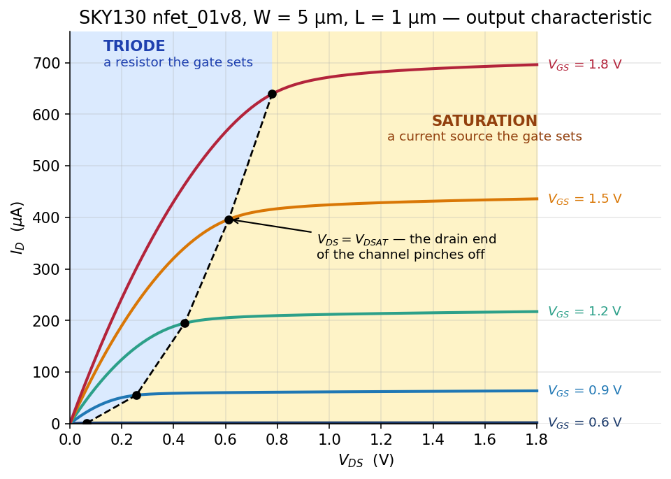
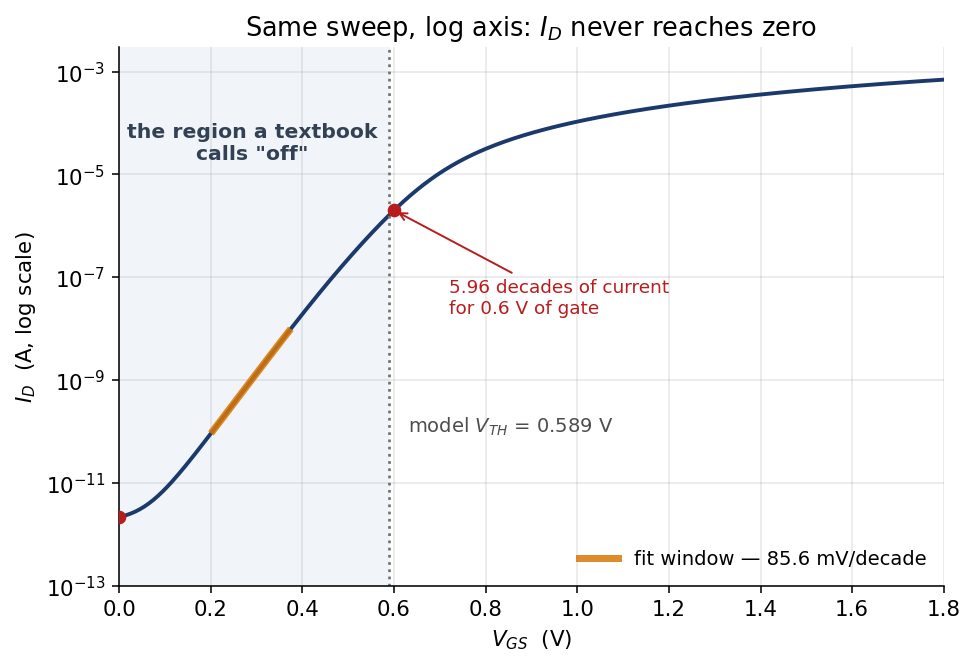

# The four regions

Your textbook gives you cutoff, triode and saturation. This page draws the boundaries between
them on measured curves, shows how to tell which region a device is in, and then adds a fourth
region that most textbooks leave out. Each region is one of the channel pictures from
[How a MOSFET works](../guide/a-mosfet-is-a-valve.md), seen this time on a graph.

## The output curves



*SKY130 `nfet_01v8`, W = 5 µm, L = 1 µm. Five sweeps of $V_{DS}$, one per gate voltage, from
`spice/id_vds.spice` in the Lab 03 package, and drawn by `src/plot_curves.py`. The dashed locus and
its dots are the `vdsat` that the model itself reports at each bias, from `spice/op_params.spice`,
so they show the simulator's own estimate of where the channel pinched off rather than a fit or a
guess of ours.*

Almost everything worth knowing about a MOSFET is somewhere in that picture, so we'll go through
it one region at a time and match each region to a panel of the cross-section figure on How a
MOSFET works.

## 1. Cutoff

**Condition:** $V_{GS} < V_{TH}$, where $V_{TH}$ is the **threshold voltage**.

**What the channel is doing:** there is no channel yet. The gate hasn't pulled enough electrons to
the surface to form a conducting layer, so the only path between source and drain is two
back-to-back diodes, and one of them is reverse-biased.

**On the plot:** none of the five curves is in cutoff. The lowest one, $V_{GS} = 0.6$ V, sits
right at threshold (the next page measures $V_{TH}$ = 0.6016 V for this device), and even there
the current never gets above 2.005 µA over the whole sweep from 0 to 1.8 V. On a plot scaled for
700 µA that is indistinguishable from the axis, and any gate voltage below threshold gives less
current still, so a curve in cutoff would be a flat line along the bottom.

$$I_D \approx 0$$

Keep the "$\approx$" in mind, because Section 4 comes back to it.

## 2. Triode: a resistor the gate sets

**Condition:** $V_{GS} > V_{TH}$ **and** $V_{DS} < V_{GS} - V_{TH}$.

**What the channel is doing:** the channel runs all the way from source to drain (panel 2 of the
cross-section). It is thinner at the drain end, because the drain's own voltage partly cancels the
gate's pull there, but it is still continuous, so if you push harder on the drain, more current
flows, almost as it would through a wire.

**On the plot:** triode is the rising left-hand part of every curve, shaded blue. Near the origin
the curves are nearly straight lines through zero, which is the signature of a resistor.

$$I_D = \mu_n C_{ox}\frac{W}{L}\left[(V_{GS}-V_{TH})V_{DS} - \frac{V_{DS}^2}{2}\right]$$

You don't need to memorise that equation, but it's worth reading. It has a term proportional to
$V_{DS}$ (the resistor), minus a term that grows as $V_{DS}^2$ (the channel thinning at the drain
end). At small $V_{DS}$ the second term vanishes, and what's left is Ohm's law, with a conductance
that the gate controls:

$$R_{ch} \approx \frac{1}{\mu_n C_{ox}\frac{W}{L}(V_{GS}-V_{TH})}$$

Lab 03 measures exactly that resistance, by putting 10 mV across the device and dividing by the
current that flows:

| $V_{GS}$ | channel resistance |
|---|---|
| 0.60 V | 26 648.3 Ω |
| 0.90 V | 2 529.2 Ω |
| 1.20 V | 1 288.0 Ω |
| 1.50 V | 907.7 Ω |
| 1.80 V | 736.9 Ω |

> **How to recognise triode:** look at the curve near the origin. If it's a straight line through
> zero, the device is in triode and you can treat it as a resistor. The check takes one glance, and
> it's right far more often than plugging numbers into the quadratic.

## 3. Saturation: a current source the gate sets

**Condition:** $V_{GS} > V_{TH}$ **and** $V_{DS} > V_{GS} - V_{TH}$.

**What the channel is doing:** the channel has run out of charge at the drain end (panel 3), and
the pinch-off point has moved back up the channel (panel 4). Any extra drain voltage falls across
the pinched-off stretch rather than across the channel, so the channel keeps carrying the current
it was already carrying.

**On the plot:** saturation is the flat right-hand part of every curve, shaded amber. The height of
each flat part is set by $V_{GS}$ alone, at 2.005, 63.876, 217.505, 436.080 and 696.275 µA for the
five gate voltages. Once the device is in saturation the drain voltage has stopped mattering, but
the gate voltage still does.

$$I_D = \frac{1}{2}\mu_n C_{ox}\frac{W}{L}(V_{GS}-V_{TH})^2$$

> **How to recognise saturation:** nudge $V_{DS}$. If $I_D$ barely moves, the device is in
> saturation. That is the definition of saturation, and it's also how bias checks are done in real
> designs: you perturb the drain and see whether the current changes.

## The boundary between triode and saturation

The two conditions above meet where $V_{DS} = V_{GS} - V_{TH}$. That quantity is called the
**overdrive voltage**, $V_{ov} = V_{GS} - V_{TH}$, and it's the number analog designers think in.
It's the drain voltage at which the device stops behaving like a resistor and starts behaving like
a current source, so it's also the headroom the device needs before it will act as one.

[Where saturation starts](../guide/where-saturation-starts.md) shows where the boundary really sits
on these curves, and why at high gate voltage the measured knee is 26 % lower than $V_{ov}$.

## 4. Subthreshold: the region most textbooks skip

Now go back to the "$\approx$" we asked you to keep in mind in cutoff.

**Predict before you read on.** The threshold of this device is about 0.6 V. At $V_{GS} = 0.30$ V,
half the threshold and comfortably "off", how much current flows with 1.8 V on the drain? Write
down an order of magnitude. Zero is an acceptable answer, as long as you commit to it.

Now put the same device on a log axis:



*From `spice/id_vgs_log.spice`. Same device, same $V_{DS} = 1.8$ V; the only change is the y-axis.*

```
== below threshold   (V_DS = 1.8 V)
   V_GS = 0.00 V   I_D = 2.1853e-12 A
   V_GS = 0.30 V   I_D = 1.3645e-09 A
   V_GS = 0.60 V   I_D = 2.0054e-06 A
   decades from 0.0 V to 0.6 V : 5.96
   subthreshold slope          : 85.6 mV/decade
```

At 0.30 V the device carries 1.36 nanoamps. That's small, but it's a smooth, repeatable,
exponential function of gate voltage, so you can't write it off as zero or as noise. On the linear
plot this whole region is a
flat line on the axis, but on the log plot it's a straight line six decades tall, which is what an
exponential looks like on a log axis.

This is **subthreshold conduction**, also called **weak inversion**. The gate hasn't formed a
proper channel, but it has lowered the barrier enough that some electrons get across by thermal
energy, and the number that do is exponential in the barrier height, exactly as in the diode from
[Lab 02](../labs/lab-02-diode-iv-overview.md). The physics is the same, so below threshold a MOSFET
behaves like a diode.

The slope of that line is the parameter everyone quotes, the **subthreshold slope**, and on this
device it is 85.6 mV per decade: it takes 85.6 mV of gate voltage to change the drain current by a
factor of ten. At room temperature no conventional MOSFET can do better than about 60 mV/decade,
which is the same $kT/q \ln 10 = 59.6$ mV you met on
[the diode page](../guide/the-diode-is-an-exponential.md), and real devices land above that limit.

### Why leakage matters

Suppose you build a chip with ten million of these transistors and switch it off, with every gate
at ground:

$$10^7 \times 2.1853\ \mathrm{pA} = 21.9\ \mu\mathrm{A}$$

That's tolerable. Now suppose your threshold came out 0.3 V lower than you designed for, which is
well within the spread of a real process. In subthreshold the current depends on $V_{GS} - V_{TH}$
and not on either one alone, so a device with $V_{TH}$ 0.3 V lower and its gate at ground carries
what this device carries with its gate at 0.3 V, which is the 0.30 V row of the output above:

$$10^7 \times 1.3645\ \mathrm{nA} = 13.6\ \mathrm{mA}$$

That's six hundred times as much current, from a 0.3 V shift in one parameter, on a chip that isn't
doing anything. This is why threshold voltage is controlled so tightly, why "low power" and "high speed"
pull in opposite directions (a low $V_{TH}$ gives you speed and leakage together), and why
subthreshold slope has its own line in every process datasheet.

> **A MOSFET is never fully off.** When you hear "the transistor is off", read it as "the
> transistor is passing a current I have decided to ignore", and then ask how many of them there
> are.

## The four regions on one card

| Region | Condition | Channel | $I_D$ behaves like |
|---|---|---|---|
| **Subthreshold** | $V_{GS} < V_{TH}$ | none, but carriers get over the barrier | an exponential in $V_{GS}$ |
| **Cutoff** | $V_{GS} \ll V_{TH}$ | none | zero, for accounting purposes |
| **Triode** | $V_{GS} > V_{TH}$, $V_{DS} < V_{ov}$ | continuous, thinner at the drain | a resistor $R(V_{GS})$ |
| **Saturation** | $V_{GS} > V_{TH}$, $V_{DS} > V_{ov}$ | pinched off at the drain end | a current source $I(V_{GS})$ |

Cutoff and subthreshold are the same region seen on two different axes, which is why textbooks
merge them. It's still worth keeping them apart in your head, because cutoff is what you assume
when you do digital logic, and subthreshold is what you count when you do a power budget.

You'll draw these plots and read these numbers yourself in Lab 03, Parts 1, 3 and 4.

## Check yourself

1. A device has $V_{GS}$ = 1.2 V, $V_{TH}$ = 0.6 V and $V_{DS}$ = 0.3 V. Which region is it in?
   What if $V_{DS}$ = 1.0 V?
2. Using the subthreshold slope of 85.6 mV/decade, by roughly what factor does $I_D$ change when
   $V_{GS}$ goes from 0.30 V to 0.39 V?
3. Why does a lower threshold voltage make a chip faster and leakier at the same time?

Next: [Where saturation starts](../guide/where-saturation-starts.md).
