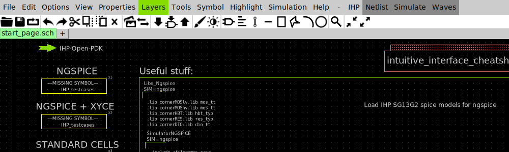
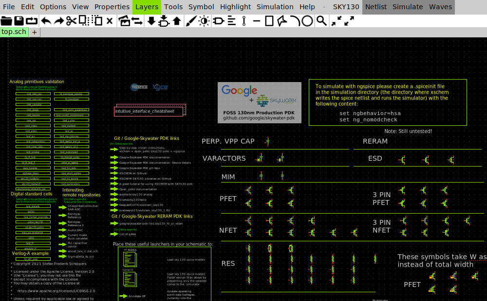
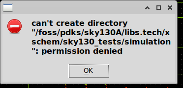
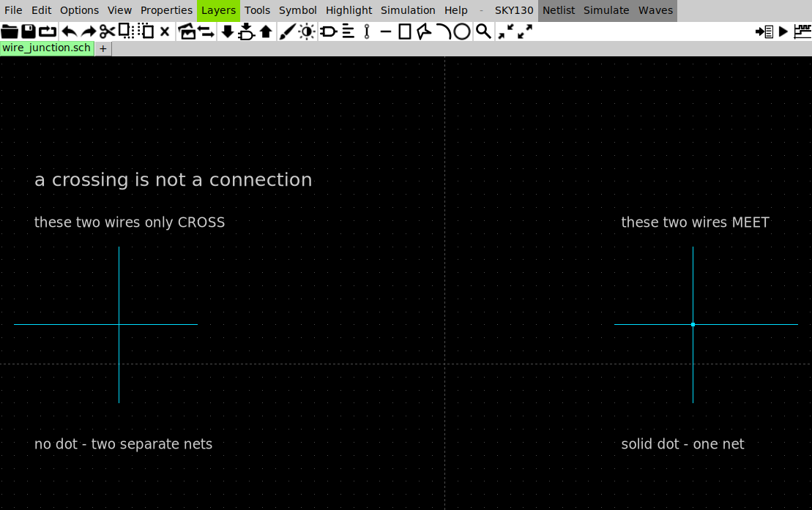
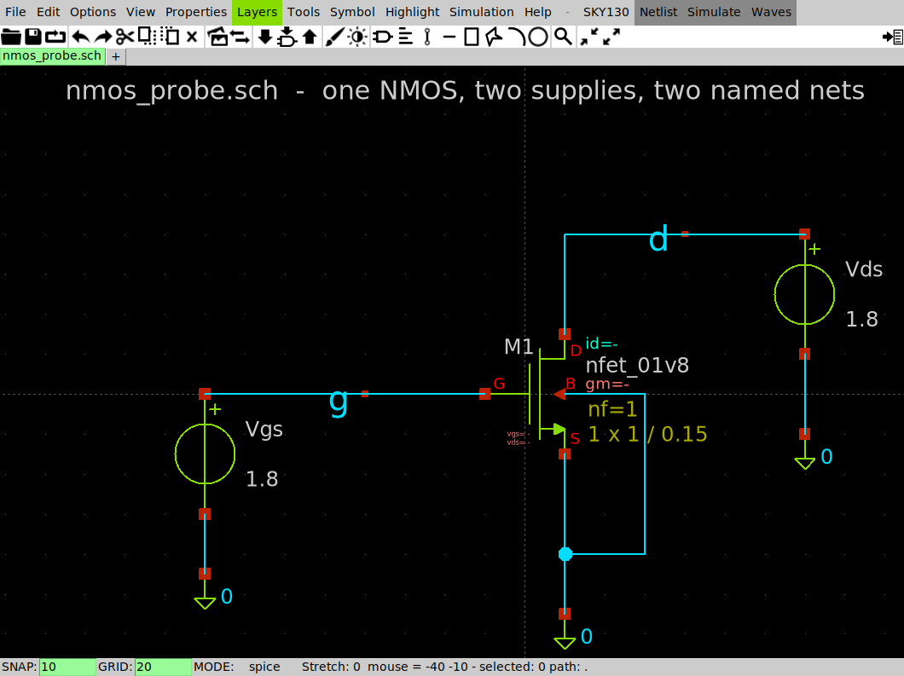
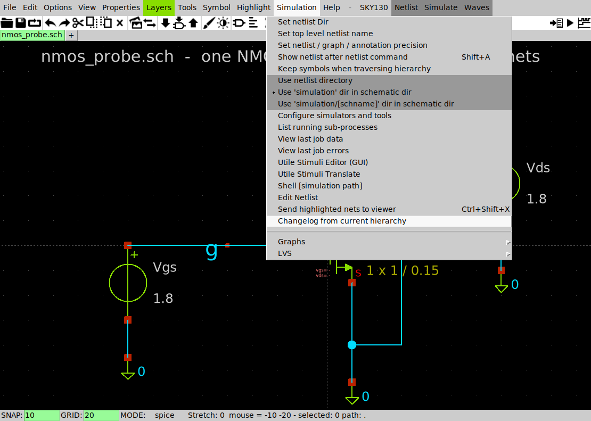
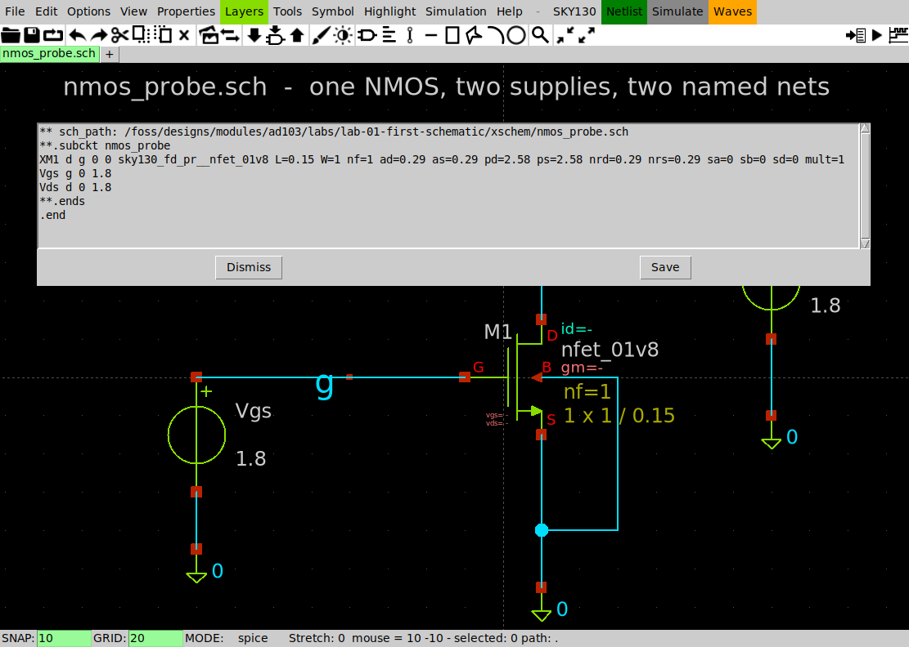

# Getting started

Nearly everything you do in AD103 happens in **XSchem**, a schematic editor. You draw a circuit,
XSchem turns the drawing into a SPICE netlist, and ngspice simulates the netlist and hands you
back numbers:

$$\text{schematic} \;\longrightarrow\; \text{netlist} \;\longrightarrow\; \text{ngspice}
\;\longrightarrow\; \text{a number}$$

You have probably never used XSchem, so this page explains how those pieces fit together, and
goes through the handful of mistakes that cost new users the most time. You won't install
anything here. AD103 needs one Docker image and a browser, and you already have both from
[IC101](https://uoftasic.com/ic101/). You'll start the tools and draw your first schematic in
[Lab 01](../labs/lab-01-first-schematic-overview.md).

## The PDK setting

The workbench image can simulate more than one manufacturing process. The environment variable
`PDK` chooses which one, and the image's default is `ihp-sg13g2`, a real 130 nm process from IHP
in Germany. We use **SKY130** for everything in AD103, so you'll need to change it.

This matters more in AD103 than anywhere else in the curriculum, because XSchem reads `$PDK` when
it starts up to decide which device library to load, and it doesn't tell you which one it picked.
If you launch it with the default setting, you get an editor that looks perfectly healthy:



*The menu bar says **IHP**, the tab says `start_page.sch`, and the page offers to load
"IHP SG13G2 spice models". XSchem gives no error and no warning.*

None of the `sky130_fd_pr/...` symbols this course uses will be there. If you draw a circuit
anyway, the netlist will have `IS MISSING !!!!` next to your transistor, and XSchem will still
report that it finished successfully.

The fix is a setup script from the workspace repo, `/foss/designs/common/.designinit`, which sets
`PDK=sky130A`. You load it with a leading `.`, which is the shell's `source` command. That runs
the file in your current shell rather than in a new one, and it's the only way a script can
change your shell's environment. The change lasts only as long as that shell, but each new
terminal on the workbench desktop loads the script by itself, and running it again does no harm.

Checking takes a couple of seconds: `echo $PDK` should print `sky130A`, and XSchem's menu bar
should say **SKY130**. You'll make the first check in Lab 01, Part 1, and the second in Part 3,
and it's worth making a habit of both.

## Where XSchem starts

When XSchem starts, it reads a settings file called `xschemrc` from the directory you launched it
in. Each AD103 lab has one in its `xschem/` folder. That file is what makes the SKY130 symbols
resolve, and it also puts your netlists somewhere you can find them. Three habits follow from
this:

- **Launch XSchem from a terminal, not from a desktop icon.** Some of XSchem's messages are
  printed to the terminal it was started from. If you start it from a menu there is no such
  terminal, so those messages are lost, and the program can appear to do nothing at all.
- **Launch it from the directory your schematics are in**, so that it reads that directory's
  `xschemrc`. If symbols that worked yesterday have vanished today, you probably started XSchem
  from somewhere else.
- **Name the file you want to open**, as in `xschem nmos_probe.sch &`. If you don't give a
  filename, XSchem opens whatever its settings name as the start page, which is the subject of
  the next section.

### The PDK start page

Every AD103 lab sets the start page to a blank `untitled.sch` in the lab directory, so inside a
lab folder a bare `xschem &` does no harm. Anywhere else (a scratch folder of your own with no
`xschemrc`, say) you get the SKY130 PDK's own start page instead:



*The menu bar reads **SKY130**, and the canvas is a live schematic: the NFET, PFET, RES, MIM and
VARACTOR rows are real symbols. It looks like any other page you could work on, but you can't
save anything to it.*

That page is a real file, `/foss/pdks/sky130A/libs.tech/xschem/sky130_tests/top.sch`, and it sits
inside the PDK, which is read-only. Two things go wrong if you work on it, and XSchem explains
neither of them:

- `Ctrl-S` can't write the file. XSchem asks `save file?`, you answer **Yes**, and it replies
  with a box saying **`file opening for write failed!`**. The tab keeps its `*`, the file on disk
  doesn't change, and nothing is printed in the terminal.
- **Netlist** writes the netlist into the same directory as the schematic, so it tries to create
  a `simulation/` folder inside the PDK and stops with this box:



```
can't create directory
"/foss/pdks/sky130A/libs.tech/xschem/sky130_tests/simulation": permission denied
```

Nothing is wrong with your installation, the PDK or your drawing; you're simply working in a
read-only folder. Open a schematic that lives in your own directory and the error goes away. If
you've already drawn something on the start page, **File → Save as** into your own folder will
keep it.

## Units on `W` and `L`

On a SKY130 transistor, **`W` and `L` are plain numbers in microns, with no unit suffix.** `W=1`
means one micrometre. Adding a `u` is the most common SKY130 mistake there is, and nearly
everyone makes it at least once.

It's an easy mistake to make, because everywhere else in SPICE you would write `1u` for a micron,
so `W=1u` looks right. The SKY130 models already treat the number as microns, though, so `W=1u`
asks for a millionth of a micron. XSchem accepts this without a murmur. Here is the device line
it writes when both `W` and `L` have the suffix:

```
XM1 d g 0 0 sky130_fd_pr__nfet_01v8 L=0.15u W=1u nf=1 ad=2.9e-07 as=2.9e-07 pd=0.580002 ps=0.580002 nrd=290000 nrs=290000 sa=0 sb=0
+ sd=0 mult=1
```

The symbol calculates the diffusion areas and resistances from `W`, so the mistake spreads to
other parameters: `nrd` went from `0.29` to `290000`, and `ad` from `0.29` to `2.9e-07`. Those
two `u`s changed six other numbers, and XSchem didn't mention any of it.

It's ngspice that finally objects:

```
could not find a valid modelname
    Simulation interrupted due to error!

Error: incomplete or empty netlist
       or no ".plot", ".print", or ".fourier" lines in batch mode;
no simulations run!
```

**`could not find a valid modelname` almost always means a unit suffix on `W` or `L`.** The
SKY130 models are **binned**: each `.model` card covers a range of widths and lengths, and a
device has to fall inside one of those ranges to get a model. A width of a millionth of a micron
is outside every bin, so no model matches and ngspice stops. The message mentions neither `W`
nor units, so when you see it, check `W` and `L` first instead of trying to work out what the
message means. [Reading a SKY130 device model](../reference/sky130-device-guide.md) explains
binning in full.

In Lab 01, Part 6 we have you cause this error on purpose, so that you'll recognise it when it
happens by accident.

## How wires connect

In XSchem, a wire connects to something only where one of its **endpoints** lands on a pin or on
another wire. Two wires that cross each other are not connected. XSchem draws a small solid dot
at a real junction, and nothing at all where two wires just pass over each other:



*The same pair of wires drawn twice. On the left, one wire runs over the other and XSchem draws
nothing at the crossing: these are two separate nets that happen to overlap on the screen. On the
right, four wire ends land on the same grid point and XSchem draws a dot, so they form one net.
The dot is the only visible difference, and it's only a few pixels across, so zoom in on every
junction before you netlist.*

XSchem also snaps every click to a grid, so a wire can end one grid step short of a pin, and at
normal zoom it will still look connected. Lab 01 shows you how to land wire ends on pins with
`Shift-W`, and the netlist check later on this page finds the gaps you miss.

For long connections you don't need to draw a wire at all. Instead you **name the net**: put a
net label (`lab_pin.sym`) at each end and give both labels the same name. Any two labels with the
same name are the same net, wherever they sit on the page, and every supply and ground
connection in this course is made this way.

Here is the reference schematic from Lab 01, which is the first one you'll netlist:



*One `nfet_01v8` with `W=1` and `L=0.15`. `Vgs` drives the gate through a net labelled `g`, and
`Vds` drives the drain through `d`. The source and body both go to ground, and the filled cyan
dot where they meet is a real junction. The status bar reads `SNAP: 10  GRID: 20  MODE: spice`;
the snap setting is why wires land exactly on pins instead of next to them.*

XSchem labels each device with its size, here `nfet_01v8`, `nf=1` and `1 x 1 / 0.15`. The last
one means `mult × W / L`, and it lets you check the sizes on a whole page of transistors at a
glance.

## The netlist

When you click **Netlist**, XSchem writes a SPICE file and tells you almost nothing about it, so
it's worth knowing where the file goes and what's in it.

**Where it goes.** By default the netlist is written to `~/.xschem/simulations/`, a folder inside
the container, so it's deleted along with the container even though your schematic is safe on
your own disk. The setting **Simulation → Use 'simulation' dir in schematic dir**
changes this, so that netlists go into a `simulation/` folder next to the `.sch` file. Each lab's
`xschemrc` turns it on with `set local_netlist_dir 1`; a scratch directory of your own won't have
that line.



*The three netlist-directory entries are radio buttons, so exactly one of them is on. Here it's
the middle one, which is what `set local_netlist_dir 1` in a lab's `xschemrc` selects.*

**What's in it.** This is the netlist of `nmos_probe.sch`:

```
** sch_path: /foss/designs/modules/ad103/labs/lab-01-first-schematic/xschem/nmos_probe.sch
**.subckt nmos_probe
XM1 d g 0 0 sky130_fd_pr__nfet_01v8 L=0.15 W=1 nf=1 ad=0.29 as=0.29 pd=2.58 ps=2.58 nrd=0.29 nrs=0.29 sa=0 sb=0 sd=0 mult=1
Vgs g 0 1.8
Vds d 0 1.8
**.ends
.end
```

Your whole drawing is in those seven lines. `XM1 d g 0 0` is the transistor, followed by its four
terminals in a fixed order: **drain, gate, source, body**. The names are the labels you placed,
and `0` is ground, which SPICE has always called node zero.

Notice that there are no device models and no analysis command. A netlist describes only the
circuit. The `.lib` line that loads the SKY130 models and the `.control` block that says what to
measure belong in the testbench, and you'll meet your first testbench in Lab 02.



*With **Simulation → Show netlist after netlist command** (`Shift-A`) ticked, each press of
**Netlist** opens the file in its own window, with the schematic still visible behind it.*

### Invented net names

Read the four node names on the device line; they should be exactly the nets you labelled. If the
gate wire stops one grid step short of the gate pin, XSchem writes this instead, with no error,
no warning and an exit status of 0:

```
XM1 d net1 0 0 sky130_fd_pr__nfet_01v8 L=0.15 W=1 nf=1 ...
```

The gate's net `g` has become `net1`. XSchem invents a name for every pin that isn't connected to
anything, and all the invented names look like `net` followed by a number. So after every
netlist, search for them with `grep 'net[0-9]' simulation/*.spice`. Any match is a wire you think
is connected but isn't. This is quicker and more reliable than inspecting the canvas by eye, and
it finds nine out of ten wiring mistakes in this course. Lab 01, Part 7 shows you what ngspice
makes of a circuit like this.

## Simulation time

Every SPICE deck in this course loads the SKY130 models with this line:

```
.lib $PDK_ROOT/sky130A/libs.tech/ngspice/sky130.lib.spice tt
```

The `tt` at the end picks the typical corner. Loading the model library is slow: a single-deck
run such as Lab 01's `make` takes about ten seconds, and the terminal shows nothing while ngspice
reads the models. It hasn't hung, so don't press `Ctrl-C`.

## Getting help

The course is self-paced, but that doesn't mean you have to work through it alone.

- **Ask in the [team Discord](https://discord.gg/hrJnP5UsGz).** No question is too basic. In an
  EDA tool, much of what looks like your own mistake is really the tool being unhelpful, and
  XSchem in particular tends to fail without saying anything.
- **Quote the exact error, and say where you saw it.** Some of XSchem's messages go to the
  terminal it was launched from, and others, such as the two error boxes on this page, appear
  only in the XSchem window, with nothing in the terminal. Either way, paste the text, along with
  the command you ran and the output of `xschem --version`.
- **Post a screenshot of the schematic.** A wiring problem that's obvious in a screenshot can be
  very hard to describe in words.
- **If a command on these pages doesn't do what the page says, that's a bug in the course**, and
  we'd like you to report it. We ran every command here before writing it down and copied every
  number from a real run, so a mismatch means something has changed, and we want to know.

## Check yourself

Answer these on paper before you start Lab 01.

1. XSchem's menu bar says **IHP**. What's wrong, and which two checks tell you it's fixed?
2. You typed `W=2u` on a transistor. Which tool complains, and what does the message say?
3. Two wires cross on the canvas, with no dot at the crossing. Are they connected?
4. A device line reads `XM1 d net3 0 0 ...`. Which terminal is unconnected?
5. You netlisted a schematic in a folder with no `xschemrc`. Where did the netlist go, and what
   happens to it when the container is removed?

Next: [Lab 01: Your first schematic](../labs/lab-01-first-schematic-overview.md).
