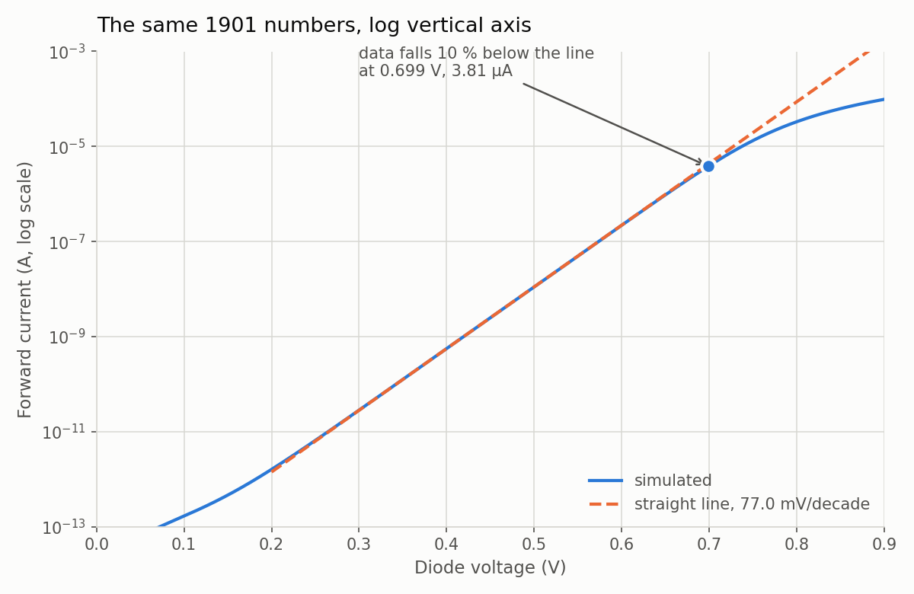

# The diode equation

This page explains why a diode's current is an exponential function of its voltage, and where the
"60 millivolts per decade" that everyone quotes comes from.

In short, a diode is a **barrier**, and the current through it is carriers **climbing** that
barrier. The number of carriers with enough energy to climb a barrier of height $E$ is
proportional to $e^{-E/kT}$, and that fact isn't specific to electronics: the same statistics make
a chemical reaction go faster when you heat it, and make the atmosphere thinner with altitude.
Whenever you put a barrier in front of a thermal population of particles, you get an exponential.
The rest of this page turns that idea into numbers you'll measure in Lab 02.

## What a junction is

Take one piece of silicon doped so that it has spare electrons to give away (**n-type**), and one
doped so that it has spare vacancies for electrons (**p-type**; the vacancies are called
**holes**). When you push them together, two things happen, and they work against each other.

**Diffusion.** Electrons are plentiful on the n side and scarce on the p side, so they spread
across, the way a drop of ink spreads through water, and holes spread the other way. Nothing
pushes them; diffusion is just the statistics of many particles moving at random.

**The field that builds up.** Every electron that leaves the n side leaves behind a positively
charged donor atom fixed in the crystal, and arrives on the p side as extra negative charge. So
the spreading builds an **electric field** across the junction, pointing from the n side to the p
side, and that field pushes the next electron back. The region where the field lives has been
emptied of mobile carriers, so it is called the **depletion region**.

The junction settles into equilibrium when the two effects cancel, with diffusion pushing
carriers across, the field pushing them back, and no net current flowing. The field corresponds
to a step in energy, a **built-in barrier** that an electron has to climb to get from the n side
to the p side. Nobody applied this barrier from outside; it formed on its own.

## Why the barrier gives an exponential

At any temperature above absolute zero, the carriers don't all sit at the same energy. They are
spread over a range, with the number at energy $E$ falling off like $e^{-E/kT}$: many carriers
with a little energy, exponentially fewer with a lot. That is the **Boltzmann distribution**, and
it is the most reused fact in device physics.

Now apply a forward voltage $V$: plus on the p side, minus on the n side. That voltage opposes the
built-in field, so it **lowers the barrier** by $qV$. The number of carriers that can now get over
is multiplied by

$$
e^{qV/kT}
$$

and the current goes up by the same factor. Two consequences of this describe the whole device:

- **Forward bias is exponential**, because you are lowering a barrier that an exponentially
  distributed population has to climb.
- **Reverse bias saturates.** A reverse voltage makes the barrier *higher*, which stops the
  climbers entirely. A second, much smaller current remains: the few minority carriers that
  thermal energy knocks loose near the junction, which the field then sweeps across. Those carriers
  fall *down* the barrier rather than climbing it, so a taller barrier doesn't produce more of
  them. Their supply is set by temperature alone, so this current stays at a tiny constant value,
  called the **saturation current** $I_0$.

Together these give the Shockley diode equation:

$$
I \;=\; I_0\left(e^{\,V/nV_T} - 1\right)
\qquad\text{where}\qquad
V_T \;=\; \frac{kT}{q}
$$

$V_T$ is the **thermal voltage**, the voltage whose energy $qV_T$ equals the characteristic thermal
energy $kT$. At the 27 °C that ngspice simulates at, $V_T = 25.8649$ mV. The $-1$ makes the current
exactly zero at $V = 0$, and it is also what produces the reverse saturation floor. The $n$ is an
experimental correction called the **ideality factor**, which lands between 1 and 2 for real
junctions, and you'll extract it from your own data in Lab 02.

## Where 60 mV per decade comes from

Rewrite the forward part in terms of *decades* of current instead of factors of $e$. To multiply
the current by 10 you need $e^{V/nV_T} = 10$, so

$$
\Delta V = n V_T \ln 10
$$

With $n = 1$ and $V_T = 25.8649$ mV:

$$
\Delta V = 25.8649\ \text{mV} \times 2.302585 = 59.556\ \text{mV}
$$

That is the famous **60 mV/decade**. It comes from $kT/q$ times $\ln 10$, which is to say from
thermodynamics and arithmetic, so it doesn't depend on silicon, on doping or on the process.
Nothing you can do to a diode makes it steeper than that at room temperature, and heating it makes
it shallower. Real junctions are shallower than this ideal by the factor $n$.

## What the SKY130 diode measures

Lab 02 sweeps a 1 µm² SKY130 diode and reports, for each decade of current, the forward voltage
needed to reach it:

```
  current      forward V     mV since previous decade
     1e-12 A   0.181962 V           -
     1e-11 A   0.264643 V       82.68
     1e-10 A   0.342408 V       77.77
     1e-09 A   0.419503 V       77.09
     1e-08 A   0.496518 V       77.02
     1e-07 A   0.573602 V       77.08
     1e-06 A   0.651480 V       77.88
```

Each of the four decades from 100 pA to 1 µA costs between **77.02 and 77.88 mV**. In other words,
the device needs a fixed extra voltage for each factor of ten in current, and that is what
"exponential" means when you say it in millivolts. A straight-line fit over 1 nA to 100 nA gives
**77.037 mV/decade**.

That exchange rate matters for all of analog design. It says you can't get a big current change
out of a small voltage change, or a small current change out of a big one, because the rate is
fixed by physics. Bias networks, references, and every "why is this circuit so sensitive?"
question come back to it.

## Reading a log axis



*Produced by `src/plot_iv.py` in the Lab 02 package.*

This plot uses the same 1901 rows as the flat-and-a-wall plot in [Linearity and
superposition](../guide/the-straight-line-runs-out.md); only the vertical axis has changed.

A **log axis** labels equal distances with equal **ratios**, not equal differences. The distance
from $10^{-9}$ to $10^{-8}$ is the same as from $10^{-8}$ to $10^{-7}$, even though the second gap
is ten times bigger in amps. That has three consequences, and they apply to every analog plot
you'll read:

1. **A straight line on a log-y plot is an exponential**, and only an exponential. Its steepness
   gives the rate in the exponent, which here is measured in mV per decade.
2. **There is no zero.** Zero is infinitely far down, and a negative number can't be drawn at all,
   which is why this plot shows only the forward half. To see both sides of zero you need either
   two plots or the *magnitude* of the current.
3. **Small features at the bottom matter as much as large ones at the top.** The wiggle near
   $10^{-13}$ spans as much real information as the wall at $10^{-4}$. A linear axis hides six
   decades of this device, while this one shows all of them.

To read a value, find the gridline below your point, judge how far up towards the next gridline
it sits, and multiply the gridline's value by the matching factor. Remember that **halfway up a
decade is ×3.16, not ×5.**

## The ideality factor

Divide the measured slope by the ideal one:

$$
n \;=\; \frac{\text{measured mV/decade}}{V_T \ln 10}
   \;=\; \frac{77.0367}{59.556} \;=\; 1.2935
$$

SKY130's own model card for this diode declares:

```
+ js = 2.75e-015 ; Units: amper/meter^2
+ jsw = 6e-016 ; Units: amper/meter
+ n = 1.2928
+ rs = 981 ; Units: ohm (ohm/meter^2 if area defined)
```

The slope gives **1.2935**, and the card declares **1.2928**, so a foundry parameter pulled out of
the slope of a graph agrees with the foundry's own number to five parts in ten thousand. That is what parameter
extraction is, and it is most of what a device engineer does: rather than reading a number off a
card, you show that you can get it back out of a measurement. You'll find the card yourself in
Lab 02, Part 4.

> **Any straight run on a log-current plot gives you an ideality factor.** Its slope in mV/decade
> divided by 59.6 is $n$, and a value between 1 and 2 tells you you're looking at a junction.
> You'll use the same check on a MOSFET in [The four regions](../guide/four-regions-not-three.md),
> where the line comes out at 85.6 mV/decade. The number lands in the same range for a reason:
> below threshold, the MOSFET's current is also carriers getting over a barrier.

## Where the straight line ends

The straight part of the log plot runs from about 0.3 V to about 0.7 V. Outside that range it
bends at both ends, and the two bends have different causes: the one at the bottom comes from the
simulator, and the one at the top comes from the diode.

### The bottom of the curve: GMIN

At the bottom left, the curve flattens into a floor near a picoamp. It's tempting to call that
floor the saturation current, but nearly all of it comes from the simulator.

Every SPICE simulator puts a conductance called **GMIN** across every junction, because a branch
that conducts nothing makes the matrix it solves singular and the simulation fails to converge.
ngspice's default is $10^{-12}$ S, one picoamp per volt.

Lab 02 measures the current at two reverse voltages and one small forward one, with the default
GMIN and again with GMIN set a thousand times smaller:

| $V$ | GMIN = $10^{-12}$ S | GMIN = $10^{-15}$ S |
|---|---:|---:|
| −1.000 V | −1.00356 pA | −4.55885 fA |
| −0.500 V | −0.503558 pA | −4.05763 fA |
| +0.100 V | 0.1672571 pA | 67.35706 fA |

Look at the default column. At −1.000 V the current is 1.00356 pA and at −0.500 V it is
0.503558 pA. The **difference is 0.500002 pA across 0.5 V**, a conductance of
$1.000\times10^{-12}$ S to six digits. A diode doesn't have a constant resistance, so this
conductance has to come from something other than the diode. It comes from GMIN, which makes up
nearly all of the floor.

Subtract GMIN × $V$ from each reverse reading and what's left is constant, which is what a
saturation current should be:

| $V$ | current | minus GMIN × $V$ |
|---|---|---|
| −1.000 V | 1.00356 pA | **3.56 fA** |
| −0.500 V | 0.503558 pA | **3.558 fA** |
| −1.000 V, GMIN = 1e-15 | 4.55885 fA | **3.559 fA** |
| −0.500 V, GMIN = 1e-15 | 4.05763 fA | **3.558 fA** |

All four ways give **3.558 fA**. Separately, the straight-line fit to the *forward* curve gives a
$V = 0$ intercept of **3.5864 fA**, so two unrelated pieces of arithmetic, done at opposite ends of
the plot, agree to 0.8 %. That is $I_0$, and it's measured in femtoamps: the entire reverse
current of this device is about **22,000 electrons per second**.

There's one more check you can make. With GMIN out of the way, the forward point at +0.100 V reads
**67.357 fA**. The equation, using only the two numbers extracted from the straight part of the
graph, predicts

$$
I_0\left(10^{\,V/77.0367\,\text{mV}} - 1\right)
 = 3.5864\ \text{fA} \times (19.858 - 1) = 67.63\ \text{fA}
$$

That is **within 0.4 %** of the measurement, and you need the $-1$ to get there: at 0.1 V the $-1$
term is still worth 5 % of the answer.

If you report that your diode's reverse leakage is 1 pA, what you've actually reported is
ngspice's default setting. The useful exponential range of a real diode is finite at both ends,
and the bottom end may be set by your simulator rather than by your circuit.

### The top of the curve: series resistance

Above about 0.7 V the measured curve falls **below** the straight line and keeps falling further
behind. Lab 02 reports the point where it leaves the line: **at 0.699 V it carries 3.8136 µA,
against 4.2487 µA on the line.**

This bend comes from outside the junction, so it doesn't mean the junction is failing. Its cause
is the **series resistance** of everything the current has to pass through *besides* the
junction: the neutral silicon on either side, the contacts and the metal. You can extract it the same way you extracted $n$:

```
  series resistance, from the top of the curve:
    at 0.900 V the diode carries 98.0354 uA
    the straight line needs only 0.804011 V for that current
    so 95.989 mV is dropped outside the junction
    rs = 95.989 mV / 98.0354 uA = 979.1 ohm
```

The junction itself only needed 0.804011 V, and the other **95.989 mV** was dropped getting the
current to it. The model card above says **`rs = 981`**, so the 979.1 Ω extracted from the shape
of the graph agrees with the foundry's number to **0.2 %**.

As the current climbs, the voltage lost to $I \cdot r_s$ climbs *linearly*, while the junction's
own requirement climbs only logarithmically, so the resistor term eventually dominates. The local
slope shows it taking over (annotations added here):

```
     V        I(A)         mV/decade
   0.450  2.4887e-09       77.01     <- pure junction
   0.600  2.1945e-07       77.50
   0.700  3.9174e-06       85.92     <- rs starting to cost you
   0.800  3.3105e-05      151.64
   0.850  6.2443e-05      217.80     <- mostly a resistor now
```

## Driving a diode with a current

Everything above says that a diode's *voltage* is set by its current, rather than the other way
round. Thinking of it that way is the hardest habit to build, because for two years you've treated
a component as something you put a voltage across.

So you can't say what voltage a diode sits at until you've said what current it carries. If you
ask what happens when you put 0.900 V across it, the sweep says it carries **98.0354 µA**, which is
**25 times** the current at 0.700 V for only 200 mV more. There is no such thing as slightly too
much voltage on a diode, and that is why every diode in a real circuit has something in series
with it to limit the current. If you drive it with a current, it settles at a sensible voltage,
but if you drive it with a voltage, you had better have the voltage right.

## Check yourself

1. Heating a diode from 27 °C to 100 °C raises $V_T$ in proportion to absolute temperature. Does
   the ideal mV-per-decade figure go up or down?
2. On a log axis, a point sits a quarter of the way from the $10^{-8}$ gridline to the $10^{-7}$
   one. Roughly what current is it?
3. Why does the GMIN floor make the reverse current look larger than $I_0$, and how did the second
   GMIN setting confirm that?
4. The local slope is 77.01 mV/decade at 0.450 V and 151.64 mV/decade at 0.800 V. Which effect is
   responsible for the change?

Next: [Three diode models](../guide/three-models-of-one-diode.md).
