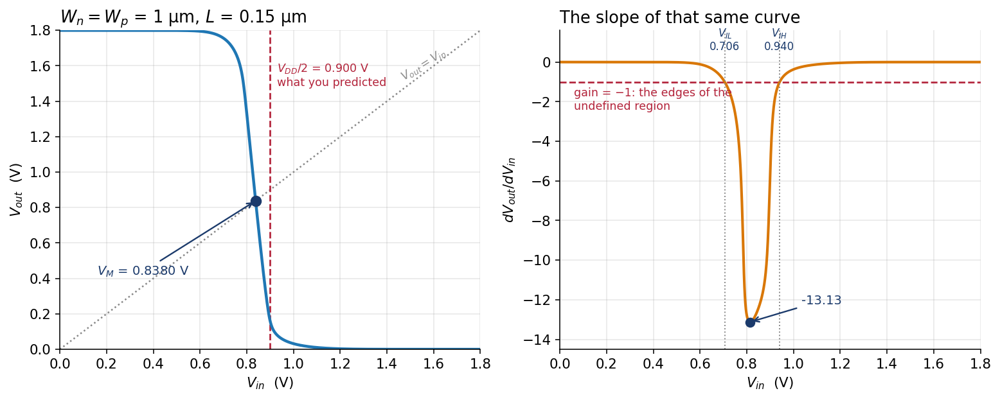
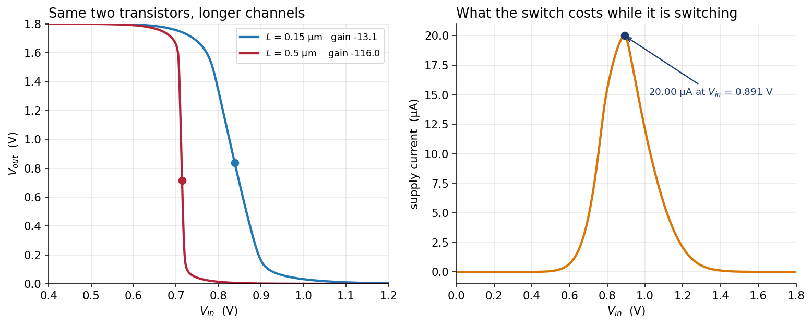

# The CMOS inverter

The digital track draws this circuit and calls it a NOT gate. It is also an amplifier, although
digital design only ever looks at it from its two ends (the two flat ends of the transfer curve
below), and this page treats it as one.

The circuit is two transistors with their gates tied together and their drains tied together: an
NMOS pulling the output down and a PMOS pulling it up. In [DD101](https://uoftasic.com/dd101/)
this is the smallest circuit that computes. In this course it is the smallest circuit with gain,
and both descriptions are of the same circuit.

## What you already know

The pieces you need all come from earlier pages:

- A MOSFET is **off** below threshold and **on** above it
  ([How a MOSFET works](../guide/a-mosfet-is-a-valve.md)).
- Between those extremes it has four regions, and the interesting one here is saturation
  ([The four regions](../guide/four-regions-not-three.md)).
- In saturation the gate moves the current by $g_m$, and the drain leaks it back through $r_o$
  ([Transconductance and output resistance](../guide/gm-and-ro.md)).
- Electrons are more mobile than holes, so the same shape drawn as a PMOS is weaker.

Everything the inverter does follows from these four facts, without any new idea.

## Drive strength of each half

The capstone lab starts by measuring each transistor on its own, with both drawn at W = 1 µm,
L = 0.15 µm and both turned fully on:

```
== 1. What each transistor can do on its own   W = 1 um, L = 0.15 um
   NMOS, gate and drain at 1.8 V          501.0462 uA
   PMOS, gate and drain at 0 V            200.7478 uA
   NMOS / PMOS                              2.4959
```

The NMOS current, **501.0462 µA**, is the same number Lab 01's `make` printed on your first day,
from a deck with only that one transistor in it.

The PMOS, drawn the same size and driven just as hard, carries **200.7478 µA**, which is **2.4959
times less**. Holes drift through silicon more slowly than electrons do, by roughly that factor in
this process, and the only thing a designer can do about it is draw the PMOS wider. Every
asymmetry on the rest of this page comes from that ratio.

## The transfer curve

If you sweep the input from 0 to 1.8 V and plot the output, you get this curve:



*From `spice/vtc.spice` in the capstone package, with $W_n = W_p = 1$ µm and $L = 0.15$ µm, at the
SKY130 tt corner.*

The curve has three parts, and digital design uses only two of them:

- **Input low.** The NMOS is below threshold and the PMOS is fully on, so the circuit is a closed
  switch to $V_{DD}$ and the output sits at **1.7506 V**.
- **Input high.** This is the mirror image, with the NMOS on and the PMOS off, and the output sits
  at **0.0684 V**.
- **In between.** Both transistors are on and both are in saturation, and the output falls
  steeply.

That steep middle part is where the circuit amplifies, and its slope is the voltage gain:

```
   switching threshold V_M       0.838027 V   (V_DD/2 would be 0.900000)
   steepest slope                -13.1253     at V_in = 0.814 V
```

The gain is **−13.1253**: if you wiggle the input by 1 mV near 0.814 V, the output moves 13.1 mV
the other way. That makes it a real amplifier, if not a good one (the circuit doesn't know it's
supposed to be a logic gate).

Digital logic works *because* this gain is bigger than one. A gate with a gain of 0.9 would shrink
every signal a little at each stage, and a chain of them would fade to grey. With a gain above
one, a logic level **restores** itself as it passes through: a slightly degraded 1.6 V at the
input comes out as a clean 1.7506 V. You can think of digital design as analog design with enough
gain that nobody has to think about it.

## The switching threshold $V_M$

The **switching threshold** $V_M$ is the input voltage at which the output equals the input, which
is where the curve crosses the 45° line. Here it is **0.838027 V**. $V_{DD}/2$ would be
0.900000 V, so $V_M$ sits **62.0 mV low**.

Despite the name, $V_M$ isn't the threshold voltage of either device. Those are 769.27 mV and
510.03 mV, and their average, 0.6396 V, isn't $V_M$ either. $V_M$ is a property of the *circuit*:
it's the input voltage at which the NMOS current and the PMOS current are equal, with both devices
in saturation. Because the NMOS is 2.4959× stronger, the currents balance at an input **below** the
midpoint, so the pull-down wins with less gate voltage than you might expect.

## Sizing the PMOS

The obvious fix is to make the PMOS 2.4959× wider so that the two devices are equally strong, but
as this sweep of the PMOS width shows, that doesn't quite work:

```
   Wp (um)   Wp/Wn        V_M        error vs 0.9 V      gain
   1          1.00    0.838027 V      -61.97 mV     -13.1253
   2          2.00    0.869826 V      -30.17 mV     -12.8834
   2.5        2.50    0.882739 V      -17.26 mV     -11.8856
   3.5        3.50    0.899865 V       -0.13 mV     -11.2590
   4          4.00    0.905807 V       +5.81 mV     -11.2846
```

$W_p = 2.5$ µm, the ratio the current measurement suggested, still leaves **17.26 mV** of error,
so it removes about two thirds of the problem and leaves a third. The ratio that actually centres
$V_M$ is **3.5**.

It's worth understanding why, more than remembering the number. The drive measurement had each
gate at the *full* supply. At $V_M$ the input is $V_M$, so with $V_M$ centred the NMOS sees
$V_{GS} = 0.9$ V and the PMOS sees $V_{SG} = 0.9$ V. Neither device is anywhere near full drive,
and at that lower overdrive the two devices' currents don't scale in the same way. **Matching
currents at 1.8 V is a different condition from matching them at 0.9 V**, and only the second one
sets $V_M$.

Now time all three sizings, each driving a 10 fF load:

```
   Wp (um)      t_pHL         t_pLH      pull-up / pull-down
   1          27.7001 ps    64.6539 ps         2.334
   2.5        30.2508 ps    30.7067 ps         1.015
   3.5        31.7807 ps    24.1077 ps         0.759
```

The two sizings answer two different questions, and neither is wrong:

| You want | Draw | You get |
|---|---|---|
| equal rise and fall time | $W_p = 2.5$ µm | 30.2508 / 30.7067 ps, 1.5 % apart |
| equal noise margins ($V_M$ centred) | $W_p = 3.5$ µm | $V_M$ = 0.899865 V, 0.13 mV out |

Delay is charge divided by current, and the load and the voltage swing are the same for both
edges, so equal drive currents give equal delays. That is why $W_p = 2.5$ µm, which matches the
full-drive currents, gives matched edges. The $W_p = 3.5$ inverter rises **24 % faster than it
falls**, while the $W_p = 2.5$ inverter has its switching point 17 mV low. No width does both, so
which one you choose depends on whether your concern is timing or noise.

> **When two reasonable criteria give two different answers,** you've found a trade-off rather
> than a mistake. Name both criteria before you pick a width.

## Lengthening the channels

The gain was −13.1253 with $L = 0.15$ µm, the process minimum. [Transconductance and output
resistance](../guide/gm-and-ro.md) showed that gain is $g_m$ times an output resistance, and that $r_o$
grows quickly with length. So the next step is to lengthen both devices and change nothing else:

```
   L = 0.15 um, Wn = Wp = 1 um    gain  -13.1253 at V_in = 0.814 V
   L = 0.5  um, Wn = Wp = 1 um    gain -116.0341 at V_in = 0.712 V
                                  V_M   0.714056 V
```

Making the channels 3.33× longer gives **8.84× the gain**, from the same two transistors on the
same supply, with one number changed in one field.



It's worth checking this against [Transconductance and output
resistance](../guide/gm-and-ro.md), where the intrinsic gain $g_m r_o$ of a single $L = 0.5$ µm
device was **35.07**. The inverter gets **116.03**, more than three times that.

The extra gain comes from **both** transistors amplifying at once. The gates are tied together, so
a wiggle on the input moves the NMOS current and the PMOS current in the same direction through
the output node. The transconductances therefore add, and the output resistances combine in
parallel:

$$A_v = -\left(g_{mn} + g_{mp}\right)\left(r_{on} \parallel r_{op}\right)$$

Two devices pushing into one node is the cheapest gain in analog design. The arrangement is called
the **CMOS inverting amplifier**, or push-pull stage, and you'll meet it again in AD201. It's the
same schematic your logic library calls `inv_1`.

> **The bias problem.** To use this as an amplifier you have to hold the input at 0.712 V, where
> the slope is 116. A 10 mV drift in that bias then moves the output by 1.16 V, which slams it into
> a rail. Real amplifiers spend most of their transistors on holding the operating point still,
> and the first tool for that is [the current mirror](../guide/the-current-mirror.md), on the next
> page.

## Current while switching

```
   supply current at V_in = 0 V             0.000002 uA
   supply current at V_in = 1.8 V           0.000320 uA
   peak supply current                       20.0048 uA   at V_in = 0.891 V
```

At either end of the sweep one transistor is off, so the gate draws almost nothing: 2 pA with the
input low and 320 pA with it high. That is why CMOS replaced every logic family before it: a CMOS
gate that isn't switching costs essentially nothing.

Halfway through a transition both devices are on at once, and **20.0048 µA** flows straight from
$V_{DD}$ to ground without doing any useful work. This is **short-circuit current**, one of the two
reasons a chip heats up when it computes (the other is charging all that gate capacitance).
Multiply it by a hundred million gates switching a billion times a second and you have the
thermal design problem of a processor.

The same current explains a rule the digital track gives without proof: **never leave an input
floating.** A floating gate drifts to somewhere near $V_M$, which parks the inverter in the steep
middle of its curve, and there it burns 20 µA indefinitely in a gate that is doing nothing.

You'll measure every number on this page yourself in the capstone lab.

## Check yourself

1. Why does a gain greater than one let a chain of inverters restore a degraded logic level?
2. With $W_n = W_p$, $V_M$ is below $V_{DD}/2$. Which device is stronger, and why does that pull
   $V_M$ down?
3. Why doesn't $W_p$ = 2.5 µm, the measured drive ratio, centre $V_M$? Which criterion does it
   satisfy instead?
4. Lengthening both devices from 0.15 µm to 0.5 µm raised the gain from 13 to 116. Which quantity
   in $A_v = -(g_{mn} + g_{mp})(r_{on} \parallel r_{op})$ changed most?

Next: [The current mirror](../guide/the-current-mirror.md).
