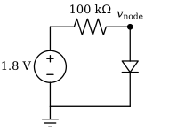
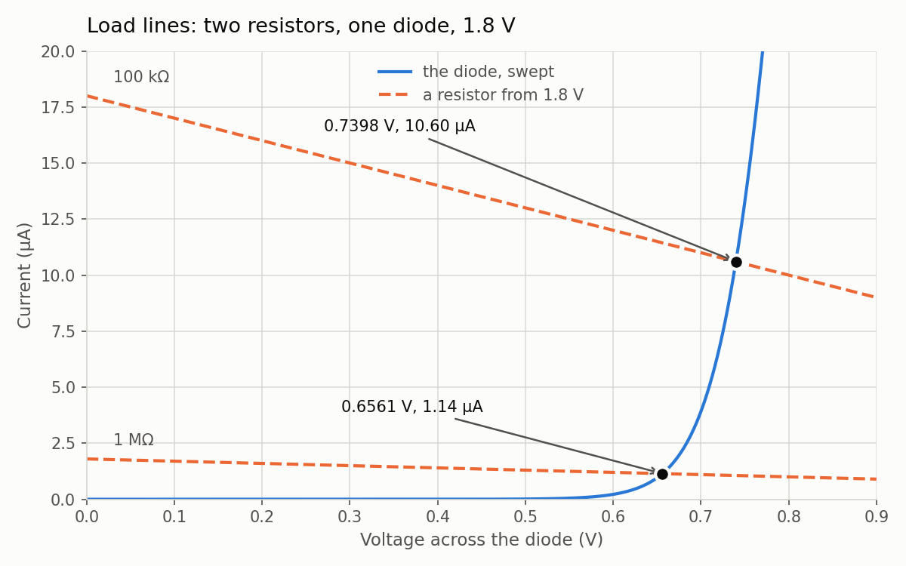

# The operating point

When you can't use superposition on a circuit and you can't solve its equation by hand either,
the only way left to get a number out of it is to search for one. You can run that search
yourself on paper in about ninety seconds, and it's worth doing once, because it's what every
SPICE simulation you launch is doing underneath.

## A resistor and a diode in series

The circuit has one supply, one resistor and one diode:

{width=320 fig-alt="A 1.8 V source drives a 100 kΩ resistor, which feeds a diode to ground. The node between the resistor and the diode is labelled v_node."}

There is only one unknown, `v_node`, and KCL at that node gives you one equation for it: the
current flowing down through the resistor has to equal the current through the diode.

$$
\frac{1.8 - v}{100\,\text{k}\Omega} \;=\; I_{\text{diode}}(v)
$$

The left side is a straight line in $v$. The right side is the diode's curve, which
[the next page](../guide/the-diode-is-an-exponential.md) shows is an exponential in $v$, so
written out in full the equation is

$$
\frac{1.8 - v}{100\,000} \;=\; I_0\!\left(e^{v/nV_T} - 1\right)
$$

with $v$ appearing both outside an exponential and inside one. **No rearrangement of this
equation leaves $v$ alone on one side.** That's a property of the equation itself, whatever
algebra you try, and mathematicians call an equation like this **transcendental**. The usual way to deal with one is to stop trying for an exact answer and get
close to it instead, then closer still.

## Load lines

Plot the diode's curve, and then plot the resistor's equation on the same axes. The resistor's
equation, $i = (1.8 - v)/R$, is a straight line with an intercept of $1.8/R$ and a slope of
$-1/R$. It's called the **load line**, and drawing one is still the fastest way to *see* what a
circuit like this will do.

*Produced by `src/plot_iv.py` in the Lab 02 package. The blue curve is plotted from the same 1901
rows as every other diode plot in this course.*

Every point on the blue curve satisfies the diode's equation, and every point on an orange line
satisfies the resistor and the supply. The only point that satisfies all of them at once is where
the two cross, and that crossing, a single voltage and current together, is the **operating
point**.

Two things follow from the picture:

- Changing the resistor moves the operating point **along the diode's curve**; it can't move off
  it. Going from 1 MΩ to 100 kΩ multiplies the current by 9.27 but moves the voltage by only
  83.7 mV, so you get roughly ten times the current for less than a tenth of a volt.
- The diode's curve is so steep near 0.7 V that even a large change in the load line produces
  only a small change in voltage. That's where the rule of thumb "a diode drops 0.7 V" comes
  from, and [Three diode models](../guide/three-models-of-one-diode.md) puts a number on how good
  a rule it is.

## Worked example: guess, correct, repeat

You can also find the operating point numerically, with a calculator and two facts taken from
the measured curve. Start from the rule of thumb, 0.7 V, and use one measured anchor point: the
diode carries **3.917437 µA at 0.700 V**, and its current rises by one decade for every
**77.04 mV**.

1. **Guess** $v = 0.700$ V. The resistor then delivers $(1.8 - 0.700)/100\,\text{k}\Omega =
   11.000\ \mu\text{A}$.
2. **Correct.** A diode carrying 11.000 µA wouldn't sit at 0.700 V; it would sit at
   $0.700 + 0.07704\log_{10}(11.000/3.917437) = 0.7345$ V.
3. **Repeat.** At 0.7345 V the resistor delivers only 10.655 µA, which the diode holds at
   0.7335 V. That voltage gives 10.665 µA, and 10.665 µA gives 0.7335 V again, so the answer has
   stopped moving.

After three rounds of arithmetic, the hand answer is **0.7335 V and 10.665 µA**.

## What ngspice gets

ngspice's operating-point analysis, `op`, solves the same circuit, and it too works by
iterating until the answer stops moving. For three values of the resistor it gives:

| $R$ | diode voltage | current |
|---|---:|---:|
| 10 kΩ | 0.8905358 V | 90.94642 µA |
| 100 kΩ | **0.7398473 V** | **10.60153 µA** |
| 1 MΩ | 0.6561163 V | 1.143884 µA |

Your hand answer of 0.7335 V and 10.665 µA was **6.3 mV** and **0.60 %** away from the 100 kΩ
row, and you got that close with three lines of arithmetic and one measured anchor point.

The 0.60 % error comes from a real property of the device rather than from your arithmetic.
You used a constant 77.04 mV per decade, but above about 0.7 V the diode's curve has already
started to bend away from that straight line. Lab 02 measures where the bend starts,
**0.699 V**, and [the next page](../guide/the-diode-is-an-exponential.md) explains why it
happens. If you redo the three steps with 86 mV per decade instead, which is the local value
measured in that region, you land on **0.7373 V and 10.627 µA**. That's 2.6 mV and 0.24 % out,
less than half the error.

## Two independent calculations

`op` and a DC sweep (`.dc`) are different computations. `op` solves the nonlinear circuit once,
by iterating. The diode sweep is 1901 separate solves of a *different* circuit, a lone diode
driven by a voltage source with no resistor at all. The only reason the two should agree is that
they describe the same device.

That gives you a way to check one against the other. In the sweep data, find the voltage at
which the diode's current equals the current on the 100 kΩ load line. Interpolating between the
two sweep rows on either side of the crossing gives **0.739846 V and 1.060154e-05 A**, and `op`
said 7.398473e-01 V and 1.060153e-05 A. The two calculations share nothing but the device model,
and they agree to six digits. When two independent routes to a number agree that closely, you
can be confident the number isn't an artifact of either route. You'll make this comparison
yourself in Lab 02, Part 5.

Every amplifier, current mirror and logic gate is designed by first choosing an operating point
and then arranging for the circuit to sit at it. The back half of this course
([transconductance](../guide/gm-and-ro.md), [the CMOS inverter](../guide/the-inverter-is-an-amplifier.md),
[the current mirror](../guide/the-current-mirror.md)) is about picking that point on purpose,
rather than discovering where the circuit ended up afterwards.

## Small-signal resistance

If you zoom in far enough on any smooth curve, it looks like a straight line. Near the 1 MΩ
operating point, the diode's own sweep gives $\Delta V = 2$ mV between the rows at 0.655 V and
0.657 V, and $\Delta I = 65.98$ nA across the same two rows, so $\Delta V/\Delta I$ is
**30.3 kΩ**. That's the slope of $V$ against $I$, the reciprocal of the slope you see on the plot
above, where current is drawn against voltage. A small wiggle riding on that operating point sees
the diode as a 30.3 kΩ resistor, which means superposition works again, at least for the wiggle.

That is the idea behind every analog circuit you have used: the circuit is nonlinear enough to
set a bias point, and everything small that happens near that point is treated as linear. If you
move the operating point, the resistance moves with it. At the 100 kΩ point the same measurement
gives 4.12 kΩ, about seven times smaller, while the current there is 9.27 times larger.

For a pure junction those two ratios would be the same. Differentiating the diode equation gives
a resistance of $nV_T/I$, and $nV_T$ for this diode is the 77.04 mV per decade divided by
$\ln 10$, or 33.5 mV, so the resistance would fall exactly as fast as the current rises. It falls
more slowly because the diode also has 979.1 Ω of
[series resistance](../guide/the-diode-is-an-exponential.md#the-top-of-the-curve-series-resistance)
in the measurement, and that part doesn't change with current:
$33.5\ \text{mV}/I + 0.98\ \text{k}\Omega$ gives 30.2 kΩ and 4.13 kΩ, close to both measured
values.

> **A small-signal resistance needs an operating point.** If someone quotes you the resistance of
> a diode without telling you the current through it, they haven't told you anything, because
> the resistance changes with the current.

## Check yourself

1. In the worked example, why does the iteration converge instead of running away? (Think about
   the slopes of the two curves at the crossing.)
2. With $R$ = 1 MΩ, the load line is ten times flatter. Without calculating anything, would you
   expect the operating-point voltage to be higher or lower than with 100 kΩ? Check your answer
   against the table.
3. The small-signal resistance is 30.3 kΩ at the 1 MΩ point and 4.12 kΩ at the 100 kΩ point. What
   does that tell you about how steep the diode's I–V curve gets as the current rises?

Next: [The diode equation](../guide/the-diode-is-an-exponential.md).
