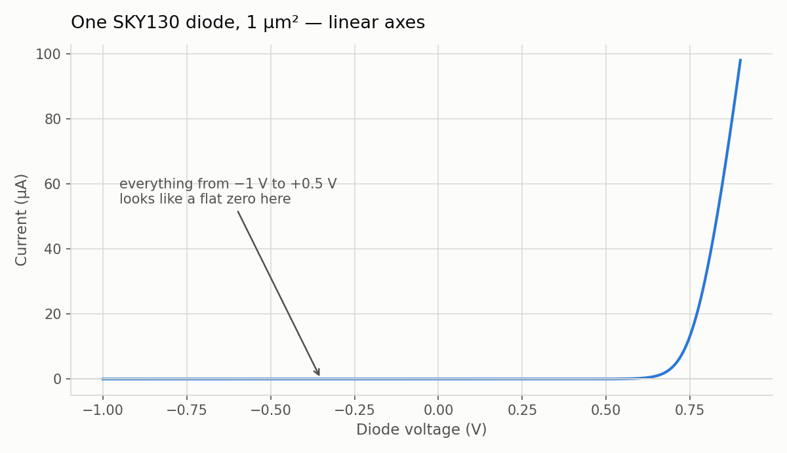

# Linearity and superposition

Between ECE110 and AD102 you learned methods that solve any circuit you were shown. This page
explains why adding a single diode breaks those methods, and what still works once it does.

Superposition, Thévenin equivalents, node-voltage analysis with a matrix and the impedance algebra
you do in your head are **theorems** rather than facts about wires, and every one of them rests on
the same hypothesis: *every element in this circuit is linear.* You have never had to check that
hypothesis, because until now it has always been true. When it fails, the theorem doesn't apply at
all, and the answer it gives you is wrong rather than approximately right.

## What linear means

An element is **linear** if the relationship between the voltage across it and the current through
it keeps two promises:

- **Scaling.** If you double the voltage, the current doubles too.
- **Additivity.** The response to $v_1 + v_2$ is the response to $v_1$ plus the response to
  $v_2$.

A resistor, including the poly-silicon strips you sized in AD102, keeps both, because $i = v/R$
and division distributes over addition. Capacitors and inductors keep both too, because
differentiation and integration are linear operations. Superposition is just additivity applied to
a whole circuit at once.

That gives you a direct test for any component: drive it with A, then with B, then with A+B, and
see whether the third answer is the sum of the first two.

## The additivity test

Lab 02's `spice/straight_line.spice` runs exactly that test. It builds six one-ports, three
copies each of a 100 kΩ resistor and a 1 µm² SKY130 diode, and drives the three copies of each
part at 0.35 V, at 0.35 V again, and at 0.70 V, which is the sum of the first two. These are its results:

| | A (0.35 V) | B (0.35 V) | A + B, predicted | A + B, measured at 0.70 V |
|---|---:|---:|---:|---:|
| 100 kΩ resistor | 3.500000 µA | 3.500000 µA | 7.000000 µA | **7.000000 µA** |
| 1 µm² diode | 125.4090 pA | 125.4090 pA | 250.8180 pA | **3.917437 µA** |

For the resistor, 3.500000 µA + 3.500000 µA = 7.000000 µA, and the measured answer is 7.000000 µA,
to seven digits, which is what you'd expect from a theorem whose hypothesis holds.

For the diode, superposition predicts **250.8180 pA**, but the circuit actually delivers
**3.917437 µA**, which is out by a factor of **15,618**.

The wrong answer isn't noisy, and nothing about it looks broken. It's a clean, plausible-looking
number with seven significant figures, and nothing in the output says
"superposition does not apply", so it's up to you to know when the theorem holds and when it
doesn't.

> **Check before you reach for a linear tool.** Before you write down a Thévenin equivalent, a
> superposition sum or an impedance divider, ask whether every element in the loop is linear. If
> the loop has even one diode, one transistor or anything else with a curve in it, the answer is
> no.

You'll run this test yourself in Lab 02, Part 2.

## The diode on linear axes

Here is the same diode swept from −1 V to +0.9 V and plotted the way you have plotted everything
so far, as current against voltage with both axes linear.

*Produced by `src/plot_iv.py` in the Lab 02 package, from the 1901 rows that
`spice/diode_iv.spice` writes.*

On these axes a resistor is a straight line through the origin with slope $1/R$. The diode is
instead a flat stretch followed by a wall. The slope is the conductance, so this component's
resistance is anywhere between "infinite" and "almost zero" depending on where you are on the
curve, which means $R$ is no longer a property of the part.

The current along the flat stretch isn't zero, though. At −1.000 V the sweep reads
**−1.003559 pA**, and at +0.350 V it reads **125.4090 pA**, which is 125 times more current, yet on
this plot both are indistinguishable from the axis. Linear axes hide the part of the curve that
carries most of the physics, and [The diode equation](../guide/the-diode-is-an-exponential.md)
shows it on a better axis.

## What still works

**Kirchhoff's laws still hold**, because KCL is charge conservation and KVL is energy
conservation. Neither law says anything about what the elements are made of, so it makes no
difference that one of them is a diode, and you can still write every node equation you know how
to write.

| Tool | Still valid with a diode in the loop? |
|---|---|
| KCL, KVL | **Yes.** They are conservation laws, not linearity results. |
| Ohm's law on the *resistors* | **Yes.** The resistors are still resistors. |
| Superposition | **No.** It was off by 15,618× in the test above. |
| Thévenin / Norton equivalent | **No** for the part of the circuit containing the diode. It still works for the linear part around the diode, and that turns out to be useful. |
| Series/parallel combination | **No** for the diode, because it has no $R$ to combine. |
| Solving the system by algebra | **Usually no.** You get an equation with $v$ both inside and outside an exponential, and no rearrangement gets $v$ on its own. |

The last row is the hard one, and it's a problem with the equations rather than with diodes. The
next page deals with it.

## From procedure to search

Until now you have treated circuit analysis as a procedure: identify the topology, apply the right
theorem, turn the crank and get a number. For linear circuits that's the right way to work, and it
will serve you for the rest of your career.

With a nonlinear element in the circuit, analysis becomes a **search**. Instead of asking
"what is the answer?", you ask "which pair of numbers, one voltage and one current, satisfies both the
element and the rest of the circuit at the same time?" There's no crank to turn; what you have
instead is a target, and a way of closing in on it.

## Check yourself

1. A circuit contains only resistors, capacitors and inductors. Can you use superposition on it?
   Why?
2. Using the table above, how would you show that a diode fails the scaling promise as well as the
   additivity one?
3. Why can't you combine a diode in series with a resistor into one equivalent resistance?

Next: [The operating point](../guide/the-operating-point.md).
