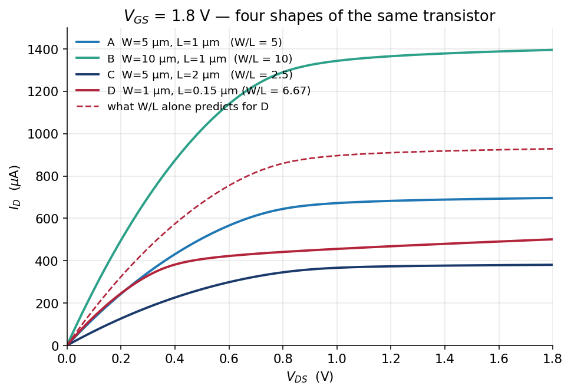

# Sizing with W and L

A resistor has a resistance and a capacitor has a capacitance. When you place a transistor, there
is no single value to choose. You choose two lengths, $W$ and $L$.

Every equation in the last few pages carries the factor $W/L$, and it is the only factor in them
that belongs to you. $\mu_n$, $C_{ox}$ and $V_{TH}$ belong to the foundry and arrive fixed in the
model file. $V_{GS}$ and $V_{DS}$ belong to the rest of the circuit. $W$ and $L$ are the two numbers
you type, and they are how a transistor gets designed. This is the lesson AD102 taught you about
resistors, [that on a chip a value is a geometry](https://uoftasic.com/ad102/), applied to the
device that matters most.

## Four shapes at one bias

In Lab 03, Part 6, `spice/wl_sweep.spice` put four differently shaped transistors at the same bias,
$V_{GS} = V_{DS} = 1.8$ V:

| | $W$ | $L$ | $W/L$ | why it is there |
|---|---|---|---|---|
| **A** | 5 µm | 1 µm | 5 | the reference device from the last few pages |
| **B** | 10 µm | 1 µm | 10 | twice as wide |
| **C** | 5 µm | 2 µm | 2.5 | twice as long |
| **D** | 1 µm | 0.15 µm | 6.67 | minimum length |

If current scaled with $W/L$, then relative to A, B would carry 2.00× as much, C 0.50×, and D
(whose $W/L$ is 6.67 against A's 5) 1.33×, or **928 µA**. The measurement:

```
== W/L is a knob   (V_GS = 1.8 V, V_DS = 1.8 V)
   device              W/L          I_D  I_D/I_D(A)  (W/L)/(W/L)_A
   A  W=5   L=1       5.00   696.275 uA      1.0000         1.0000
   B  W=10  L=1      10.00  1395.320 uA      2.0040         2.0000
   C  W=5   L=2       2.50   380.728 uA      0.5468         0.5000
   D  W=1   L=0.15    6.67   501.046 uA      0.7196         1.3333
```



*From `spice/wl_sweep.spice`, drawn by `src/plot_curves.py`. The dashed line is what $W/L$ alone
predicts for device D. The solid red curve is device D.*

One hit and two misses. Each miss has a different cause, so take them in order of size.

## Device B: width

Predicted 1 392.551 µA, measured **1 395.320 µA**: two parts in a thousand.

Width really is a clean multiplier. Doubling $W$ is physically the same as putting two of the
original transistors side by side and wiring them in parallel, and that is how a wide device is
laid out on a real chip, as `nf` fingers of a narrower device. Nothing about the physics along the
channel changes, so the current per micron of width doesn't change either.

The 0.20 % left over is the source and drain diffusion resistance, which doesn't scale quite in
step. You'll meet it properly in AD104 when you draw one of these devices.

**The rule you can trust:** current is proportional to $W$. Use it in hand calculations.

## Device C: length

Predicted 348.138 µA, measured **380.728 µA**. The long device carries 9.4 % *more* than $1/L$ says
it should.

The direction is the clue. From [Where saturation starts](guide/where-saturation-starts.md#velocity-saturation):
a longer channel with the same voltage across it has a **lower field**, so its carriers are further
from their speed limit. Halving the current by doubling $L$ assumes carrier velocity doesn't depend
on the field, and it does.

The model agrees. `vdsat` is **0.912 V** for the L = 2 µm device and **0.779 V** for L = 1 µm: the
longer device needs more drain voltage before its carriers stop responding, which is another way
of saying it was less velocity-limited all along.

**The rule you can trust:** current goes *up* when you shorten the channel, but by less than $1/L$.
For quick reasoning, $1/L$ gives the right direction and an optimistic size.

## Device D: minimum length

Predicted 928.367 µA, measured **501.046 µA**: 54 % of the prediction.

The prediction assumed $V_{TH}$ and $\mu_n$ stay the same when you change the shape. Neither does.
The gap closes in two steps.

**Step 1: the threshold moved.** From `spice/op_params.spice`, at the same bias:

| | $L$ | model `vth` |
|---|---|---|
| A | 1 µm | 0.5895 V |
| C | 2 µm | 0.5495 V |
| **D** | **0.15 µm** | **0.7693 V** |

The minimum-length device's threshold is **180 mV higher**. That is the reverse short-channel
effect from [What moves the threshold](guide/threshold-is-not-a-constant.md#threshold-and-drawn-length),
which showed the same trend over nine lengths at low drain voltage: 171 mV, rising at every step.
The halo implants that cause it are a small fraction of a long channel and most of a 0.15 µm one,
which is why `nfet_01v8` at minimum length is deliberately harder to turn on.

That uses up a lot of overdrive. Redo the prediction with each device's own threshold and the
square law:

$$\frac{I_D(\mathrm{D})}{I_D(\mathrm{A})} = \frac{(W/L)_\mathrm{D}\,(1.8-0.7693)^2}{(W/L)_\mathrm{A}\,(1.8-0.5895)^2} = \frac{6.667 \times 1.0624}{5 \times 1.4654} = 0.9666$$

$$696.275\ \mu\mathrm{A} \times 0.9666 = 673.06\ \mu\mathrm{A}$$

That's better: from 928 down to 673, against a measured 501.

**Step 2: the carriers hit their speed limit.** 501.046 / 673.06 = **0.744**. The remaining 26 % is
velocity saturation, and the model shows it: `vdsat` for device D is **0.362 V**, while its
overdrive $V_{GS} - V_{TH}$ is 1.031 V. That device stopped responding to drain voltage at barely a
third of the overdrive the square law assumed it would use.

So shrinking the transistor 6.7× in length gives 0.72× the current instead of 1.33×, because you
paid 180 mV of threshold and the carriers were already at their speed limit.

This is the most common failure in a first analog design: a hand calculation says the circuit
works, a simulation says it doesn't, and a minimum-length device sits in the middle. Analog
designers usually pick $L$ **two to four times the minimum**, for three reasons you can now see at
once: the square law still roughly holds, $V_{TH}$ is closer to nominal, and $r_o$ is larger
(64.13 kΩ against 19.45 kΩ, 3.3×, from [Where saturation starts](guide/where-saturation-starts.md)).
Digital designers use minimum length for the opposite reason: they want the smallest, fastest
switch, and they don't care about $r_o$.

> **When a measured current disagrees with $W/L$ scaling,** look at the model's `vth` and `vdsat`
> for that device before you look at your algebra. Two `print` statements usually settle it.

## What geometry costs

$W/L = 5$ can be built as W = 5 µm, L = 1 µm, or as W = 0.75 µm, L = 0.15 µm. The ratio is the same,
so every equation on these pages treats them identically, but the first one has **forty-four times
the area** (5 µm² against 0.1125 µm²).

| Device | $W \times L$ | area, relative to D |
|---|---|---|
| A | 5 × 1 | 33.3× |
| B | 10 × 1 | 66.7× |
| C | 5 × 2 | 66.7× |
| D | 1 × 0.15 | 1× |

Area is money. A wafer costs what it costs, and you are billed for the square millimetres you
occupy, so every micron of $W$ you spend buying current is a micron you can't spend on something
else. Area isn't the only cost: gate capacitance also scales with $W \times L$. The 30.56 fF from
[How a MOSFET works](guide/a-mosfet-is-a-valve.md) is for device A, and every femtofarad of gate
has to be charged by whatever drives it, which costs time and energy elsewhere in the circuit.

That trade (more current, more area and more capacitance, against less of all three) is what
designing a transistor means. There is no correct answer, only a chosen one.

Lab 04 tests the $W/L$ rule over a much wider range: seventeen devices, including five that all
have $W/L$ = 5. The third Lab 03 extension (device D at `L=0.5`) checks whether the two-step
arithmetic above still closes for a longer device.

## Check yourself

1. Why is doubling $W$ almost exactly the same as using two devices in parallel?
2. Device C is twice as long as A. Why does it carry *more* than half of A's current?
3. In the two-step calculation for device D, which step closed more of the gap?
4. Two designs have $W/L$ = 5, one at minimum length and one at L = 1 µm. Name one property the
   long one wins on and one it loses on.

Next: [Lab 04: Testing the W/L rule](labs/lab-04-wl-knob-overview.md).
