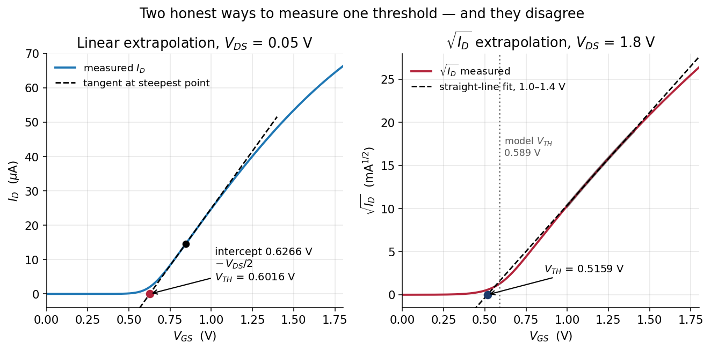

# Where saturation starts

The textbook puts the boundary between triode and saturation at $V_{DS} = V_{GS} - V_{TH}$, but
the knee in a measured curve lands somewhere else. This page shows why, names the effect
responsible, and puts a number on it.

Along the way you'll pick up the two most useful habits in device work: **extract a parameter from
a curve instead of looking it up**, and **compare your extraction with the model's own value**, so
that you can see how much your choice of definition mattered.

## Measuring $V_{TH}$

Nothing on the device tells you $V_{TH}$, and the model card doesn't hold it as a single number
either, because the BSIM model computes it afresh at every operating point from the geometry and
the bias. So engineers *measure* it, by drawing a construction on a measured curve. Here are two
common constructions.



*Both panels show a SKY130 `nfet_01v8` with W = 5 µm and L = 1 µm, simulated with
`spice/id_vgs.spice` in the Lab 03 package.*

### Method 1: linear extrapolation at small $V_{DS}$

Hold the drain at 0.05 V, which keeps the device firmly in triode where it behaves like a
resistor, and sweep the gate. In triode with a small $V_{DS}$, the current is very nearly a
straight line in $V_{GS}$:

$$I_D \approx \mu_n C_{ox}\frac{W}{L}\left(V_{GS}-V_{TH}-\frac{V_{DS}}{2}\right)V_{DS}$$

Find the steepest point of the measured curve, draw the tangent there, extend it down to
$I_D = 0$, and read off where it crosses. According to the equation, that intercept is
$V_{TH} + V_{DS}/2$, so you subtract half the drain voltage to get $V_{TH}$. Lab 03's extraction
prints each step of the working:

```
== V_TH by linear extrapolation   (V_DS = 0.05 V)
   steepest point      V_GS = 0.845 V
   tangent slope       66.716 uA/V
   tangent hits zero   V_GS = 0.6266 V
   minus V_DS/2        V_TH = 0.6016 V
```

That gives **0.6016 V** from four lines of arithmetic on 361 sampled points, without a datasheet.

### Method 2: $\sqrt{I_D}$ extrapolation in saturation

The saturation law says $I_D \propto (V_{GS}-V_{TH})^2$, so $\sqrt{I_D}$ should be a straight line
whose x-intercept is $V_{TH}$. Sweep the gate with the drain at 1.8 V, take the square root of
the current, fit a line over a sensible window, and extrapolate it to zero:

```
== V_TH by sqrt(I_D) extrapolation   (V_DS = 1.8 V, fit 1.0-1.4 V)
   sqrt(I_D) slope     21.4889 mA^0.5 / V
                       V_TH = 0.5159 V
```

This method gives **0.5159 V**.

### Two methods, 86 mV apart

```
== your number vs the model's own number   (device A)
   quantity                              yours    ngspice   diff
   V_TH  (linear extrapolation)         0.6016     0.5895   V   +2.07 %
   V_TH  (sqrt extrapolation)           0.5159     0.5895   V  -12.49 %
```

The `ngspice` column is `@m.xma.msky130_fd_pr__nfet_01v8[vth]`, the threshold that BSIM itself
reports at that operating point, read from `spice/op_params.spice`. So two reasonable methods and
the model, all looking at one device, give three answers spread over 86 mV.

All three are legitimate, because **$V_{TH}$ is defined by its extraction method**. The methods
disagree because the square law they both rely on isn't exactly true for this device. Method 1
relies on it only very near threshold, where it is nearly right, and lands within about 2 % of the
model. Method 2 relies on it across a whole volt of overdrive, where it is well off, and comes out
12 % low.

> **Ask how a threshold was extracted.** "0.52 V" and "0.60 V" can describe the same transistor,
> so a datasheet threshold with no method beside it has a tolerance you can't see.

For the rest of this course we take **$V_{TH} = 0.6016$ V** for this device, because that is what
the linear extrapolation gives, and every prediction below is checked against it.

## The measured knee

Take the five output curves and find where each one stops rising. Lab 03's `src/mosfit.py` uses
one explicit rule, and says which rule it is: **the knee is the first $V_{DS}$ at which the slope
has fallen to 10 % of the slope at the origin.** The 10 % is our choice rather than anything
physical, and what matters is that the same rule is applied to every curve.

```
   knee of each curve vs the model's vdsat
     V_GS  V_GS - V_TH  your knee     vdsat
     0.60       -0.002       0.09     0.065
     0.90        0.298       0.29     0.256
     1.20        0.598       0.50     0.442
     1.50        0.898       0.70     0.612
     1.80        1.198       0.89     0.779
```

Read the second and third columns together, from top to bottom.

At $V_{GS} = 0.9$ V the textbook boundary predicts a knee at 0.298 V, and the curve knees at
**0.29 V**, so at low overdrive the simple theory is right to two digits.

At $V_{GS} = 1.8$ V the boundary predicts 1.198 V, but the curve knees at **0.89 V**, which makes
the theory 34 % higher than the measured knee. Taken the other way round, with $V_{ov}$ as the
base, the knee is 26 % lower than the theory. The error grows steadily the harder you drive the
gate.

## Velocity saturation

The square law rests on an assumption that is rarely stated: that the drift velocity of the
electrons is proportional to the electric field, without limit, so that doubling the field doubles
their speed.

In silicon that holds only up to roughly $10^4$ V/cm. Above that the carriers stop speeding up,
because they scatter off the crystal lattice as fast as the field can accelerate them, and they
settle at a **saturation velocity** of about $10^7$ cm/s. Once the carriers in the channel are
moving as fast as they can, more drain voltage can't push any more current through. This is
**velocity saturation**.

As a result, the current doesn't wait for $V_{DS}$ to reach the overdrive
$V_{ov} = V_{GS} - V_{TH}$ before it stops responding. It stops as soon as the field along the
channel is high enough, and for $L = 1\ \mu\mathrm{m}$ and a volt of overdrive, that happens at a
lower drain voltage. The model reports the drain voltage where it actually
happens as **`vdsat`**, and `vdsat` is below $V_{ov}$ at every one of the five bias points above.

There are two consequences you'll use constantly:

- **A short device saturates earlier**, because the same overdrive across a shorter channel makes
  a higher field. At $V_{GS} = 1.8$ V, `spice/op_params.spice` gives `vdsat = 0.912` V for
  L = 2 µm and **`vdsat = 0.362` V** for L = 0.15 µm. The minimum-length device pinches off at
  less than a third of the drain voltage the long one needs.
- **The square law drifts toward a straight line.** When the device is fully velocity-saturated,
  $I_D$ becomes proportional to $V_{ov}$ rather than $V_{ov}^2$. That is why Method 2 under-read
  the threshold by 12 %: it fitted a square root to a curve that was drifting toward linear.

> **When a square-law calculation is tens of percent out** on a short modern device, suspect the
> square law before your arithmetic. Simulate the circuit, and use the hand calculation for
> *direction* ("wider means more current") and the simulator for *magnitude*.

## Channel-length modulation

The right-hand end of the $V_{GS} = 1.8$ V curve isn't horizontal. The current rises from
**682.502 µA** at $V_{DS} = 1.2$ V to **696.275 µA** at 1.8 V, which is 2.0 % more current for
0.6 V more on the drain.

You can see the reason in panel 4 of the [channel cross-section](../guide/a-mosfet-is-a-valve.md#the-channel-at-four-bias-points).
As $V_{DS}$ grows, the pinch-off point moves further from the drain, so the conducting part of the
channel gets slightly **shorter**, and a shorter channel carries more current. This is
**channel-length modulation**, and it is what the $(1 + \lambda V_{DS})$ factor in your textbook
approximates.

The slope of the curve in this region is called the **output conductance** $g_{ds}$, and its
reciprocal is the **output resistance** $r_o$:

| Device | $g_{ds}$ at $V_{GS}=V_{DS}=1.8$ V | $r_o = 1/g_{ds}$ |
|---|---|---|
| W = 5 µm, **L = 1 µm** | 15.593 µS | **64.13 kΩ** |
| W = 1 µm, **L = 0.15 µm** | 51.415 µS | **19.45 kΩ** |

Both rows are from `spice/op_params.spice`. They mean that a saturated transistor isn't an
ideal current source: it behaves like one with 64 kΩ in parallel, or 19 kΩ if you use the
minimum-length device.

That resistance sets how much voltage gain one transistor can give, and it is the first thing
[Transconductance and output resistance](../guide/gm-and-ro.md) uses.

You'll reproduce every number on this page in Lab 03, Parts 2 and 3.

## Check yourself

1. Method 1 subtracts $V_{DS}/2$ from the tangent's intercept. Where does that term come from?
2. Why does Method 2 give a lower $V_{TH}$ than Method 1 on this device?
3. At $V_{GS}$ = 1.5 V, how far is the measured knee below $V_{GS} - V_{TH}$, in percent?
4. You shorten a device from L = 1 µm to L = 0.15 µm at the same bias. Does `vdsat` go up or down,
   and does $r_o$ go up or down?

Next: [Lab 03: MOSFET regions](../labs/lab-03-mosfet-regions-overview.md).
