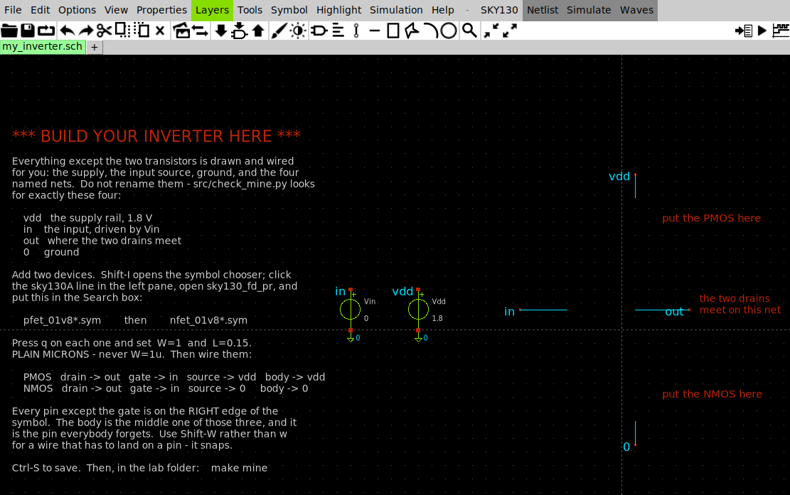
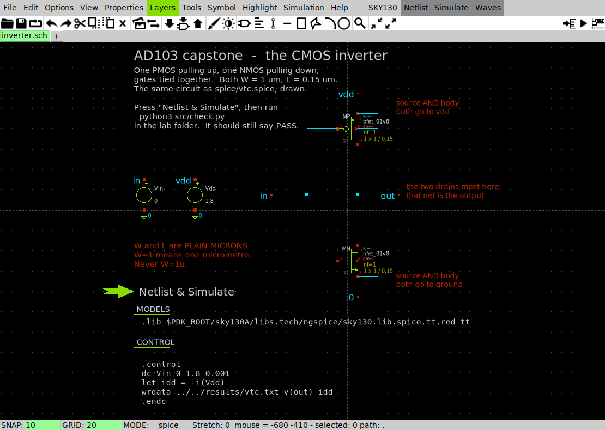
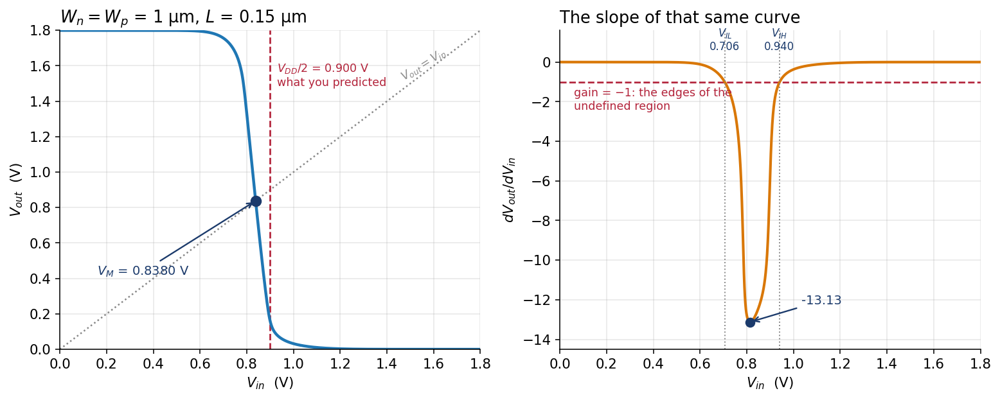
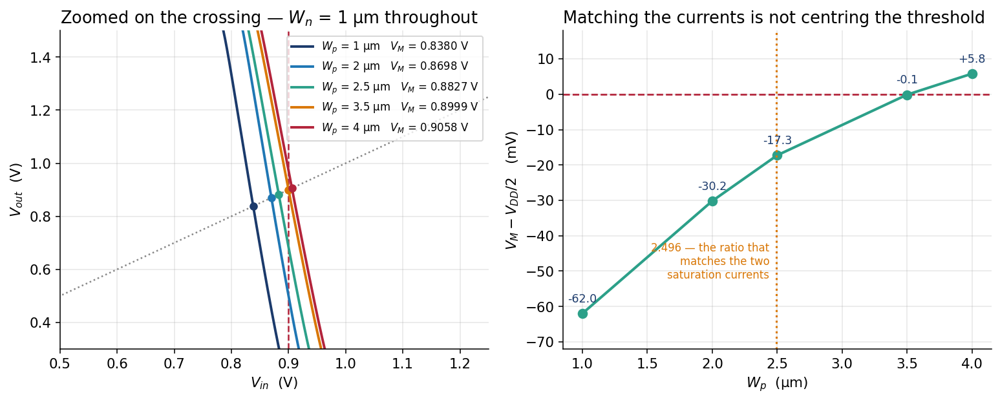
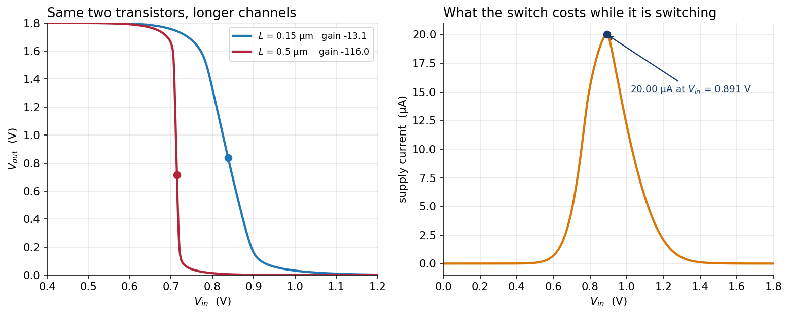
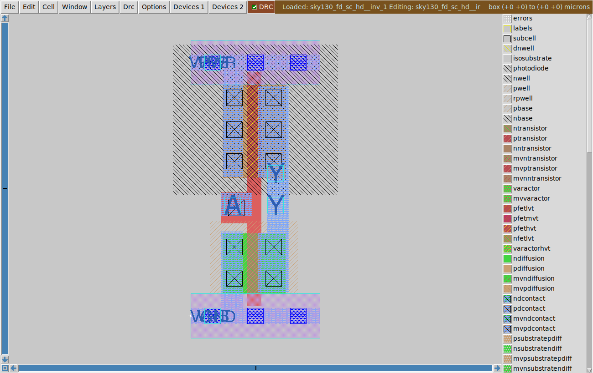

# Capstone: The CMOS inverter

You'll draw a CMOS inverter, measure the voltage at which it switches, and size its PMOS two
different ways for two different goals. You'll also run the same circuit as an amplifier, and
finish with the current mirror that would bias it.

At the end you'll have a schematic of a real logic gate, sized by you and verified against a
simulation. That is the file **AD104** asks you to draw as geometry.

Package: [`labs/capstone-inverter/`](https://github.com/uoftasic/ad103/tree/main/labs/capstone-inverter)

## Before you start

- Finish [Lab 04](../labs/lab-04-wl-knob-overview.md).
- Read [The CMOS inverter](../guide/the-inverter-is-an-amplifier.md) and
  [The current mirror](../guide/the-current-mirror.md).
- Open a terminal in the workbench, load the environment (you'll use XSchem in Part 2), and go to
  the lab folder:

  ```bash
  . /foss/designs/common/.designinit
  cd /foss/designs/modules/ad103/labs/capstone-inverter
  ```

  The `Makefile` sets `PDK=sky130A` itself, so the `make` targets work even without the first line.

**Time:** about 2.5 hours. `make` takes about 55 seconds; `make mirror` and `make broken` take about
ten each; `make extract` and `make figures` take a few seconds once `make` has run.

At the switching threshold the input and output are the same voltage, so **both** transistors are
saturated and carrying the same current:

$$
I_{Dn}(V_{GS}=V_M) \;=\; I_{Dp}(V_{SG}=V_{DD}-V_M)
$$

Notice what that condition is *not*: it isn't "the two devices are equally strong at full drive",
and the difference between those two statements is most of this lab. The gain at the switching
point is the expression every amplifier uses:

$$
A_v = -\,(g_{mn}+g_{mp})\,(r_{on}\parallel r_{op})
$$

## Part 1: Run the reference decks

Does your workbench reproduce the reference inverter?

1. Run the five decks and the checker:

   ```bash
   make
   ```

   ```
   == spice/vtc.spice
      wrote results/vtc.txt
   == spice/vtc_ratio.spice
      wrote results/vtc_ratio.txt
   == spice/vtc_long.spice
      wrote results/vtc_long.txt
   == spice/drive.spice
      wrote results/drive.log
   == spice/delay.spice
      wrote results/delay.log
   == checking
     YOUR NUMBERS
     ok  I_D  NMOS W=1 L=0.15         501.0462 uA  (reference 501.0462)
     ok  I_D  PMOS W=1 L=0.15         200.7478 uA  (reference 200.7478)
     ok  NMOS / PMOS drive ratio        2.4959     (reference 2.4959)
     ok  V_M   Wn = Wp = 1              0.8380 V   (reference 0.8380)
     ok  gain at V_M, L = 0.15        -13.1253     (reference -13.1253)
     ok  V_M   Wp = 2.5                 0.8827 V   (reference 0.8827)
     ok  V_M   Wp = 3.5                 0.8999 V   (reference 0.8999)
     ok  V_M   L = 0.5, Wn = Wp         0.7141 V   (reference 0.7141)
     ok  gain at V_M, L = 0.5        -116.0341     (reference -116.0341)
     ok  t_pHL  Wp = 2.5               30.2508 ps  (reference 30.2508)
     ok  t_pLH  Wp = 2.5               30.7067 ps  (reference 30.7067)
     ok  t_pLH / t_pHL  Wp = 1          2.3341     (reference 2.3341)

     V_out(0.0 V) = 1.800000 V   V_out(1.8 V) = 2.129252e-07 V

   PASS  all twelve measured values match the reference run
   ```

2. Draw the figures into `results/`:

   ```bash
   make figures
   ```

**You should see** `PASS  all twelve measured values match the reference run`.

## Part 2: Draw the inverter

Can you draw an inverter that behaves exactly like the shipped deck?

1. Open your scaffold:

   ```bash
   make edit
   ```

   

   *Everything except the two transistors. `vdd`, `in`, `out` and `0` are already named and wired.
   Don't rename them, because `src/check_mine.py` looks for exactly those four.*

2. Add a `pfet_01v8` and an `nfet_01v8` (`Shift-I`, as in Lab 01), both with `W=1` and `L=0.15`.

3. Wire the eight pins:

   ```
       PMOS   drain -> out    gate -> in    source -> vdd    body -> vdd
       NMOS   drain -> out    gate -> in    source -> 0      body -> 0
   ```

   The first time, wire the PMOS **body** to `0` instead of `vdd`, on purpose. It is the pin
   everyone forgets.

4. Save (`Ctrl-S`, then **Yes**) and check your drawing:

   ```bash
   make mine
   ```

   Read what it says about the PMOS body, then fix the wire, save, and run `make mine` again.

   `make mine` checks the things a first inverter usually gets wrong (a missing device, a unit
   suffix on `W`, an invented `net7` where a wire didn't land, the PMOS body left on ground) and
   reports each in words.

5. When it passes, compare your switching threshold with the reference.

**You should see**, once the wiring is right:

```
  YOUR INVERTER
    V_out(0.0 V)              1.800000 V
    V_out(1.8 V)          2.131046e-07 V
    switching threshold       0.838029 V
    gain at V_M               -13.1252
    noise margins H / L     0.8106 / 0.6376 V

PASS  Wn = Wp = 1 um, and your V_M is 0.838029 V against the
      reference 0.838027 V. You drew the same inverter the
      shipped deck describes, and it behaves identically.
```

Your 0.838029 V against the deck's 0.838027 V is two microvolts. Your drawing and the hand-written
deck in `spice/vtc.spice` are the same circuit, and now you have proof. Every schematic you draw is
a claim about a netlist, and comparing it against a known deck is how you check the claim.

Here is the finished version, to compare against once yours works:



*One `pfet_01v8` above one `nfet_01v8`, drains tied to `out`, gates tied to `in`. The `.lib` line
and the `.control` block ride along in two `code_shown` symbols.*

## Part 3: The switching threshold

Where does an inverter with $W_n = W_p$ switch?

1. Before you look, write down where you think an inverter with $W_n = W_p$ switches. There is only
   one plausible guess.

2. Print the analysis, and read block 2:

   ```bash
   make extract
   ```

   ```
      switching threshold V_M       0.838027 V   (V_DD/2 would be 0.900000)
      steepest slope                -13.1253     at V_in = 0.814 V
      V_IL / V_IH                      0.706 / 0.940 V
      V_OH / V_OL                     1.7506 / 0.0684 V
      noise margin high / low         0.8106 / 0.6376 V
   ```

3. Open `results/ad103-inverter-vtc.png`:

   

   $V_{IL}$ and $V_{IH}$ are the two inputs at which the slope passes through −1, marked on the
   right-hand plot. Between them the gate amplifies noise instead of rejecting it, and the noise
   margins are what is left on either side.

**You should see** $V_M$ = **0.838027 V**, not 0.900 V: **62.0 mV low**.

Why does the $W_n = W_p$ inverter switch below $V_{DD}/2$?

<details>
<summary>Answer</summary>

The pull-down is the stronger device (Part 4 measures how much: 2.4959×), so it takes less input
voltage than you'd expect to drag the output down. $V_M$ isn't the threshold voltage of either
device (769.27 mV for the NMOS, the `vth` Lab 01's `make bins` printed, and 510.03 mV for the PMOS)
or their average; it is the input at which the two currents are equal. It is the first parameter in this
course that belongs to a circuit rather than to a transistor.

</details>

## Part 4: Size the PMOS from the drive ratio

If you widen the PMOS by the drive ratio, does $V_M$ land at 0.9 V?

1. Read block 1 of `make extract`, the drive of each transistor on its own:

   ```
      NMOS, gate and drain at 1.8 V          501.0462 uA
      PMOS, gate and drain at 0 V            200.7478 uA
      NMOS / PMOS                              2.4959
   ```

   501.0462 µA is the number [Lab 01](../labs/lab-01-first-schematic-overview.md) gave you for exactly
   this device at exactly this bias.

2. The PMOS is weaker, so widen it to match. Using the ratio, predict $V_M$ for $W_p$ = 2.5 µm.

3. Read block 3, five pull-up widths, and open `results/ad103-inverter-ratio.png`:

   

   ```
      Wp (um)   Wp/Wn        V_M        error vs 0.9 V      gain
      1          1.00    0.838027 V      -61.97 mV     -13.1253
      2          2.00    0.869826 V      -30.17 mV     -12.8834
      2.5        2.50    0.882739 V      -17.26 mV     -11.8856
      3.5        3.50    0.899865 V       -0.13 mV     -11.2590
      4          4.00    0.905807 V       +5.81 mV     -11.2846
   ```

**You should see** **0.882739 V** for $W_p$ = 2.5 µm: 17.3 mV out instead of 62.0, so better, but
still off. The width that does centre it is **3.5 µm, giving $V_M$ = 0.899865 V**, 0.13 mV from the
middle.

Why didn't matching the drive ratio centre $V_M$?

<details>
<summary>Answer</summary>

The condition you satisfied isn't the one $V_M$ imposes. At $V_M$ the NMOS has $V_{GS} = V_M$ and
the PMOS has $V_{SG} = 1.8 - V_M$; **neither device is at 1.8 V**. You matched the currents at full
drive, and the crossing doesn't happen at full drive.

</details>

## Part 5: Time the three inverters

Which pull-up width gives equal rise and fall delays?

1. Before you read it, guess which of the three inverters ($W_p$ = 1, 2.5 and 3.5 µm) has the most
   equal pair of delays.

2. Read block 4 of `make extract`. The delays come from `spice/delay.spice`: a real edge, a 10 fF
   load, and `.meas` for rise and fall delay.

   ```
      Wp (um)      t_pHL         t_pLH      pull-up / pull-down
      1          27.7001 ps    64.6539 ps         2.334
      2.5        30.2508 ps    30.7067 ps         1.015
      3.5        31.7807 ps    24.1077 ps         0.759
   ```

**You should see** the $W_p$ = 2.5 µm inverter with the most equal pair: **30.2508 ps down against
30.7067 ps up, 1.5 % apart.** The $W_p$ = 3.5 µm inverter, the one with the centred threshold,
rises 24 % faster than it falls.

Why does the drive-ratio width equalise the delays, when it didn't centre $V_M$?

<details>
<summary>Answer</summary>

Delay is charge over current, with the same 10 fF load and the same 0.9 V swing, so making the two
saturation currents equal is exactly what makes the two delays equal. The two sizings aren't a
right answer and a wrong one:

| you want | set $W_p$ to | because |
|---|---|---|
| equal rise and fall delay | **2.5 µm**, the current ratio | delay is charge over current |
| $V_M$ at $V_{DD}/2$ | **3.5 µm** | that is where the currents match *at the crossing* |

Your Part 4 prediction was the right answer to a question Part 4 wasn't asking, which is the most
common way an engineering calculation goes wrong.

</details>

In the same table, $t_{pHL}$ rises from 27.70 to 31.78 ps as the pull-up gets wider, although
nothing about the pull-down changed. Why?

<details>
<summary>Answer</summary>

A wider PMOS is still partly on while the NMOS pulls down, and it fights it.

</details>

## Part 6: The same circuit as an amplifier

How much voltage gain do the same two transistors give at a longer $L$?

1. Find what changed between the minimum-length and long-channel decks:

   ```bash
   diff spice/vtc.spice spice/vtc_long.spice
   ```

2. Predict: will the $L$ = 0.5 µm inverter have more gain at $V_M$ or less? Use what Lab 04, Part 3
   measured about $g_m r_o$.

3. Read block 5 of `make extract`, and open `results/ad103-inverter-gain.png`:

   

   ```
      L = 0.15 um, Wn = Wp = 1 um    gain  -13.1253 at V_in = 0.814 V
      L = 0.5  um, Wn = Wp = 1 um    gain -116.0341 at V_in = 0.712 V
   ```

**You should see** the two device lines differ only in `L`, 0.15 against 0.5 (the rest of the diff
is comments and the output file name), and **8.84× the voltage gain for 3.33× the channel
length**, from the same two transistors on the same supply.

Why does a longer channel give so much more gain, and which inverter would you use for which job?

<details>
<summary>Answer</summary>

Lab 04 measured why: $r_o$ rises with $L$, and the gain is $g_m (r_{on} \parallel r_{op})$. A logic
gate needs enough gain to restore a degraded signal and doesn't care beyond that; an amplifier
wants every decibel. Same two transistors, different $L$, different job.

</details>

## Part 7: The current while it switches

How much supply current does an inverter draw, and when?

1. Read block 6 of `make extract`, the supply current of the $W_n = W_p$ = 1 µm inverter across its
   input sweep:

   ```
      supply current at V_in = 0 V             0.000002 uA
      supply current at V_in = 1.8 V           0.000320 uA
      peak supply current                       20.0048 uA   at V_in = 0.891 V
   ```

**You should see** almost nothing at either end and **20.0048 µA** at $V_{in}$ = 0.891 V.

Why is the current almost zero at both ends and largest near the middle, and what does that mean
for power?

<details>
<summary>Answer</summary>

At either end one device is off. Near the middle both are on at once, and current runs straight
from `vdd` to ground doing no useful work. That is why CMOS replaced everything before it, and why
a processor gets hot when it computes and cool when it idles.

</details>

## Part 8: The PMOS source on the wrong node

What happens when the PMOS source and body go to the wrong node?

1. Predict: will ngspice or the checker warn you about a PMOS whose source is on ground? Write
   down your guess.

2. Run the broken deck:

   ```bash
   make broken
   ```

   It is `spice/vtc.spice` with one node name changed: the PMOS source and body go to `0` instead of
   `vdd`.

   ```
     The sweep ran. 1801 rows, no errors, no warnings.
     Here is what it says the output does:

       V_in       V_out          supply current
       0.000 V     0.000000000 V      -0.000000 uA
       0.300 V     0.000000000 V      -0.000000 uA
       0.600 V     0.000000000 V      -0.000000 uA
       0.900 V     0.000000000 V      -0.000000 uA
       1.200 V     0.000000000 V      -0.000000 uA
       1.500 V     0.000000000 V      -0.000000 uA
       1.800 V     0.000000000 V      -0.000000 uA

     this curve never gets steeper than -1. Its steepest slope is -4.794e-15, which means the output barely responds to the input at all. A circuit with no gain above 1 cannot restore a logic level, so it is not a usable inverter whatever else it is.

   FAIL  this circuit is not an inverter
   ```

3. Find the change: `diff spice/vtc.spice spice/vtc_broken.spice`. Apart from comments, spacing and
   the output file name, the only change is on the `XP` line, where `vdd vdd` became `0 0`.

**You should see** an output pinned at exactly zero for all 1801 points, a supply delivering
nothing, and no complaint from ngspice, because nothing is wrong with the netlist. A PMOS whose
source is grounded simply isn't a pull-up. The check that catches this in one line, on any
inverter, is the one the checker performs before anything else:

```
  V_out(0.0 V) = 1.800000 V   V_out(1.8 V) = 2.129252e-07 V
```

**Read both rails first.** If the output doesn't swing from one supply to the other, nothing else
in the measurement means anything, and no amount of staring at $V_M$ will tell you why.

## Part 9: The current mirror

How accurately does a mirror copy a current, and what limits it?

1. Force 50 µA into a diode-connected reference and copy it four ways:

   ```bash
   make mirror
   ```

   ```
   == spice/mirror.spice   a 50 uA reference, copied four ways
   --- part 1: the reference branch sets a gate voltage ---
   v(ng) = 8.672678e-01
   @m.xmref.msky130_fd_pr__nfet_01v8[vdsat] = 2.336319e-01
   --- part 2: one gate voltage, three widths, V_out = 0.9 V ---
   i(vo2) = -5.00878e-05
   i(vo3) = -1.12313e-04
   i(vo4) = -2.39347e-04
     and why the ratio is not what you drew:
   @m.xmw1.msky130_fd_pr__nfet_01v8[vth] = 5.894596e-01
   @m.xmw2.msky130_fd_pr__nfet_01v8[vth] = 5.766246e-01
   @m.xmw1.msky130_fd_pr__nfet_01v8[gm] = 3.340839e-04
   @m.xmw2.msky130_fd_pr__nfet_01v8[gm] = 7.187672e-04
   --- part 4: one W=10 device vs two W=5 devices in parallel ---
   i(vo3) = -1.12313e-04
   i(vo5) = -1.00176e-04
   --- part 3: the same 1:1 copy at several output voltages ---
   V_out = 0.1 V
   i(vo1) = -2.84076e-05
   ...
   V_out = 1.8 V
   i(vo1) = -5.20797e-05
   ```

2. Work out the 1:1 copy's error at $V_{out}$ = 0.9 V, from `i(vo2)`.

3. In the `part 3` block (it comes after `part 4` in the output), find the output voltage below
   which the copy collapses, and compare it with the reference branch's `vdsat`.

4. Work out the actual ratios for the 2× and 4× outputs (`i(vo3)` and `i(vo4)` against `i(vo2)`),
   and the threshold difference between the 5 µm and 10 µm devices.

5. Compare one W = 10 µm device (`i(vo3)` in `part 4`) with two W = 5 µm devices in parallel
   (`i(vo5)`), against twice the 1:1 current.

**You should see** a 1:1 copy good to **0.176 %**, a collapse below about **0.2336 V**, ratios of
**2.2423** and **4.7785** instead of 2 and 4, a threshold **12.835 mV** lower for the wide device,
and the two parallel unit devices within **0.0004 %** of twice the unit current.

Why does one wide device copy a current less accurately than two unit devices, and why does the
copy collapse below 0.2336 V?

<details>
<summary>Answer</summary>

The wide device's threshold is 12.835 mV lower, so at the same gate voltage it carries more than
its width alone would give. The two unit devices are each the same 5 µm device as the reference. Below about
0.2336 V, the reference branch's `vdsat`, the output device leaves saturation.
[The current mirror](../guide/the-current-mirror.md) works through each of these.

</details>

## Finishing

**You're done when** `make mine` passes with your own `xschem/my_inverter.sch` and reports a
switching threshold of 0.838029 V (Part 2).

### Questions

1. Why does the $W_n = W_p$ inverter switch below $V_{DD}/2$? (Part 3.)
2. Which $W_p$ gives equal delays, which centres $V_M$, and why are they different? (Part 5.)
3. Why does one wide device copy a current less accurately than two unit devices? (Part 9.)

### Submit

Nothing to submit. Keep `xschem/my_inverter.sch`: AD104 starts from it.

## Going further

### Extensions

Three, with reference answers in
[`solutions/`](https://github.com/uoftasic/ad103/tree/main/labs/capstone-inverter/solutions):

1. **Why the foundry's inverter isn't symmetric.** `sky130_fd_sc_hd__inv_1`, the inverter
   LibreLane puts in your digital designs, is $W_n$ = 0.65 µm, $W_p$ = 1.0 µm, a ratio of
   **1.54**: neither of this lab's answers. You can read it yourself:

   ```bash
   grep -A3 'subckt sky130_fd_sc_hd__inv_1 ' \
     /foss/pdks/sky130A/libs.ref/sky130_fd_sc_hd/spice/sky130_fd_sc_hd.spice
   ```

   It switches at **0.790872 V**, 109 mV below centre, on purpose. Work out why before you read
   the reference answer.
2. **The delay arithmetic.** Write out why equal drive currents give equal delays in Part 5, and
   check that the arithmetic closes.
3. **More gain.** Take `spice/vtc_long.spice` to longer $L$ and find out how much gain two
   transistors can give.

### SiliWiz

[SiliWiz](https://tinytapeout.com/siliwiz/), which AD102 used to look at a resistor in
cross-section, is worth one more visit: draw an NMOS in it, sweep the gate, and watch the channel
you've been calculating about appear under the oxide.

### Your inverter in AD104

You now have a schematic of a real logic gate, sized by you against a criterion you chose and
verified against a simulation to six digits. **AD104: Layout** takes this file and asks you to draw
it as geometry in Magic. Every transistor becomes a rectangle of diffusion under a stripe of poly,
and every net becomes metal with a width and a spacing. Then Magic runs **DRC** to check that a fab
could make what you drew, and netgen runs **LVS** to show that what you drew is the same circuit as
your schematic, node for node and device for device.

This is the foundry's own inverter, `sky130_fd_sc_hd__inv_1`, opened in Magic:



Every hatch pattern in that window is a mask layer, listed by name on the right. `A` enters on local
interconnect, crosses both channels as the single poly stripe in the middle, and `Y` leaves on local
interconnect: the same three nodes you put on the schematic, drawn as rectangles.

The geometry has rules, and Magic checks them continuously as you paint. Drop one metal1 shape
0.04 µm from the power rail and it tells you before you've finished the wire:


The white hatch is the error region, `DRC=2` in the toolbar counts errors live as you edit, and
`drc why` names the rule that was broken: `Metal1 spacing < 0.14um (met1.2)`.

Three things from AD103 come back in AD104:

- **$W$ and $L$ are geometry.** In Magic you draw them with a mouse instead of typing them, so the
  `W=1` versus `W=1u` trap disappears: there is no number to put a unit on.
- **`nf=2`**, the multi-finger device from Lab 04 that changed the current by 4.5 % with no change
  to $W$ or $L$, becomes a picture: two gate stripes sharing a drain.
- **Unit devices in an array**, from the current mirror. AD104 is where you see what a mirror looks
  like when it is drawn properly, dummies and all.

Stuck, or want to argue about any of this? Ask in the [team Discord](https://discord.gg/hrJnP5UsGz),
and bring the number you got and the number you expected.

Next on the [Course path](../index.md#course-path): you've finished AD103. The next course is
[AD104: Layout](https://uoftasic.com/ad104/), and it starts from your `xschem/my_inverter.sch`.
