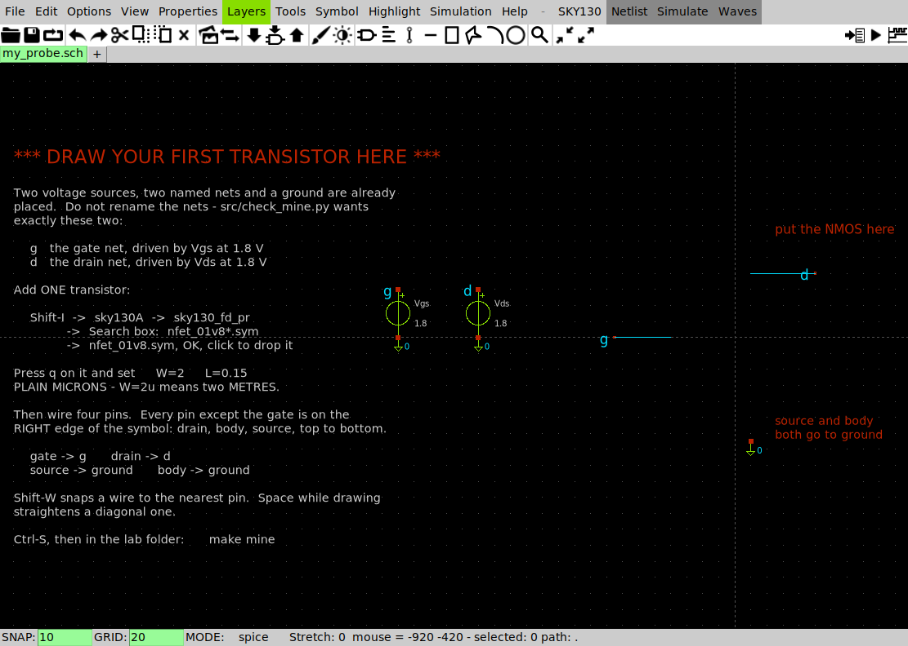
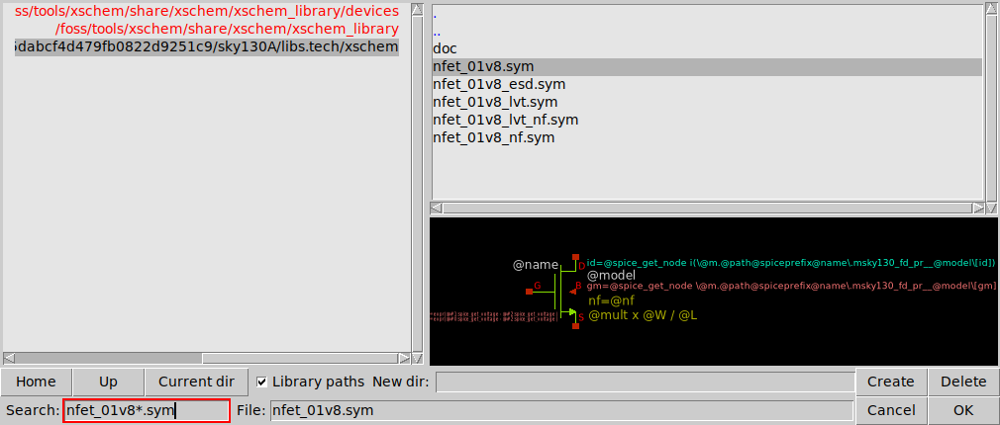
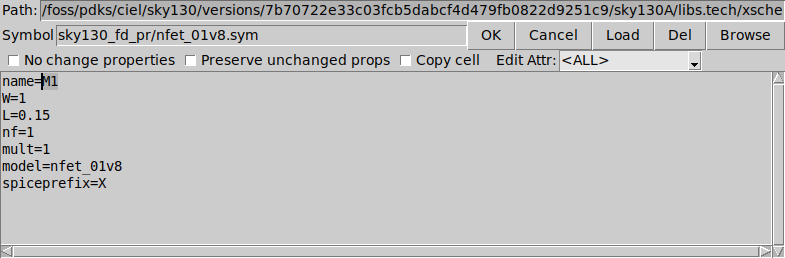

# Lab 01: Your first schematic

You'll load the course, draw one transistor in XSchem, watch it become seven lines of SPICE,
and get a current out of it. Then you'll break the same circuit twice on purpose: once so loudly
that ngspice refuses to run, and once so quietly that it hands you a wrong answer without any
error.

Package: [`labs/lab-01-first-schematic/`](https://github.com/uoftasic/ad103/tree/main/labs/lab-01-first-schematic)

## Before you start

- Read [Getting started](../guide/getting-started.md).
- Keep the [XSchem cheat sheet](../reference/xschem-cheatsheet.md) open in another tab.

**Time:** about 2 hours, most of it learning XSchem, not counting the optional Part 8. Each `make`
target takes about ten seconds, almost all of it ngspice loading the SKY130 models.

## Part 1: Load the course

If you haven't set up the workbench yet, do
[IC101 Lab 03](https://uoftasic.com/ic101/#/labs/lab-03-launch-the-workbench-overview) first.

1. Start the desktop from your `workspace` clone (`./scripts/start_vnc.sh`, or
   `scripts\start_vnc.bat` on Windows), open **http://localhost/**, and open a terminal on that
   desktop. Every command from here on goes in that terminal, not on your laptop.

2. Load the course environment. Do this in every new terminal:

   ```bash
   . /foss/designs/common/.designinit
   ```

   ```
   ASIC-EDU: PDK=sky130A  PDK_ROOT=/foss/pdks  designs=/foss/designs
             run 'mod' to list course modules, or 'mod <name>' to enter one.
   ```

   Check that it says `PDK=sky130A`; `echo $PDK` prints the same. The image's own default is
   `ihp-sg13g2`, which is the wrong process for this course.

3. Get the course files:

   ```bash
   mod add ad103      # first time only: clones github.com/uoftasic/ad103
   mod ad103          # every time after that
   ```

   ```
   Cloning https://github.com/uoftasic/ad103.git
        into /foss/designs/modules/ad103
   Cloning into '/foss/designs/modules/ad103'...
   OK  module ready: /foss/designs/modules/ad103
       run: mod ad103
   cwd: /foss/designs/modules/ad103
   ```

   | What you see | What it means |
   |---|---|
   | `bash: mod: command not found` | You did not run step 2 in this terminal. |
   | `mod: no such module: ad103` | You ran `mod ad103` before `mod add ad103`. |
   | `fatal: could not read Username for 'https://github.com'` | git could not read the repo anonymously. Check the spelling; if it is right, ask in [Discord](https://discord.gg/hrJnP5UsGz). Do not type your password. |

4. Check the tool versions:

   ```bash
   xschem --version
   ngspice -v
   ```

**You should see** `PDK=sky130A` in the banner from step 2, then `XSCHEM V3.4.8RC` and
`ngspice-47` at the top of the two version outputs. The course is pinned to these versions.
XSchem's keys and menus have changed between releases, so with a different version the screenshots
may not match your window. For problems with the desktop or the container, see IC101's
[Troubleshooting](https://uoftasic.com/ic101/#/reference/troubleshooting) page.

## Part 2: Prove the toolchain works

Does your workbench give the reference answer, and what does a SPICE device line say?

1. Run the reference check:

   ```bash
   cd /foss/designs/modules/ad103/labs/lab-01-first-schematic
   make
   ```

   ```
   == netlisting xschem/nmos_probe.sch
      wrote xschem/simulation/nmos_probe.spice
   == simulating spice/nmos_op.spice
      wrote results/nmos_op.log
   == checking
     device line : XM1 d g 0 0 sky130_fd_pr__nfet_01v8 L=0.15 W=1 nf=1 ad=0.29 as=0.29 pd=2.58 ps=2.58 nrd=0.29 nrs=0.29 sa=0 sb=0 sd=0 mult=1
     drain current : 501.046 uA  (reference 501.046 uA)

   PASS  netlist and operating point match the reference run
   ```

2. Read the device line before the current. `make` netlists `xschem/nmos_probe.sch` and prints
   the device line from that netlist; the drain current comes from simulating the hand-written
   deck `spice/nmos_op.spice`. The four node names, `d g 0 0`, are in the order **drain, gate,
   source, body**. You'll find each of them on the drawing in Part 3.

3. Open `results/nmos_op.log` and find `i(vds) = -5.01046e-04`. The log opens with several
   `Error opening osdi lib` lines; they are harmless, and
   [Harmless messages](../reference/ngspice-errors.md#harmless-messages) says why.

   The transistor is conducting, so why is the current negative?

   <details>
   <summary>Answer</summary>

   ngspice reports current flowing *into* the positive terminal of a source, and `Vds` is pushing
   current out.

   </details>

**You should see** `PASS` and **501.046 µA**. That is a real SKY130 NMOS, one micrometre wide
and 150 nanometres long, with 1.8 V on both the gate and the drain: half a milliamp through a
device you could fit two thousand of across the width of a human hair. Lab 03 explains why it
carries that current and not some other.

`make` needs no environment setup at all. The `Makefile` sets `PDK=sky130A` itself, so this
works in a bare container even if Part 1 went wrong. From now on, if a page in this course seems
to disagree with your screen, come back here and run `make`. A `PASS` means your toolchain is
fine and the problem is in your drawing.

## Part 3: Look around the reference schematic

What does XSchem write when you press **Netlist**, and where does each line come from on the
drawing?

1. Open the reference schematic from its own folder, so XSchem reads that folder's `xschemrc`:

   ```bash
   cd xschem
   xschem nmos_probe.sch &
   ```

2. Check the menu bar says **SKY130**. If it says **IHP**, close XSchem, run step 2 of Part 1
   in this terminal, and launch it again. Other XSchem failures, most of which give no error, are
   listed under [Failures that exit 0](../reference/xschem-cheatsheet.md#failures-that-exit-0).

3. Learn the keys you need. XSchem has several hundred bindings; these cover the whole course.
   They come from XSchem's own list: **Help → Keys**, or press `/` for a full-screen poster.

   | Do this | Key |
   |---|---|
   | Zoom to fit | `f` |
   | Zoom in / out | mouse wheel, or `Shift-Z` / `Ctrl-Z` |
   | Pan | hold `Space` and drag, or drag with the middle button |
   | Insert a symbol | `Shift-I` (or `Ins`) |
   | Draw a wire | `w`: press it at one end, then click the other |
   | Draw a wire whose **ends** snap onto the nearest pin | `Shift-W`, and hold `Shift` for the closing click too |
   | Place a net label | `Alt-L` |
   | Edit the selected thing's properties | `q` |
   | Duplicate / move / delete selection | `c` / `m` / `Delete` |
   | Undo | `u` |
   | Save | `Ctrl-S` |
   | Abort whatever you started, and unselect | `Escape` |
   | Help | `?` |

   Three of these will catch you out, because your text editor uses the same keys for something
   else: **`c` duplicates** the selection (plain `Ctrl-C` is a different, less useful copy),
   **`u` is undo** (`Ctrl-Z` is zoom out), and **`q` opens properties** (it does not quit). The
   full list, with menu equivalents, is in the [XSchem cheat sheet](../reference/xschem-cheatsheet.md).

4. Pan and zoom around `nmos_probe.sch` until it stops looking random. Find the two supplies,
   the nets `g` and `d`, and the junction dot where the source and body wires meet. Compare it
   with the picture in [Getting started](../guide/getting-started.md#how-wires-connect).

   > **Warning:** `nmos_probe.sch` is the lab's reference, and `make` checks against it.
   > Practise on it freely (`u` undoes any number of steps), but don't save over it. If you
   > already did, run `git checkout -- xschem/nmos_probe.sch` from the lab folder to put it back.

   The status bar at the bottom of the window is where XSchem tells you what mode you are in. If
   it is hidden behind the taskbar, see
   [Windows that open off screen](../reference/xschem-cheatsheet.md#windows-that-open-off-screen).

5. Open the **Simulation** menu and check the bullet is on **Use 'simulation' dir in schematic
   dir**. The lab's `xschemrc` sets this. While the menu is open, tick **Show netlist after
   netlist command** (`Shift-A`).

6. Click **Netlist** in the menu bar. It is the grey button to the right of `SKY130`. The netlist
   pops up in its own window.

7. In the terminal, still in the `xschem/` folder, print the file XSchem wrote:

   ```bash
   cat simulation/nmos_probe.spice
   ```

   ```
   ** sch_path: /foss/designs/modules/ad103/labs/lab-01-first-schematic/xschem/nmos_probe.sch
   **.subckt nmos_probe
   XM1 d g 0 0 sky130_fd_pr__nfet_01v8 L=0.15 W=1 nf=1 ad=0.29 as=0.29 pd=2.58 ps=2.58 nrd=0.29 nrs=0.29 sa=0 sb=0 sd=0 mult=1
   Vgs g 0 1.8
   Vds d 0 1.8
   **.ends
   .end
   ```

**You should see** the seven-line netlist above, with `d g 0 0` on the device line matching the
nets on the drawing.

## Part 4: Draw your own transistor

Can you draw the reference circuit yourself, with a transistor twice as wide?
`xschem/my_probe.sch` is the same circuit with the transistor left out.

1. Go back to the lab folder and open it:

   ```bash
   cd ..
   make edit
   ```

   

   *Everything but the transistor is placed and wired. `Vgs` and `Vds` are 1.8 V, connected by
   net name rather than by wire: two `lab_pin`s with the same label are the same net, wherever
   they sit on the page. The status bar reads `SNAP: 10  GRID: 20  MODE: spice`.*

2. Press `Shift-I`. The symbol chooser opens:

   

   *Left pane: the symbol libraries XSchem knows about. Right pane: the current directory.
   **Search** filters by pattern. Pick a file (`vsource.sym` here) and the pane underneath draws
   the symbol, so you can check you have the right one before you place it. Press **OK**, or
   double-click the file, and the symbol attaches to your cursor; click to drop it.*

   Look at the left pane first, because it is a second PDK check. Three paths are listed, and the
   third is `…/sky130A/libs.tech/xschem`. If that line is missing or says `ihp-sg13g2`, close
   XSchem and go back to Part 1, step 2.

   The right pane opens on XSchem's built-in **`devices`** library. You need four things from it
   during the course: `vsource.sym` (a voltage source), `gnd.sym` (ground), `lab_pin.sym` (a net
   label), and `capa.sym` (a capacitor).

   On a 1280-wide desktop the chooser opens mostly off the right edge of the screen, with
   **OK** out of view. Drag it back by the part of the title bar you can see;
   [Windows that open off screen](../reference/xschem-cheatsheet.md#windows-that-open-off-screen)
   has the details.

3. Click the `sky130A` line on the left, open **`sky130_fd_pr`**, and replace the **Search** text
   with `nfet_01v8*.sym`. That cuts the library's 77 symbols down to five. Search takes a glob,
   not a substring, so `nfet` on its own matches nothing.

   

   *The whole `sky130_fd_pr` library cut down to five files. The preview shows the symbol with
   its attributes still as placeholders (`@name`, `@model`, `@mult x @W / @L`), because they are
   filled in per instance.*

   The three symbols you'll use in this course are **`nfet_01v8.sym`** (the 1.8 V n-channel
   MOSFET, the workhorse of this process), **`pfet_01v8.sym`** (its p-channel twin) and
   **`diode.sym`** (Lab 02's subject). The other seventy-odd devices are described in
   [Reading a SKY130 device model](../reference/sky130-device-guide.md).

4. Pick `nfet_01v8.sym`, press **OK**, and click to drop it in the gap.

5. Select the transistor and press `q`:

   

   *One attribute per line. `W=1` and `L=0.15` are the only two you will normally change. `nf`,
   `mult`, `model` and `spiceprefix` come from the symbol, so leave them alone.*

   Set **`W=2`** and **`L=0.15`**. Plain numbers, no `u`.

6. Wire the four pins: drain to `d`, gate to `g`, source and body to ground. To draw a wire, put
   the pointer on the first end, press `w`, move to the second end, and click. The key anchors
   the start, so pressing `w` and *then* clicking two places draws a wire from wherever the
   pointer was parked to your first click, and nothing between the two places you clicked. Each
   wire is one straight segment; for an L-shape, draw two.

   Two things often cost a first half hour:

   - **Your wires may come out diagonal.** XSchem's routing mode has an oblique setting, and it
     is not always off. Press `Space` while a wire is in progress to cycle between
     horizontal-then-vertical, vertical-then-horizontal, and straight diagonal. `Escape` throws
     away a wire you started by mistake.
   - **A wire end can miss a pin by one grid step.** If you're not sure a wire will land on a
     pin, use `Shift-W` instead of `w`, and hold `Shift` down for the closing click as well.
     `Shift-W` snaps the end you *start* from onto the nearest pin or net endpoint, however far
     away it is. The click that finishes the wire is an ordinary click, which lands on the snap
     grid; it only pulls onto a pin that is already within about one snap step, which is why the
     mistake comes and goes. Measured on a pin 28 units away: a plain closing click landed on
     the grid 28 units short, and with `Shift` held it landed exactly on the pin.

   Zoom in on every junction and check for the dot.

7. Save with `Ctrl-S`. XSchem always raises a small window titled **Ask Save** reading
   `save file?`, with **Yes / Cancel / No**, placed wherever the pointer happens to be. Nothing
   reaches disk until you press **Yes** (or `Return`), and the tab title keeps its `*` until you
   do. XSchem has no autosave, so save often.

   > **Warning:** if you press `Ctrl-S`, miss the **Ask Save** window, and run `make mine`, you
   > check the *last* version you saved. That's usually the one with no transistor in it, and it
   > gives a confident `FAIL - the netlist has no nfet_01v8` that sends you hunting for a
   > placement bug that isn't there. Check the `*` has gone from the tab first.

**You should see** an `nfet_01v8` in the gap with `W=2` and `L=0.15`, no hollow square on any wire
end or pin, a dot where the source and body wires meet, and no `*` in the tab title.

## Part 5: Simulate your drawing

Does a transistor twice as wide carry twice the current?

1. Predict the current before you simulate. The reference device is $W$ = 1 µm and draws
   501.046 µA. Yours is twice as wide. Write your number down.

2. Netlist, check and simulate your drawing:

   ```bash
   make mine
   ```

   It netlists what you drew and checks the wiring before it simulates anything:

   ```
     WHAT YOU DREW
       XM1 d g 0 0 sky130_fd_pr__nfet_01v8 L=0.15 W=2 nf=1 ad=0.58 as=0.58 pd=4.58 ps=4.58 nrd=0.145 nrs=0.145 sa=0 sb=0 sd=0 mult=1

     Wired correctly. Simulating it.

     YOUR TRANSISTOR
       W = 2 um, L = 0.15 um, V_GS = V_DS = 1.8 V
       drain current    1030.4200 uA
       reference        1030.4200 uA

   PASS  you drew a transistor, XSchem turned it into SPICE, and ngspice
         answered 1030.4200 uA. That is the whole chain, and it is the
         chain every other lab in this course runs on.

     One more thing before you leave. The reference schematic is W=1 and
     draws 500.9410 uA. Yours is twice as wide. Twice 500.9410 is
     1001.8820, and you measured 1030.4200 - +2.85 %.
     Small, and not zero, and not noise. Lab 04 is entirely about that gap.
   ```

   If it says `FAIL`, it names which of five things went wrong (a missing device, a unit suffix
   on `W`, a `net7` where a wire did not land, the source on the wrong node, the body left
   floating) and what to do about each.

3. Compare the result with your prediction. The note at the end compares your current with twice
   the reference schematic's 500.9410 µA. What does the +2.85 % say about the rule "current is
   proportional to $W$"?

   <details>
   <summary>Answer</summary>

   Doubling the width bought slightly more than double the current. That is too small to be a
   mistake and too large to be noise. It is the first crack in "current is proportional to $W$",
   and [Lab 04](../labs/lab-04-wl-knob-overview.md) is about what is behind it.

   </details>

4. The hand-written deck in Part 2 gave 501.046 µA for the reference device, and the XSchem
   netlist gives 500.941 µA. Both are correct. Compare the device line in Part 2's `make` output
   with the one in `spice/nmos_op.spice`. What makes them differ by 0.02 %?

   <details>
   <summary>Answer</summary>

   The symbol computes the source and drain diffusion areas and resistances from $W$ (`ad`, `as`,
   `pd`, `ps`, `nrd`, `nrs`) and writes them onto the device line. The hand deck leaves them at
   zero. This is the first time in the course that layout shows up in an electrical answer, and
   the effect is the smallest you'll see.

   </details>

**You should see** `PASS` and **1030.4200 µA** from `make mine`.

## Part 6: Units on `W` and `L`

What does ngspice say when `W` and `L` carry a unit suffix?

1. Run the deck with units on `W` and `L`:

   ```bash
   make wrong-units
   ```

   ```
   Error on line 56 or its substitute:
     m.xm1.msky130_fd_pr__nfet_01v8 d g 0 0 xm1:sky130_fd_pr__nfet_01v8__model l=    1.500000000000000e-07     w=    1.000000000000000e-06 ...
   could not find a valid modelname
       Simulation interrupted due to error!
   ```

2. Find what changed:

   ```bash
   diff spice/nmos_op.spice spice/nmos_op_wrong_units.spice
   ```

**You should see** two characters of difference: `L=0.15u W=1u` instead of `L=0.15 W=1`.
[Getting started](../guide/getting-started.md#units-on-w-and-l) explains what the `u` does.

The message names neither `W` nor units. So when you see `could not find a valid modelname`, what
do you check first?

<details>
<summary>Answer</summary>

`W` and `L`, before you try to read the error. The message doesn't point at them, which is why it
has to be a habit.

</details>

## Part 7: A gate wire that stops short

What does ngspice do with a gate wire that stops short of the pin?

1. Predict: will ngspice stop with an error, as it did in Part 6? Write down your guess.

2. Run the schematic with one short wire:

   ```bash
   make unconnected
   ```

   ```
      XSchem exit status: 0.  No error, no warning.  Here is the device line:
        XM1 d net1 0 0 sky130_fd_pr__nfet_01v8 L=0.15 W=1 nf=1 ...

        Note: Starting dynamic gmin stepping
        Warning: Dynamic gmin stepping failed
        Note: Starting true gmin stepping
        Warning: True gmin stepping failed
        Note: Starting source stepping
        Warning: source stepping failed
        Note: Transient op started
        Note: Transient op finished successfully
        i(vds) = -7.34593e-08
        v(net1) = 5.017472e-01
   ```

3. Open the broken schematic in its own window and compare it with `nmos_probe.sch` (open that
   too if you closed it after Part 3):

   ```bash
   cd xschem
   xschem broken_probe.sch &
   ```

   Find the difference. It is one wire, ending 20 units short of the gate pin: about a millimetre
   on screen.

4. Compare the current with Part 2's 501.046 µA. By what factor is it wrong?

5. `v(net1) = 5.017472e-01` is the gate. `Vgs` is still in the circuit and still set to 1.8 V. Why
   is the gate at 0.50 V?

   <details>
   <summary>Answer</summary>

   The gate is floating, and settles wherever the solver left it. `Vgs` is no longer connected to
   anything that matters.

   </details>

6. Go back to the lab folder and search the netlists for invented names:

   ```bash
   cd ..
   grep 'net[0-9]' xschem/simulation/*.spice
   ```

**You should see** ngspice print an answer, **73.4593 nA**, with no error anywhere: wrong by a
factor of **6821**. The `grep` finds the `broken_probe` device line with `net1` on it. The only
other warning you got was three lines of solver complaints that look exactly like the noise you
learn to scroll past. Run that `grep` after every netlist for the rest of the course. Any hit is a
wire you believe is connected and is not.

## Part 8 (optional): Your device's model bin

1. Ask ngspice which model card it chose for `L=0.15 W=1`:

   ```bash
   make bins
   ```

   ```
         model xm1:sky130_fd_pr__nfe
          toxe             4.148e-09
          vth0              0.411231
          lmin               1.5e-07
          wmin               8.4e-07
         model xm1:sky130_fd_pr__nfe
             l               1.5e-07
             w                 1e-06
           vth              0.769267
          weff           9.56282e-07
          leff           1.26136e-07
   ```

**You should see** two `model` headers. Everything above the second one is the **bin**, and
everything below it is **your device**. [Reading a SKY130 device
model](../reference/sky130-device-guide.md#what-a-bin-is) explains each line, including why `leff`
is 16 % shorter than the `L` you drew.

## Finishing

**You're done when** `make mine` prints `PASS` and `1030.4200 uA` for the transistor you drew in
Part 4.

### Questions

Answer these without looking anything up. Each one points to where the lab answered it.

1. How do you set `W` and `L` on an `nfet_01v8`, and what goes wrong if you write `W=1u`?
   (Part 4, step 5, and Part 6.)
2. How do you draw a wire that isn't diagonal, and make sure it lands on a pin? (Part 4, step 6.)
3. How do you connect two things by net name alone? (Part 4, step 1, and the key table in
   Part 3.)
4. Where does XSchem write the netlist when you press **Netlist**? (Part 3, steps 5 to 7.)
5. What are the four node names on a device line, in order, and what does a `net7` on it mean?
   (Part 2, step 2, and Part 7.)

### Submit

Nothing to submit.

Next on the [Course path](../index.md#course-path): read
[Linearity and superposition](../guide/the-straight-line-runs-out.md).
