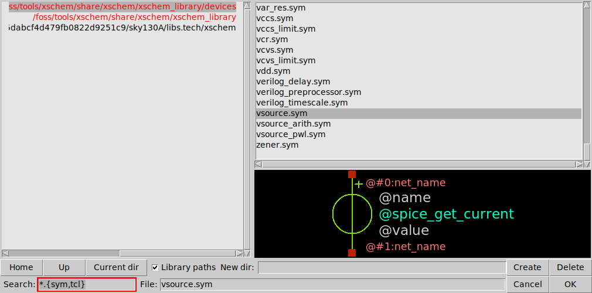

# Lab 01 — Your first schematic

You'll set up the workbench, draw one transistor in XSchem, watch it become seven lines of SPICE,
and get a current out of it. Then you'll break the same circuit twice on purpose: once so loudly
that ngspice refuses to run, and once so quietly that it hands you an answer that is wrong by a
factor of 6821.

Package: [`labs/lab-01-first-schematic/`](https://github.com/uoftasic/ad103/tree/main/labs/lab-01-first-schematic)

## Before you start

- Read [Getting started](guide/getting-started.md).
- Finish [IC101](https://uoftasic.com/ic101/): you need the `workspace` clone and a working
  `start_vnc` script.
- Keep the [XSchem cheat sheet](reference/xschem-cheatsheet.md) open in another tab.

**Time:** about 2 hours, most of it learning XSchem. Each `make` target takes about ten seconds,
almost all of it ngspice loading the SKY130 models.

## Part 1: Start the workbench

1. On your own machine, in your `workspace` clone, start the desktop:

   ```bash
   cd workspace
   ./scripts/start_vnc.sh          # Windows: scripts\start_vnc.bat
   ```

2. Open **http://localhost/** in your browser and open a terminal on that desktop. Every command
   from here on is typed in that terminal, not on your laptop. Ports, passwords, resolution, and
   what to do when the page is blank are in
   [IC101 — Launch the noVNC desktop](https://uoftasic.com/ic101/#/guide/launch-novnc).

3. Check the PDK before you load anything:

   ```bash
   echo $PDK
   ```

   ```
   ihp-sg13g2
   ```

   That is the image's default, and it is the wrong process for this course.

4. Load the course environment. Do this in every new terminal; it does not carry over.

   ```bash
   . /foss/designs/common/.designinit
   ```

   ```
   ASIC-EDU: PDK=sky130A  PDK_ROOT=/foss/pdks  designs=/foss/designs
             run 'mod' to list course modules, or 'mod <name>' to enter one.
   ```

5. Get the course files. `mod` is a shell function that `.designinit` defines.

   ```bash
   mod add ad103      # first time only: clones github.com/uoftasic/ad103
   mod ad103          # every time after that
   ```

   ```
   Cloning https://github.com/uoftasic/ad103.git
        into /foss/designs/modules/ad103
   Cloning into '/foss/designs/modules/ad103'...
   OK  module ready: /foss/designs/modules/ad103
       run: mod ad103
   cwd: /foss/designs/modules/ad103
   ```

   Everything lands under `/foss/designs/modules/`, which is your `workspace` folder mounted
   into the container. Your files are on your own disk, so deleting the container does not
   delete your work.

   | What you see | What it means |
   |---|---|
   | `bash: mod: command not found` | You did not run step 4 in this terminal. Every new tab starts clean. |
   | `mod: no such module: ad103` | You ran `mod ad103` before `mod add ad103`. |
   | `fatal: could not read Username for 'https://github.com'` | git is being asked to log in, which means it could not read the repo anonymously. Check the spelling; if it is right, ask in [Discord](https://discord.gg/hrJnP5UsGz). Do not type your password. |

6. Check your tool versions:

   ```bash
   xschem --version
   ngspice -v
   ```

   ```
   XSCHEM V3.4.8RC
   Copyright (C) 1998-2026 Stefan Schippers
   ```

   ```
   ******
   ** ngspice-47 : Circuit level simulation program
   ** Compiled with KLU Direct Linear Solver
   ** The U. C. Berkeley CAD Group
   ** Copyright 1985-1994, Regents of the University of California.
   ```

**You should see** `PDK=sky130A` in the `.designinit` banner from step 4, `XSCHEM V3.4.8RC`, and
`ngspice-47`. XSchem's
keys and menus have changed between releases, so if your version is different, the screenshots
in this course may not match your window.

## Part 2: Prove the toolchain works

1. Run the reference check:

   ```bash
   cd /foss/designs/modules/ad103/labs/lab-01-first-schematic
   make
   ```

   ```
   == netlisting xschem/nmos_probe.sch
      wrote xschem/simulation/nmos_probe.spice
   == simulating spice/nmos_op.spice
      wrote results/nmos_op.log
   == checking
     device line : XM1 d g 0 0 sky130_fd_pr__nfet_01v8 L=0.15 W=1 nf=1 ad=0.29 as=0.29 pd=2.58 ps=2.58 nrd=0.29 nrs=0.29 sa=0 sb=0 sd=0 mult=1
     drain current : 501.046 uA  (reference 501.046 uA)

   PASS  netlist and operating point match the reference run
   ```

2. Read the device line before the current. The four node names, `d g 0 0`, are in the order
   **drain, gate, source, body**. You'll find each of them on the drawing in Part 3.

3. Open `results/nmos_op.log` and find `i(vds) = -5.01046e-04`. The sign is negative because
   ngspice reports current flowing *into* the positive terminal of a source, and this source is
   pushing current out.

**You should see** `PASS` and **501.046 µA**. That is a real SKY130 NMOS, one micrometre wide
and 150 nanometres long, with 1.8 V on both the gate and the drain: half a milliamp through a
device you could fit two thousand of across the width of a human hair. Lab 03 explains why it
carries that current and not some other.

`make` needs no environment setup at all. The `Makefile` sets `PDK=sky130A` itself, so this
works in a bare container even if Part 1 went wrong. From now on, if a page in this course seems
to disagree with your screen, come back here and run `make`. A `PASS` means your toolchain is
fine and the problem is in your drawing.

## Part 3: Look around the reference schematic

1. Open the reference schematic from its own folder, so XSchem reads that folder's `xschemrc`:

   ```bash
   cd xschem
   xschem nmos_probe.sch &
   ```

2. Check the menu bar says **SKY130**. If it says **IHP**, close XSchem, run step 4 of Part 1
   in this terminal, and launch it again.

3. Learn the keys you need. XSchem has several hundred bindings; these cover the whole course.
   They come from XSchem's own list: **Help → Keys**, or press `/` for a full-screen poster.

   | Do this | Key |
   |---|---|
   | Zoom to fit | `f` |
   | Zoom in / out | mouse wheel, or `Shift-Z` / `Ctrl-Z` |
   | Pan | hold `Space` and drag, or drag with the middle button |
   | Insert a symbol | `Shift-I` (or `Ins`) |
   | Draw a wire | `w`: press it at one end, then click the other |
   | Draw a wire whose **ends** snap onto the nearest pin | `Shift-W`, and hold `Shift` for the closing click too |
   | Place a net label | `Alt-L` |
   | Edit the selected thing's properties | `q` |
   | Duplicate / move / delete selection | `c` / `m` / `Delete` |
   | Undo | `u` |
   | Save | `Ctrl-S` |
   | Abort whatever you started, and unselect | `Escape` |
   | Help | `?` |

   Three of these will catch you out, because your text editor uses the same keys for something
   else: **`c` duplicates** the selection (plain `Ctrl-C` is a different, less useful copy),
   **`u` is undo** (`Ctrl-Z` is zoom out), and **`q` opens properties** (it does not quit). The
   full list, with menu equivalents, is in the [XSchem cheat sheet](reference/xschem-cheatsheet.md).

4. Pan and zoom around `nmos_probe.sch` until it stops looking random. Find the two supplies,
   the nets `g` and `d`, and the junction dot where the source and body wires meet. Compare it
   with the picture in [Getting started](guide/getting-started.md#how-wires-connect).

   > **Warning:** `nmos_probe.sch` is the lab's reference, and `make` checks against it.
   > Practise on it freely (`u` undoes any number of steps), but don't save over it. If you
   > already did, run `git checkout -- xschem/nmos_probe.sch` from the lab folder to put it back.

   If you can't see the status bar at the bottom of the window: on the default 1280×800 desktop,
   XSchem opens 764 px tall at 29 px down, which puts its last 24 px behind the Xfce taskbar.
   Drag the window's bottom edge up a little, or start the desktop bigger
   (`VNC_RESOLUTION=1920x1080 ./scripts/start_vnc.sh`). The status bar is where XSchem tells you
   what mode you are in, so it's worth having.

5. Open the **Simulation** menu and check the bullet is on **Use 'simulation' dir in schematic
   dir**. The lab's `xschemrc` sets this. While the menu is open, tick **Show netlist after
   netlist command** (`Shift-A`).

6. Click **Netlist** in the menu bar. It is the grey button to the right of `SKY130`. The netlist
   pops up in its own window.

7. In the terminal, still in the `xschem/` folder, print the file XSchem wrote:

   ```bash
   cat simulation/nmos_probe.spice
   ```

   ```
   ** sch_path: /foss/designs/modules/ad103/labs/lab-01-first-schematic/xschem/nmos_probe.sch
   **.subckt nmos_probe
   XM1 d g 0 0 sky130_fd_pr__nfet_01v8 L=0.15 W=1 nf=1 ad=0.29 as=0.29 pd=2.58 ps=2.58 nrd=0.29 nrs=0.29 sa=0 sb=0 sd=0 mult=1
   Vgs g 0 1.8
   Vds d 0 1.8
   **.ends
   .end
   ```

**You should see** the seven-line netlist above, with `d g 0 0` on the device line matching the
nets on the drawing.

## Part 4: Draw your own transistor

`xschem/my_probe.sch` is the same circuit with the transistor left out.

1. Go back to the lab folder and open it:

   ```bash
   cd ..
   make edit
   ```

   

   *Everything but the transistor is placed and wired. `Vgs` and `Vds` are 1.8 V, connected by
   net name rather than by wire: two `lab_pin`s with the same label are the same net, wherever
   they sit on the page. The status bar reads `SNAP: 10  GRID: 20  MODE: spice`.*

2. Press `Shift-I`. The symbol chooser opens:

   

   *Left pane: the symbol libraries XSchem knows about. Right pane: the current directory.
   **Search** filters by pattern. Pick a file (`vsource.sym` here) and the pane underneath draws
   the symbol, so you can check you have the right one before you place it. Press **OK**, or
   double-click the file, and the symbol attaches to your cursor; click to drop it.*

   Look at the left pane first, because it is a second PDK check. Three paths are listed, and the
   third is `…/sky130A/libs.tech/xschem`. If that line is missing or says `ihp-sg13g2`, close
   XSchem and go back to Part 1, step 4.

   The right pane opens on XSchem's built-in **`devices`** library. You need four things from it
   during the course: `vsource.sym` (a voltage source), `gnd.sym` (ground), `lab_pin.sym` (a net
   label), and `capa.sym` (a capacitor).

   > **The chooser may open partly off screen.** It opens positioned relative to the main
   > XSchem window, and because that window is nearly as wide as the screen, on a 1280-wide
   > desktop the chooser lands mostly off the right edge. The library pane, the file list, the
   > Search box and **OK** can all be out of view. Drag it back by the part of the title bar you
   > can see (or Alt-drag anywhere in it). It stays where you put it for the rest of the session.
   > The chooser also remembers the directory you were last in; click **Home** to jump back to
   > the top of the tree. The **Edit Properties** window that `q` opens behaves the same way.

3. Click the `sky130A` line on the left, open **`sky130_fd_pr`**, and replace the **Search** text
   with `nfet_01v8*.sym`. That cuts the library's 77 symbols down to five. Search takes a glob,
   not a substring, so `nfet` on its own matches nothing.

   

   *The whole `sky130_fd_pr` library cut down to five files. The preview shows the symbol with
   its attributes still as placeholders (`@name`, `@model`, `@mult x @W / @L`), because they are
   filled in per instance.*

   The three symbols you'll use in this course are **`nfet_01v8.sym`** (the 1.8 V n-channel
   MOSFET, the workhorse of this process), **`pfet_01v8.sym`** (its p-channel twin) and
   **`diode.sym`** (Lab 02's subject). The other seventy-odd devices are described in
   [Reading a SKY130 device model](reference/sky130-device-guide.md).

4. Pick `nfet_01v8.sym`, press **OK**, and click to drop it in the gap.

5. Select the transistor and press `q`:

   

   *One attribute per line. `W=1` and `L=0.15` are the only two you will normally change. `nf`,
   `mult`, `model` and `spiceprefix` come from the symbol, so leave them alone.*

   Set **`W=2`** and **`L=0.15`**. Plain numbers, no `u`.

6. Wire the four pins: drain to `d`, gate to `g`, source and body to ground. To draw a wire, put
   the pointer on the first end, press `w`, move to the second end, and click. The key anchors
   the start, so pressing `w` and *then* clicking two places draws a wire from wherever the
   pointer was parked to your first click, and nothing between the two places you clicked. Each
   wire is one straight segment; for an L-shape, draw two.

   Two things cost everyone their first half hour:

   - **Your wires may come out diagonal.** XSchem's routing mode has an oblique setting, and it
     is not always off. Press `Space` while a wire is in progress to cycle between
     horizontal-then-vertical, vertical-then-horizontal, and straight diagonal. `Escape` throws
     away a wire you started by mistake.
   - **A wire end can miss a pin by one grid step.** If you're not sure a wire will land on a
     pin, use `Shift-W` instead of `w`, and hold `Shift` down for the closing click as well.
     `Shift-W` snaps the end you *start* from onto the nearest pin or net endpoint, however far
     away it is. The click that finishes the wire is an ordinary click, which lands on the snap
     grid; it only pulls onto a pin that is already within about one snap step, which is why the
     mistake comes and goes. Measured on a pin 28 units away: a plain closing click landed on
     the grid 28 units short, and with `Shift` held it landed exactly on the pin.

   Zoom in on every junction and check for the dot.

7. Save with `Ctrl-S`. XSchem always raises a small window titled **Ask Save** reading
   `save file?`, with **Yes / Cancel / No**, placed wherever the pointer happens to be. Nothing
   reaches disk until you press **Yes** (or `Return`), and the tab title keeps its `*` until you
   do. XSchem has no autosave, so save often.

   > **Warning:** if you press `Ctrl-S`, miss the **Ask Save** window, and run `make mine`, you
   > check the *last* version you saved. That's usually the one with no transistor in it, and it
   > gives a confident `FAIL - the netlist has no nfet_01v8` that sends you hunting for a
   > placement bug that isn't there. Check the `*` has gone from the tab first.

8. Before you simulate, predict the current. The reference device is $W$ = 1 µm and draws
   501.046 µA. Yours is twice as wide. Write your number down.

9. Netlist, check and simulate your drawing:

   ```bash
   make mine
   ```

   It netlists what you drew and checks the wiring before it simulates anything:

   ```
     WHAT YOU DREW
       XM1 d g 0 0 sky130_fd_pr__nfet_01v8 L=0.15 W=2 nf=1 ad=0.58 as=0.58 pd=4.58 ps=4.58 nrd=0.145 nrs=0.145 sa=0 sb=0 sd=0 mult=1

     Wired correctly. Simulating it.

     YOUR TRANSISTOR
       W = 2 um, L = 0.15 um, V_GS = V_DS = 1.8 V
       drain current    1030.4200 uA
       reference        1030.4200 uA

   PASS  you drew a transistor, XSchem turned it into SPICE, and ngspice
         answered 1030.4200 uA. That is the whole chain, and it is the
         chain every other lab in this course runs on.
   ```

   It then prints a short note comparing your current with twice the reference; step 10 goes
   through it.

   If it says `FAIL`, it names which of five things went wrong (a missing device, a unit suffix
   on `W`, a `net7` where a wire did not land, the source on the wrong node, the body left
   floating) and what to do about each.

10. Compare the result with your prediction. Twice 500.941 µA (the reference current *as the
    XSchem netlist produces it*) is 1001.882 µA. You measured **1030.42 µA**, which is
    **2.85 % more**: doubling the width bought slightly more than double the current. That is
    too small to be a mistake and too large to be noise. It is the first crack in "current is
    proportional to $W$", and [Lab 04](labs/lab-04-wl-knob-overview.md) is about what is behind
    it.

    > **Two numbers, both correct, 0.02 % apart.** The hand-written deck gives 501.046 µA and the
    > XSchem netlist gives 500.941 µA for the same device. The symbol computes the source and
    > drain diffusion areas and resistances from $W$ and writes them onto the device line; the
    > hand deck leaves them at zero. This is the first time in the course that layout shows up in
    > an electrical answer, and the effect is the smallest you'll see.

**You should see** `PASS` and **1030.4200 µA** from `make mine`.

## Part 5: The loud failure

1. Run the deck with units on `W` and `L`:

   ```bash
   make wrong-units
   ```

   ```
   Error on line 56 or its substitute:
     m.xm1.msky130_fd_pr__nfet_01v8 d g 0 0 xm1:sky130_fd_pr__nfet_01v8__model l=    1.500000000000000e-07     w=    1.000000000000000e-06 ...
   could not find a valid modelname
       Simulation interrupted due to error!
   ```

2. Find what changed:

   ```bash
   diff spice/nmos_op.spice spice/nmos_op_wrong_units.spice
   ```

**You should see** two characters of difference: `L=0.15u W=1u` instead of `L=0.15 W=1`. The
message names neither `W` nor units, which is why the habit is to check `W` and `L` first
rather than to read the error. [Getting started](guide/getting-started.md#w1-never-w1u) explains
what the `u` does.

## Part 6: The quiet failure

1. Run the schematic with one short wire:

   ```bash
   make unconnected
   ```

   ```
      XSchem exit status: 0.  No error, no warning.  Here is the device line:
        XM1 d net1 0 0 sky130_fd_pr__nfet_01v8 L=0.15 W=1 nf=1 ...

        Note: Starting dynamic gmin stepping
        Warning: Dynamic gmin stepping failed
        Note: Starting true gmin stepping
        Warning: True gmin stepping failed
        Note: Starting source stepping
        Warning: source stepping failed
        Note: Transient op started
        Note: Transient op finished successfully
        i(vds) = -7.34593e-08
        v(net1) = 5.017472e-01
   ```

2. Open `xschem/broken_probe.sch` next to `xschem/nmos_probe.sch` (from the `xschem/` folder,
   `xschem broken_probe.sch &`) and find the difference. It is one wire, ending 20 units short of
   the gate pin: about a millimetre on screen.

3. Compare the current with Part 2. **73.4593 nA**, where the working circuit gives 501.046 µA:
   wrong by a factor of **6821**, with no error anywhere. `v(net1) = 0.5017472 V` is the gate,
   floating, settling wherever the solver left it. `Vgs` is still in the circuit and still set
   to 1.8 V, but it is no longer connected to anything that matters.

4. Search the netlists for invented names:

   ```bash
   grep 'net[0-9]' xschem/simulation/*.spice
   ```

**You should see** the `broken_probe` device line with `net1` on it. The only other warning you
got was three lines of solver complaints that look exactly like the noise you learn to scroll
past. Run that `grep` after every netlist for the rest of the course. Any hit is a wire you
believe is connected and is not.

## Part 7 (optional): Which model bin your device landed in

1. Ask ngspice which model card it chose for `L=0.15 W=1`:

   ```bash
   make bins
   ```

   ```
         model xm1:sky130_fd_pr__nfe
          toxe             4.148e-09
          vth0              0.411231
          lmin               1.5e-07
          wmin               8.4e-07
         model xm1:sky130_fd_pr__nfe
             l               1.5e-07
             w                 1e-06
           vth              0.769267
          weff           9.56282e-07
          leff           1.26136e-07
   ```

**You should see** two `model` headers. Everything above the second one is the **bin**, and
everything below it is **your device**. [Reading a SKY130 device
model](reference/sky130-device-guide.md#what-a-bin-is) explains each line, including why `leff`
is 16 % shorter than the `L` you drew.

## Finishing

You're done when:

- `make` prints `PASS` and `501.046 uA`
- `make mine` prints `PASS` and `1030.4200 uA`

and you can do these without looking anything up:

- [ ] place an `nfet_01v8` and set `W` and `L` without the `u`
- [ ] draw a wire that is not diagonal, and land it on a pin
- [ ] name a net with `Alt-L` and connect two things by name alone
- [ ] save, netlist, and find the `.spice` file
- [ ] read the four node names on a device line and spot a `net7`

There is nothing to submit.

## Harmless messages

On some builds of the workbench image, a deck you run by hand with `ngspice -b` opens with a
block like this before your circuit is even read:

```
Error opening osdi lib "/foss/pdks/sky130A/libs.tech/ngspice/osdi/psp103.osdi": No such file or directory!
Error: Library /foss/pdks/sky130A/libs.tech/ngspice/osdi/psp103.osdi couldn't be loaded!
...
Warning: OSDI libs have not been loaded successfully.
    Any of the following steps may fail, if Verilog A models are involved!.
```

Several `Error:` lines, on a run that then works perfectly. OSDI is ngspice's plug-in interface
for compiled Verilog-A models. SKY130's `nfet_01v8`, `pfet_01v8` and diodes are all built-in BSIM
and diode models, so nothing in this course needs those libraries. The `Makefile` sends ngspice's
output to a log, so you normally don't see it.

You may also see these two:

```
Warning: Eta0 = -0.0310679 is negative.
Note: No compatibility mode selected!
```

The first is SkyWater's model card having a negative fitting parameter, which BSIM allows and
mentions. The second is ngspice saying it is not pretending to be HSPICE.

To tell these apart from a real problem: a real failure says `Error on line …`, followed by
`Simulation interrupted due to error!` and then `no simulations run!`. If you see numbers after
the warnings, the warnings didn't matter.

## If something goes wrong

| What you see | What it means |
|---|---|
| `could not find a valid modelname` | A unit suffix on `W` or `L`. See Part 5. |
| `*  M1 -  nfet_01v8  IS MISSING !!!!` in the netlist | XSchem could not find the symbol. Nearly always the wrong `PDK`: check the menu bar says SKY130, then `echo $PDK`, then relaunch XSchem. |
| `net1`, `net2`, … in your netlist | Unconnected pins. See Part 6. |
| Netlist file nowhere to be found | It went to `~/.xschem/simulations/`. See [Getting started](guide/getting-started.md#the-netlist). |
| `can't create directory "/foss/pdks/sky130A/libs.tech/xschem/sky130_tests/simulation": permission denied` | You pressed **Netlist** while XSchem was showing the SKY130 PDK's own start page, which lives inside the read-only PDK. Nothing is broken. Open a schematic in your own directory (`xschem nmos_probe.sch &` from `labs/lab-01-first-schematic/xschem/`) and netlist that. |
| `file opening for write failed!` when you save | Same cause: the schematic you are editing is in a read-only directory, almost always the PDK start page. Your drawing is still in the window, and **File → Save as** into your own folder rescues it. |
| `Error: incomplete or empty netlist` | ngspice hit an earlier error and gave up. Scroll **up**: the first `Error` line is the real one. |
| A blank rectangle with a name instead of a circuit | An unexpanded subcell. Descend into it with `e`, come back with `Ctrl-E`. |
| XSchem opens the wrong start page, or symbols vanish after it worked yesterday | You started it from a different directory, so it read a different `./xschemrc`. |
| `make mine` says `FAIL - the netlist has no nfet_01v8` right after you drew one | You didn't press **Yes** in the **Ask Save** window. See Part 4, step 7. |

More errors, with the full text of each: [The ngspice survival card](reference/ngspice-errors.md).

Next on the [Course path](README.md#course-path): read
[Linearity and superposition](guide/the-straight-line-runs-out.md).
