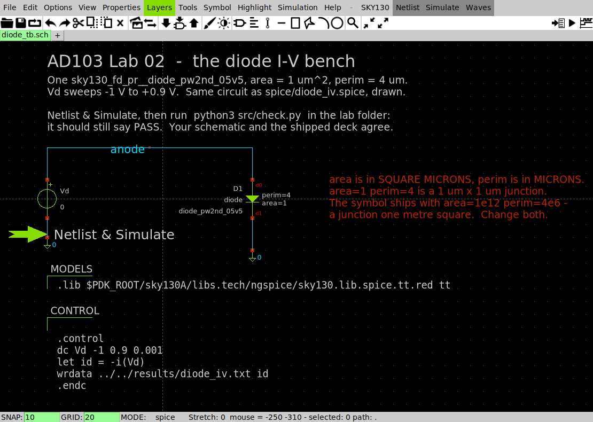
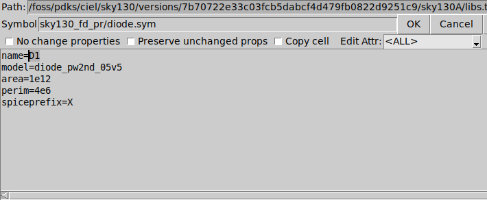

# Lab 02 — The diode I–V curve

You'll sweep one real SKY130 diode through nine decades of current, show that superposition has
stopped working, and pull two of SkyWater's own model parameters back out of the shape of your
graph. Then you'll find out which parts of the curve belong to the diode and which belong to the
simulator.

Package: [`labs/lab-02-diode-iv/`](https://github.com/uoftasic/ad103/tree/main/labs/lab-02-diode-iv)

## Before you start

- Finish [Lab 01](labs/lab-01-first-schematic-overview.md): `make` in
  `labs/lab-01-first-schematic` prints `PASS` and **501.046 µA**.
- Read [Linearity and superposition](guide/the-straight-line-runs-out.md),
  [The operating point](guide/the-operating-point.md),
  [The diode equation](guide/the-diode-is-an-exponential.md) and
  [Three diode models](guide/three-models-of-one-diode.md).
- Open a terminal in the workbench and go to the lab folder:

  ```bash
  cd /foss/designs/modules/ad103/labs/lab-02-diode-iv
  ```

  This lab needs no environment setup: no `.designinit`, no `mod`, no `PDK`. The decks find the
  models through `PDK_ROOT`, which the image already sets to `/foss/pdks`, and the `Makefile`
  sets it anyway. The XSchem bench in `xschem/` needs `PDK=sky130A` to find its symbols, so
  `xschem/xschemrc` sets that itself. (On the image's default IHP process, this bench netlists to
  `D1 - diode IS MISSING !!!!`, simulates without a single error, and writes a column of zeros.)

**Time:** about 1.5 hours. `make` takes about 25 seconds; each of the other targets takes about
ten. Wall times depend on your machine. Every other number on this page is fixed: same image, same
deck, same digits, and the checker enforces them.

The two equations from the guide pages are all the theory you need:

$$
I \;=\; I_0\left(e^{\,V/nV_T}-1\right),
\qquad V_T=\frac{kT}{q}=25.8649\ \text{mV at }27\,^\circ\text{C}
$$

$$
\text{one decade of current} \;=\; nV_T\ln 10 \;=\;n \times 59.556\ \text{mV}
$$

You'll measure the left-hand sides and solve for $n$ and $I_0$.

## Part 1: Run the lab

1. Look at the bench you are about to simulate. `xschem/diode_tb.sch` is the same circuit as
   `spice/diode_iv.spice`, drawn:

   

   *One `sky130_fd_pr__diode_pw2nd_05v5` with `area=1` and `perim=4`, a source `Vd` sweeping
   −1 V to +0.9 V, and the two text blocks that carry the `.lib` line and the `.control` block.*

2. Run everything: the DC sweep, the additivity test, three plots, and the checker.

   ```bash
   make
   ```

   It prints 81 lines. The checker enforces currents to 1 %, voltages to 1 mV and the slope to
   0.5 %.

   ```
   == DC sweep: 1901 points, -1.000 V to +0.900 V
      (about 2 s, model library included)
      wrote results/diode_iv.txt
   == additivity test: a resistor and a diode, driven three ways
   --- 100 kohm resistor (amps) ---
       A alone, B alone, then A+B predicted by superposition, then measured
   i_r_a = 3.500000e-06
   i_r_b = 3.500000e-06
   i_r_sum = 7.000000e-06
   i_r_ab = 7.000000e-06
   --- 1 um^2 diode (amps) ---
       A alone, B alone, then A+B predicted by superposition, then measured
   i_d_a = 1.254090e-10
   i_d_b = 1.254090e-10
   i_d_sum = 2.508180e-10
   i_d_ab = 3.917437e-06
   == plots
     rows read          : 1901
     reverse at -1.000 V: -1.0036 pA

     current      forward V     mV since previous decade
        1e-12 A   0.181962 V           -
        1e-11 A   0.264643 V       82.68
        1e-10 A   0.342408 V       77.77
        1e-09 A   0.419503 V       77.09
        1e-08 A   0.496518 V       77.02
        1e-07 A   0.573602 V       77.08
        1e-06 A   0.651480 V       77.88

     fit over 154 points from 1e-09 A to 1e-07 A:
       slope           : 77.037 mV/decade
       thermal voltage : 25.8649 mV  (27 degC)
       ideality n      : 1.2935
       I0 (V=0 intercept): 3.5864 fA
       leaves the line : 0.699 V, 3.8136 uA (line says 4.2487 uA)

     series resistance, from the top of the curve:
       at 0.900 V the diode carries 98.0354 uA
       the straight line needs only 0.804011 V for that current
       so 95.989 mV is dropped outside the junction
       rs = 95.989 mV / 98.0354 uA = 979.1 ohm

     local slope, measured over a 20 mV window:
        V        I(A)         mV/decade
      0.050  6.2317e-14       96.11
      0.100  1.6726e-13      123.18
      0.150  4.6233e-13      101.91
      0.200  1.6055e-12       85.75
      0.250  6.5318e-12       79.61
      0.300  2.8333e-11       77.72
      0.350  1.2541e-10       77.19
      0.400  5.5825e-10       77.05
      0.450  2.4887e-09       77.01
      0.500  1.1097e-08       77.02
      0.550  4.9442e-08       77.11
      0.600  2.1945e-07       77.50
      0.650  9.5789e-07       79.19
      0.700  3.9174e-06       85.92
      0.750  1.3278e-05      107.03
      0.800  3.3105e-05      151.64
      0.850  6.2443e-05      217.80

     wrote results/ad103-diode-iv-linear.png
     wrote results/ad103-diode-iv-log.png
     wrote results/ad103-diode-load-line.png
   == checking
     I(0.450 V) = 2.488707e-09 A   (reference 2.488707e-09)
     I(0.600 V) = 2.194466e-07 A   (reference 2.194466e-07)
     I(0.700 V) = 3.917437e-06 A   (reference 3.917437e-06)
     I(-1.000 V) = -1.0036 pA  (reference -1.0036 pA)
     V at 1e-09 A = 0.419503 V   (reference 0.419503)
     V at 1e-08 A = 0.496518 V   (reference 0.496518)
     V at 1e-07 A = 0.573602 V   (reference 0.573602)
     slope       = 77.0367 mV/decade over 154 points (reference 77.0367)
     ideality n  = 1.29351          (reference 1.29351; sky130's model card says 1.2928)
     I0          = 3.5864 fA        (reference 3.5864 fA)
     leaves the straight line at 0.699 V, 3.8136 uA
     resistor: superposition off by 0.0000 %
     diode   : superposition off by a factor of 15,618.6

   PASS  every number matches the reference run
   ```

**You should see** `PASS  every number matches the reference run`. The rest of this lab reads that
output one block at a time.

## Part 2: Test superposition

1. Find the additivity block near the top of the output. To print it on its own again, run
   `make line`.

2. For the resistor, add `i_r_a` and `i_r_b` and compare the sum with `i_r_ab`. Do the same for the
   diode.

3. Work out how far off superposition is for the diode, as a factor.

**You should see** the resistor's sum match to every digit (7.000000 µA), and the diode's
prediction of 250.8180 pA against a measured 3.917437 µA: a factor of **15,618**. The checker's
last two lines report the same thing.

## Part 3: Read the curve on two axes

1. Open `results/ad103-diode-iv-linear.png`:

   

   Try to find the point where the current is 1 nA. You can't: 1 nA is 0.001 % of the top of
   the axis. The decade table says it happens at **0.419503 V**, which on this plot is somewhere
   in the flat part. Most analog circuits live in the part of the curve that linear axes can't
   draw.

2. Open `results/ad103-diode-iv-log.png`:

   

   Put a ruler on the straight part and read off two points a decade apart. Compare your reading
   with the `mV since previous decade` column of the decade table.

**You should see** about 77 mV per decade everywhere between about 0.30 V and 0.65 V. The four
middle rows of the decade table agree to better than 1 %.

## Part 4: Extract $n$ and $r_s$, and check the model card

1. Find the fit block. Divide the slope by the ideal 59.556 mV/decade:
   $77.037 / 59.556 = 1.2935$. That is the **ideality factor**.

2. Find the series-resistance block. Check its arithmetic: 95.989 mV dropped outside the junction,
   divided by 98.0354 µA.

3. Read SkyWater's own numbers for this diode off its model card:

   ```bash
   grep -m1 -A20 'model sky130_fd_pr__diode_pw2nd_05v5 d' \
     /foss/pdks/sky130A/libs.ref/sky130_fd_pr/spice/sky130_fd_pr__diode_pw2nd_05v5.model.spice \
     | grep -E '^\+ (js|jsw|n|rs) '
   ```

   ```
   + js = 2.75e-015 ; Units: amper/meter^2
   + jsw = 6e-016 ; Units: amper/meter
   + n = 1.2928
   + rs = 981 ; Units: ohm (ohm/meter^2 if area defined)
   ```

**You should see** $n$ = 1.2935 from your fit against `n = 1.2928` on the card, and
$r_s$ = 979.1 Ω against `rs = 981`. You extracted two foundry parameters from the shape of a graph.

## Part 5: Find the operating point

1. Solve one resistor and one diode in series, from 1.8 V, for three resistor values:

   ```bash
   make op
   ```

   ```
   == one resistor and one diode in series, three times
   --- diode voltage at the operating point (volts) ---
       R = 10 kohm, 100 kohm, 1 Mohm
   v(n1) = 8.905358e-01
   v(n2) = 7.398473e-01
   v(n3) = 6.561163e-01
   --- and the current through it (amps) ---
   i_10k = 9.094642e-05
   i_100k = 1.060153e-05
   i_1meg = 1.143884e-06
   ```

2. Compare `v(n2)` and `i_100k` with the hand iteration on
   [The operating point](guide/the-operating-point.md#worked-example-guess-correct-repeat)
   (0.7335 V and 10.665 µA). How far off was the hand answer, in mV and in percent?

3. Open `results/ad103-diode-load-line.png` and check the two marked crossings against `v(n2)` and
   `v(n3)`:

   

4. Now find the same operating point a completely different way: from the DC sweep, which has no
   resistor in it at all. This script walks the sweep until the diode's current crosses the
   100 kΩ load line, then interpolates:

   ```bash
   python3 -c "
   import sys; sys.path.insert(0,'src')
   from iv import read_iv
   v, i = read_iv()
   prev = None
   for a, b in zip(v, i):
       f = b - (1.8 - a)/1e5
       if prev and prev[1] < 0 <= f:
           v0, f0 = prev
           vx = v0 + (0 - f0)/(f - f0)*(a - v0)
           print(f'{vx:.6f} V   {(1.8 - vx)/1e5:.6e} A'); break
       prev = (a, f)
   "
   ```

   ```
   0.739846 V   1.060154e-05 A
   ```

**You should see** the plot's marked crossings at `0.7398 V` and `0.6561 V`, matching `v(n2)` and
`v(n3)`, and the sweep crossing agreeing with `op`'s 7.398473e-01 V and 1.060153e-05 A to six
digits. The plot was drawn from the sweep; `op` solved a different circuit. This is what "bias
point" means in practice, and it is the first step in designing anything analog.

## Part 6: Find out what the reverse floor is

1. Measure the reverse current twice, with two simulator settings:

   ```bash
   make floor
   ```

   ```
   --- default GMIN = 1e-12 S (amps; negative = current flowing backwards) ---
       at -1.000 V, at -0.500 V, at +0.100 V
   i_m1v0 = -1.00356e-12
   i_m0v5 = -5.03558e-13
   i_p0v1 = 1.672571e-13
   --- GMIN = 1e-15 S: the same diode, a thousand times less simulator ---
       at -1.000 V, at -0.500 V, at +0.100 V
   j_m1v0 = -4.55885e-15
   j_m0v5 = -4.05763e-15
   j_p0v1 = 6.735706e-14
   ```

2. Subtract $\text{GMIN}\times V$ from each of the four reverse numbers (the `m1v0` and `m0v5`
   lines). Use $10^{-12}$ S for the `i_` lines and $10^{-15}$ S for the `j_` lines.

3. Compare what's left with the `I0` that the forward fit reported in Part 1.

**You should see** **3.56, 3.558, 3.559 and 3.558 fA**: the same constant four times, from two
voltages and two simulator settings, against **3.5864 fA** from the opposite end of the curve. If
you had reported "this diode leaks 1 pA", you would have been reporting ngspice's default GMIN, not
the silicon. [The diode equation](guide/the-diode-is-an-exponential.md#the-bottom-of-the-curve-gmin)
works through the rest of the arithmetic.

## Part 7: Junction area, and three silent size mistakes

1. Run the area deck:

   ```bash
   make area
   ```

   ```
   --- Part 1: forward current at 0.500 V vs junction area (amps) ---
       area = 1, 4, 16, 100 um^2
   i_1um = 1.109698e-08
   i_4um = 3.457181e-08
   i_16um = 1.186544e-07
   i_100um = 6.679656e-07
   ```

2. Predict, before you calculate: a hundred times the area ought to be a hundred times the
   current. Divide `i_100um` by `i_1um`. Then repeat the face-and-edge fit from
   [Three diode models](guide/three-models-of-one-diode.md#what-junction-area-buys) using only the
   first and last rows, and check it predicts the middle two.

3. Read the second half of the same output. These four device lines are all meant to be a 1 µm²
   junction:

   ```
   --- Part 2: three lines that all mean to say 1 um^2, at 0.700 V (amps) ---
       correct, then perim misspelled as pj, then symbol defaults
   i_b1um = 3.917437e-06
   i_pj = 2.571530e-04
   i_def = 2.291258e+06
   --- and area=1u, which means a millionth of a square micron (amps) ---
   i_su = 4.541414e-12
   ```

   ngspice printed no error for any of them. Compare the lines yourself:

   ```bash
   grep -n '^X' spice/diode_area.spice
   ```

   | What you wrote | What you got at 0.700 V | Why |
   |---|---|---|
   | `area=1 perim=4` | **3.917437 µA** | correct |
   | `area=1 pj=4` | 257.1530 µA, **66× too big** | `pj` is the raw model card's name for it. The subcircuit parameter is `perim`, so `pj=4` is an unknown parameter, silently ignored, and `perim` keeps its default of **1e6**: a junction one metre around. |
   | *(no parameters at all)* | 2,291,258 A | the XSchem symbol's own defaults, `area=1e12 perim=4e6`: a junction **one metre square**. Two and a quarter **mega**amps. |
   | `area=1u perim=4u` | 4.541414 pA | micron numbers carry **no unit suffix**, exactly as with `W` and `L` in Lab 01. `1u` is a millionth of a square micron. |

   

   *Row three of that table, as you meet it: press <kbd>q</kbd> on a fresh `diode.sym` and this is
   what the symbol ships with, `area=1e12` and `perim=4e6`. Change **both** before you netlist.*

**You should see** a ratio of **60.19** rather than 100, and four "1 µm²" diodes whose currents
span from picoamps to megaamps with no error message. Note the last row. In Lab 01 the same `u`
mistake stopped ngspice dead with `could not find a valid modelname`, because MOSFET models are
binned and a device that small falls outside every bin. Diode models aren't binned, so here the
same mistake produces a clean, confident, completely wrong answer, and only you can catch it.

> **Check every diode you netlist.** Run `grep -n 'diode' <netlist>` and read the `area=` and
> `perim=` on every line: bare micron numbers, `perim` spelled out, no symbol defaults left in
> place.

## Part 8: Read a FAIL you caused

1. Hand the checker a sweep that is 5 % off:

   ```bash
   make broken
   ```

   `src/bend_it.py` copies your sweep and multiplies every current by exactly 1.05, which is far
   too small to see on either plot.

   ```
   == feeding the checker a sweep that is 5 % off, on purpose
     wrote results/diode_iv_bent.txt (every current multiplied by 1.05)
   ...
   FAIL
     - I(0.450 V) is 2.613143e-09 A, reference is 2.488707e-09 A - off by +5.00 %
     - I(0.600 V) is 2.304189e-07 A, reference is 2.194466e-07 A - off by +5.00 %
     - I(0.700 V) is 4.113309e-06 A, reference is 3.917437e-06 A - off by +5.00 %
     - reverse current -1.0537 pA is not the reference -1.0036 pA
     - V at 1e-09 A is 0.417871 V, reference is 0.419503 V
     - V at 1e-08 A is 0.494886 V, reference is 0.496518 V
     - V at 1e-07 A is 0.571966 V, reference is 0.573602 V
     - I0 is 3.7644 fA, reference is 3.5864 fA - the whole curve is scaled wrong, which usually means the junction is not the size you think it is
   ```

2. Look at what did **not** fail. Scroll up to the checker's lines above `FAIL` and find the slope
   and $n$.

**You should see** the slope still at `77.0349` against a reference of `77.0367`, and $n$ still at
`1.29348`. A 5 % scaling error doesn't change the slope of a log plot at all. It slides the whole
line sideways by $77.04 \times \log_{10}(1.05) = 1.63$ mV, which is exactly the shift in the three
decade voltages.

That is the diagnostic habit this lab is teaching. On a log-current plot, **the slope tells you
about $n$ and the offset tells you about $I_0$, and they fail independently.** A wrong slope means
the physics is wrong. A wrong offset with a right slope means the *size* is wrong: wrong `area`,
wrong `perim`, or the wrong number of devices in parallel. Run `make` again afterwards to get back
to a clean `PASS`.

## Finishing

You're done when `make` prints `PASS  every number matches the reference run` and you can answer:

- What are $n$ and $r_s$ for this diode, from your fit, and what does the model card say?
- Why is the reverse current at −1 V not the saturation current?
- Why did a hundred times the area give only 60.19 times the current?

There is nothing to submit.

## Going further

None of this is graded, and all of it is quick.

1. **Change the temperature.** Add `.options temp=100` to `spice/diode_iv.spice` and re-run
   `make sweep plots`. Predict first: $V_T$ scales with absolute temperature, so 77.04 mV/decade
   should become about $77.04\times(373.15/300.15) = 95.8$ mV/decade. Then see how much of the
   change is $V_T$ and how much is $I_0$, because $I_0$ moves too, and much harder. **The checker
   will FAIL, correctly**: you changed the experiment. Read which lines it objects to and which it
   doesn't.
2. **Sweep the other diode.** `sky130_fd_pr__diode_pd2nw_05v5` is the p-diffusion-into-n-well
   junction, the same idea built the other way up. Change the model name in the deck and see
   whether $n$ comes out the same.
3. **Two in series.** Put two 1 µm² diodes in series across the sweep source. Predict the decade
   slope before you run it.

## Output that looks alarming but is normal

Every `results/*.log` file contains

```
Warning: sky130_fd_pr__diode_pw2nd_05v5: IKR too small - model effect disabled!
```

on every run, including the runs that produce the numbers above. SkyWater's model card sets a
high-injection parameter to zero, and ngspice is telling you it has therefore switched that effect
off. Nothing is wrong. A real failure in an ngspice log says `Simulation interrupted due to
error!`, so `grep -c 'Simulation interrupted' results/*.log` should print `0` for every file.

## If something goes wrong

| What you see | What it means |
|---|---|
| `Error: unknown subckt: xd1 a 0 sky130_fd_pr__diode_pw2nd_05v5 area=1 perim=4` followed by `Error: incomplete or empty netlist` | Two different causes give the same message: either there is **no `.lib` line**, or the **model name is misspelled**. The error quotes your device line, not the cause. Check the `.lib` line first; it is the more common one. |
| `Warning: … IKR too small - model effect disabled!` | Normal on every run. See above. |
| A current about 66× larger than the reference | `pj=` instead of `perim=`. |
| A current about **a million times** smaller than the reference (picoamps where you expected microamps) | a `u` on `area` or `perim`. |
| `make: ngspice: No such file or directory` | You are running on your own machine, not in the workbench container. This lab needs `hpretl/iic-osic-tools:2026.08`. |
| The checker says `no sweep data at …` | `make sweep` has not run, or `make clean` removed it. Run `make`. |

More, with the full text of each: [The ngspice survival card](reference/ngspice-errors.md).
Stuck? Ask in the [team Discord](https://discord.gg/hrJnP5UsGz); quote the exact line and say
which `make` target you ran.

Next on the [Course path](README.md#course-path): read
[How a MOSFET works](guide/a-mosfet-is-a-valve.md).
