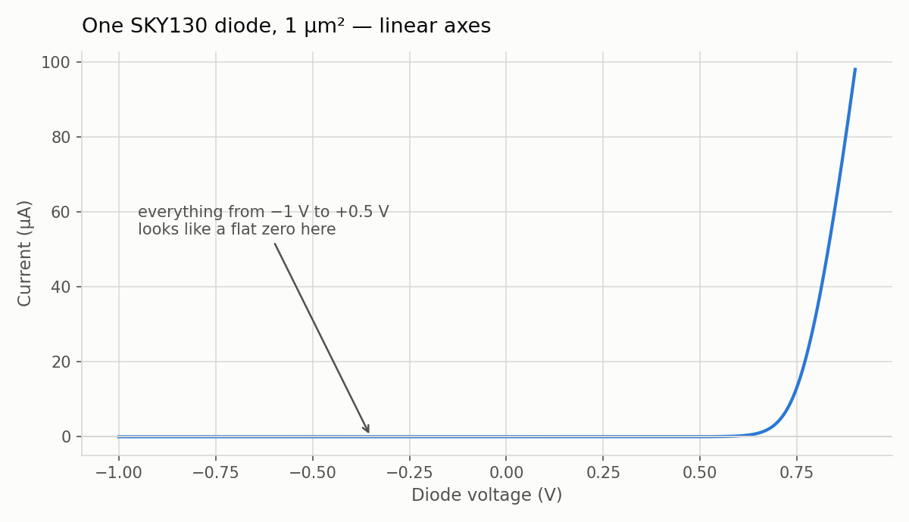
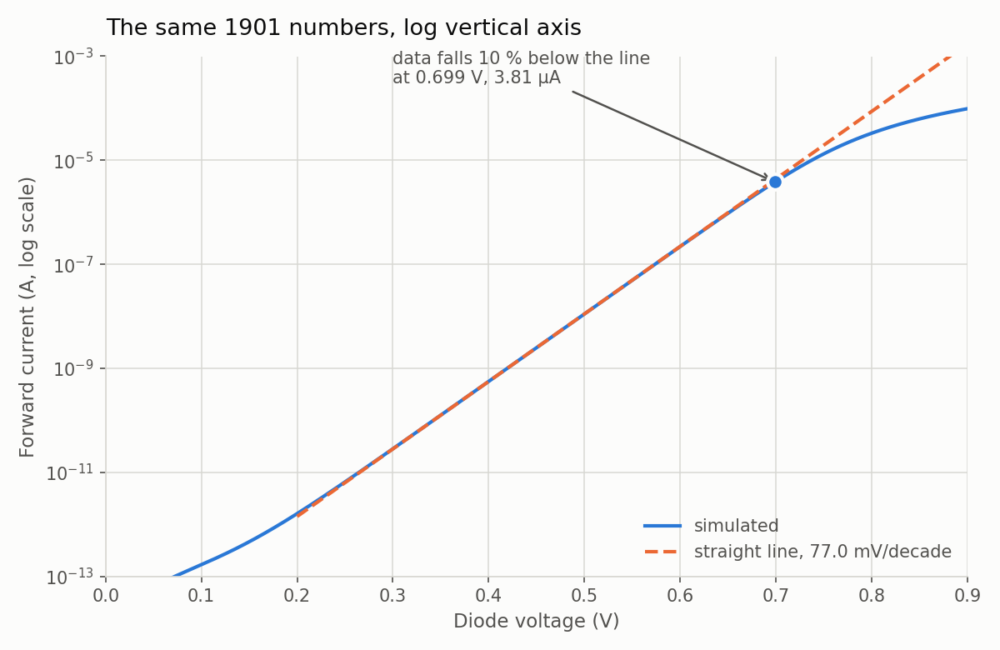
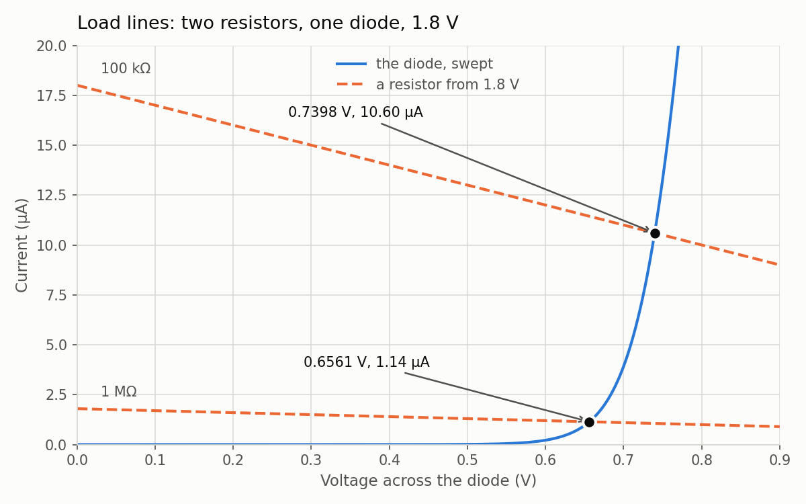

# Lab 02: The diode I–V curve

You'll sweep one real SKY130 diode through nine decades of current, show that superposition has
stopped working, and pull two of SkyWater's own model parameters back out of the shape of your
graph. Then you'll find out which parts of the curve belong to the diode and which belong to the
simulator, and heat the diode to 100 °C to see which parameters move.

Package: [`labs/lab-02-diode-iv/`](https://github.com/uoftasic/ad103/tree/main/labs/lab-02-diode-iv)

## Before you start

- Finish [Lab 01](../labs/lab-01-first-schematic-overview.md): `make` in
  `labs/lab-01-first-schematic` prints `PASS` and **501.046 µA**.
- Read [Linearity and superposition](../guide/the-straight-line-runs-out.md),
  [The operating point](../guide/the-operating-point.md),
  [The diode equation](../guide/the-diode-is-an-exponential.md) and
  [Three diode models](../guide/three-models-of-one-diode.md).
- Open a terminal in the workbench and go to the lab folder:

  ```bash
  cd /foss/designs/modules/ad103/labs/lab-02-diode-iv
  ```

  This lab needs no environment setup: no `.designinit`, no `mod`, no `PDK`. The decks find the
  models through `PDK_ROOT`, which the image already sets to `/foss/pdks`, and the `Makefile`
  sets it anyway. You don't need XSchem in this lab, but if you open the bench in `xschem/`, it
  needs `PDK=sky130A` to find its symbols, so `xschem/xschemrc` sets that itself. (On the
  image's default IHP process, this bench netlists to `D1 - diode IS MISSING !!!!`, simulates
  without a single error, and writes a column of zeros.)

**Time:** about 1.75 hours. `make` takes about 25 seconds; each of the other targets takes about
ten. Wall times depend on your machine. Every other number on this page is fixed: same image, same
deck, same digits, and the checker enforces them.

The two equations from the guide pages are all the theory you need:

$$
I \;=\; I_0\left(e^{\,V/nV_T}-1\right),
\qquad V_T=\frac{kT}{q}=25.8649\ \text{mV at }27\,^\circ\text{C}
$$

$$
\text{one decade of current} \;=\; nV_T\ln 10 \;=\;n \times 59.556\ \text{mV}
$$

You'll measure the left-hand sides and solve for $n$ and $I_0$.

## Part 1: Run the lab

Does your workbench reproduce the reference sweep?

1. Look at the bench you are about to simulate, in the picture below. `make` simulates the
   hand-written deck `spice/diode_iv.spice`; `xschem/diode_tb.sch` is the same circuit, drawn:

   

   *One `sky130_fd_pr__diode_pw2nd_05v5` with `area=1` and `perim=4`, a source `Vd` sweeping
   −1 V to +0.9 V, and the two text blocks that carry the `.lib` line and the `.control` block.*

2. Run everything: the DC sweep, the additivity test, three plots, and the checker.

   ```bash
   make
   ```

   It prints 81 lines, which Parts 2 to 4 go through one block at a time. It starts and ends like
   this:

   ```
   == DC sweep: 1901 points, -1.000 V to +0.900 V
      (about 2 s, model library included)
      wrote results/diode_iv.txt
   == additivity test: a resistor and a diode, driven three ways
   ...
   == checking
   ...
   PASS  every number matches the reference run
   ```

   The checker enforces currents to 1 %, voltages to 1 mV and the slope to 0.5 %.

**You should see** `PASS  every number matches the reference run`. Every `results/*.log` file
also contains `IKR too small - model effect disabled!`, on every run; that one is harmless, and
the [ngspice survival card](../reference/ngspice-errors.md#harmless-messages) explains it. If
something else goes wrong, the card's [Error messages](../reference/ngspice-errors.md#error-messages)
table has the diode errors.

## Part 2: Test superposition

Does doubling the drive double a diode's current, the way it does a resistor's?

The test drives a 100 kΩ resistor and a 1 µm² diode three times each: with input A (0.35 V), with
input B (0.35 V), and with A+B (0.70 V).

1. Predict: will the diode's `i_d_ab` equal `i_d_a` plus `i_d_b`? Write down yes or no, and if no,
   which way it misses.

2. Print the additivity block on its own:

   ```bash
   make line
   ```

   ```
   == additivity test: a resistor and a diode, driven three ways
   --- 100 kohm resistor (amps) ---
       A alone, B alone, then A+B predicted by superposition, then measured
   i_r_a = 3.500000e-06
   i_r_b = 3.500000e-06
   i_r_sum = 7.000000e-06
   i_r_ab = 7.000000e-06
   --- 1 um^2 diode (amps) ---
       A alone, B alone, then A+B predicted by superposition, then measured
   i_d_a = 1.254090e-10
   i_d_b = 1.254090e-10
   i_d_sum = 2.508180e-10
   i_d_ab = 3.917437e-06
   ```

3. For the resistor, add `i_r_a` and `i_r_b` and compare the sum with `i_r_ab`. Do the same for the
   diode.

4. Work out how far off superposition is for the diode, as a factor.

**You should see** the resistor's sum match to every digit (7.000000 µA), and the diode's
prediction of 250.8180 pA against a measured 3.917437 µA: a factor of **15,618.6**. The checker's
lines near the end of `make` report the same thing:
`resistor: superposition off by 0.0000 %` and `diode   : superposition off by a factor of 15,618.6`.

## Part 3: Read the curve on two axes

What does the curve look like on linear and on log axes, and what slope does the log plot have?

1. Open `results/ad103-diode-iv-linear.png`:

   

   Try to find the point where the current is 1 nA. Why can't you?

   <details>
   <summary>Answer</summary>

   1 nA is 0.001 % of the top of the axis. The decade table in step 3 says it happens at
   **0.419503 V**, which on this plot is somewhere in the flat part. Most analog circuits live in
   the part of the curve that linear axes can't draw.

   </details>

2. Open `results/ad103-diode-iv-log.png`:

   

   Put a ruler on the straight part and read off two points a decade apart. Write down the
   millivolts between them.

3. Compare your reading with the decade table in the `make` output:

   ```
     current      forward V     mV since previous decade
        1e-12 A   0.181962 V           -
        1e-11 A   0.264643 V       82.68
        1e-10 A   0.342408 V       77.77
        1e-09 A   0.419503 V       77.09
        1e-08 A   0.496518 V       77.02
        1e-07 A   0.573602 V       77.08
        1e-06 A   0.651480 V       77.88
   ```

   Then read the `local slope, measured over a 20 mV window` table further down the output, which
   gives the slope at every 50 mV from 0.050 V to 0.850 V:

   ```
     local slope, measured over a 20 mV window:
        V        I(A)         mV/decade
      0.050  6.2317e-14       96.11
      0.100  1.6726e-13      123.18
      0.150  4.6233e-13      101.91
      0.200  1.6055e-12       85.75
      0.250  6.5318e-12       79.61
      0.300  2.8333e-11       77.72
      0.350  1.2541e-10       77.19
      0.400  5.5825e-10       77.05
      0.450  2.4887e-09       77.01
      0.500  1.1097e-08       77.02
      0.550  4.9442e-08       77.11
      0.600  2.1945e-07       77.50
      0.650  9.5789e-07       79.19
      0.700  3.9174e-06       85.92
      0.750  1.3278e-05      107.03
      0.800  3.3105e-05      151.64
      0.850  6.2443e-05      217.80
   ```

**You should see** about 77 mV per decade everywhere between about 0.30 V and 0.65 V. The four
middle rows of the decade table agree to better than 1 %.

## Part 4: Extract $n$ and $r_s$, and check the model card

What are the ideality factor and series resistance of this diode, and does SkyWater agree?

1. Find the fit block in the `make` output:

   ```
     fit over 154 points from 1e-09 A to 1e-07 A:
       slope           : 77.037 mV/decade
       thermal voltage : 25.8649 mV  (27 degC)
       ideality n      : 1.2935
       I0 (V=0 intercept): 3.5864 fA
       leaves the line : 0.699 V, 3.8136 uA (line says 4.2487 uA)
   ```

   Divide the slope by the ideal 59.556 mV/decade: $77.037 / 59.556 = 1.2935$. That is the
   **ideality factor**. The `leaves the line` row is where the curve starts to bend away from the
   straight line, at 0.699 V; [The diode equation](../guide/the-diode-is-an-exponential.md#where-the-straight-line-ends)
   explains the bend.

2. Find the series-resistance block and check its arithmetic: 95.989 mV dropped outside the
   junction, divided by 98.0354 µA.

   ```
     series resistance, from the top of the curve:
       at 0.900 V the diode carries 98.0354 uA
       the straight line needs only 0.804011 V for that current
       so 95.989 mV is dropped outside the junction
       rs = 95.989 mV / 98.0354 uA = 979.1 ohm
   ```

3. Write down your $n$ and $r_s$. Then read SkyWater's own numbers for this diode off its model
   card:

   ```bash
   grep -m1 -A20 'model sky130_fd_pr__diode_pw2nd_05v5 d' \
     /foss/pdks/sky130A/libs.ref/sky130_fd_pr/spice/sky130_fd_pr__diode_pw2nd_05v5.model.spice \
     | grep -E '^\+ (js|jsw|n|rs) '
   ```

   ```
   + js = 2.75e-015 ; Units: amper/meter^2
   + jsw = 6e-016 ; Units: amper/meter
   + n = 1.2928
   + rs = 981 ; Units: ohm (ohm/meter^2 if area defined)
   ```

**You should see** $n$ = 1.2935 from your fit against `n = 1.2928` on the card, and
$r_s$ = 979.1 Ω against `rs = 981`.

## Part 5: Find the operating point

Where does one resistor and one diode in series settle, and how close was the hand iteration?

1. Solve one resistor and one diode in series, from 1.8 V, for three resistor values:

   ```bash
   make op
   ```

   ```
   == one resistor and one diode in series, three times
   --- diode voltage at the operating point (volts) ---
       R = 10 kohm, 100 kohm, 1 Mohm
   v(n1) = 8.905358e-01
   v(n2) = 7.398473e-01
   v(n3) = 6.561163e-01
   --- and the current through it (amps) ---
   i_10k = 9.094642e-05
   i_100k = 1.060153e-05
   i_1meg = 1.143884e-06
   ```

2. Compare `v(n2)` and `i_100k` with the hand iteration on
   [The operating point](../guide/the-operating-point.md#worked-example-guess-correct-repeat)
   (0.7335 V and 10.665 µA). How far off was the hand answer: the voltage in mV, and the current
   in percent?

   <details>
   <summary>Answer</summary>

   **6.3 mV** and **0.60 %**. The hand iteration used a constant 77.04 mV per decade, and above
   about 0.7 V the curve has already started to bend away from that straight line.
   [The operating point](../guide/the-operating-point.md#what-ngspice-gets) works it through.

   </details>

3. Open `results/ad103-diode-load-line.png` and check the two marked crossings against `v(n2)` and
   `v(n3)`:

   

4. Now find the same operating point a completely different way: from the DC sweep, which has no
   resistor in it at all. This script reads `results/diode_iv.txt`, the sweep from Part 1, walks
   it until the diode's current crosses the 100 kΩ load line, then interpolates:

   ```bash
   python3 -c "
   import sys; sys.path.insert(0,'src')
   from iv import read_iv
   v, i = read_iv()
   prev = None
   for a, b in zip(v, i):
       f = b - (1.8 - a)/1e5
       if prev and prev[1] < 0 <= f:
           v0, f0 = prev
           vx = v0 + (0 - f0)/(f - f0)*(a - v0)
           print(f'{vx:.6f} V   {(1.8 - vx)/1e5:.6e} A'); break
       prev = (a, f)
   "
   ```

   ```
   0.739846 V   1.060154e-05 A
   ```

**You should see** the plot's marked crossings at `0.7398 V` and `0.6561 V`, matching `v(n2)` and
`v(n3)`, and the sweep crossing agreeing with `op`'s 7.398473e-01 V and 1.060153e-05 A to within
one in the sixth digit.

The script's crossing came from the sweep of a lone diode, and `op` solved a different circuit, a
resistor and a diode together. Why do the two agree that closely?

<details>
<summary>Answer</summary>

The two calculations share nothing but the device model: `op` solves the resistor and diode once,
by iterating, and the sweep is 1901 solves of a lone diode with no resistor. When two independent
routes to a number agree that far, the number is not an artifact of either route. That crossing
is the bias point, and finding it is the first step in designing anything analog.

</details>

## Part 6: The reverse floor

Is the flat reverse current on the log plot the diode, or the simulator?

1. Measure the reverse current twice, with two simulator settings:

   ```bash
   make floor
   ```

   ```
   --- default GMIN = 1e-12 S (amps; negative = current flowing backwards) ---
       at -1.000 V, at -0.500 V, at +0.100 V
   i_m1v0 = -1.00356e-12
   i_m0v5 = -5.03558e-13
   i_p0v1 = 1.672571e-13
   --- GMIN = 1e-15 S: the same diode, a thousand times less simulator ---
       at -1.000 V, at -0.500 V, at +0.100 V
   j_m1v0 = -4.55885e-15
   j_m0v5 = -4.05763e-15
   j_p0v1 = 6.735706e-14
   ```

2. GMIN is the small conductance ngspice puts across every junction; the default is
   $10^{-12}$ S. Subtract $\text{GMIN}\times V$ from each of the four reverse numbers (the `m1v0`
   and `m0v5` lines). Use $10^{-12}$ S for the `i_` lines and $10^{-15}$ S for the `j_` lines, and
   keep the signs: $V$ is negative. Write down what's left.

3. Compare what's left with the `I0` that the forward fit reported in Part 4.

**You should see** **−3.56, −3.558, −3.559 and −3.558 fA** (negative because the current flows
backwards): the same constant four times, from two voltages and two simulator settings, against
**3.5864 fA** from the opposite end of the curve.

Suppose you had reported "this diode leaks 1 pA" from the default run. What would you have been
reporting?

<details>
<summary>Answer</summary>

ngspice's default GMIN, not the silicon: $10^{-12}$ S across 1 V is 1 pA.
[The diode equation](../guide/the-diode-is-an-exponential.md#the-bottom-of-the-curve-gmin) works
through the rest of the arithmetic.

</details>

## Part 7: Junction area and size mistakes

What does a bigger junction buy, and what happens when the size is written wrong?

1. Run the area deck:

   ```bash
   make area
   ```

   ```
   --- Part 1: forward current at 0.500 V vs junction area (amps) ---
       area = 1, 4, 16, 100 um^2
   i_1um = 1.109698e-08
   i_4um = 3.457181e-08
   i_16um = 1.186544e-07
   i_100um = 6.679656e-07
   ```

2. Predict, before you calculate: if current were proportional to area, what would `i_100um`
   divided by `i_1um` be? Write it down, then do the division. Then repeat the face-and-edge fit
   from [Three diode models](../guide/three-models-of-one-diode.md#what-junction-area-buys) using only
   the first and last rows, and check it predicts the middle two. The four junctions are squares,
   1×1, 2×2, 4×4 and 10×10 µm, so their perimeters are 4, 8, 16 and 40 µm. That page has the
   numbers to check your fit against.

3. Read the second half of the same output. (The `Part 1` and `Part 2` in it are the deck's own
   sections.) All four of these currents are meant to come from a 1 µm² junction:

   ```
   --- Part 2: three lines that all mean to say 1 um^2, at 0.700 V (amps) ---
       correct, then perim misspelled as pj, then symbol defaults
   i_b1um = 3.917437e-06
   i_pj = 2.571530e-04
   i_def = 2.291258e+06
   --- and area=1u, which means a millionth of a square micron (amps) ---
   i_su = 4.541414e-12
   ```

   ngspice printed no error for any of them. Compare the lines yourself:

   ```bash
   grep -n '^X' spice/diode_area.spice
   ```

   For each of the three wrong lines, work out what junction ngspice actually simulated.

   <details>
   <summary>Answer</summary>

   | What you wrote | What you got at 0.700 V | Why |
   |---|---|---|
   | `area=1 perim=4` | **3.917437 µA** | correct |
   | `area=1 pj=4` | 257.1530 µA, **66× too big** | `pj` is the raw model card's name for it. The subcircuit parameter is `perim`, so `pj=4` is an unknown parameter, silently ignored, and `perim` keeps its default of **1e6**: a junction one metre around. |
   | *(no parameters at all)* | 2,291,258 A | the subcircuit's own defaults, `area=1e12 perim=1e6`: a junction **one metre square**. Two and a quarter **mega**amps. An XSchem `diode.sym` you never edit writes the same area, with `perim=4e6`. |
   | `area=1u perim=4u` | 4.541414 pA | micron numbers carry **no unit suffix**, exactly as with `W` and `L` in Lab 01. `1u` is a millionth of a square micron. |

   </details>

   

   *The symbol-defaults row as you would meet it in XSchem: a fresh `diode.sym` ships with
   `area=1e12` and `perim=4e6`, shown here in its property editor (<kbd>q</kbd>). Whenever you
   place one, change **both** before you netlist.*

**You should see** a ratio of **60.19** rather than 100, and four "1 µm²" diodes whose currents
span from picoamps to megaamps with no error message.

In Lab 01 the same `u` mistake on a MOSFET stopped ngspice dead with
`could not find a valid modelname`. Why is it silent here?

<details>
<summary>Answer</summary>

MOSFET models are binned, and a device that small falls outside every bin. Diode models aren't
binned, so here the same mistake produces a clean, confident, completely wrong answer, and only
you can catch it.

</details>

> **Check every diode you netlist.** Run `grep -n 'diode' <netlist>` and read the `area=` and
> `perim=` on every line: bare micron numbers, `perim` spelled out, no symbol defaults left in
> place.

## Part 8: Read a FAIL you caused

Which checks does a 5 % scaling error trip, and which does it leave alone?

1. Predict: if every current is 5 % too high, will the slope check fail? Write down your guess.

2. Hand the checker a sweep that is 5 % off:

   ```bash
   make broken
   ```

   `src/bend_it.py` copies your sweep and multiplies every current by exactly 1.05, which is far
   too small to see on either plot.

   ```
   == feeding the checker a sweep that is 5 % off, on purpose
     wrote results/diode_iv_bent.txt (every current multiplied by 1.05)
   ...
   FAIL
     - I(0.450 V) is 2.613143e-09 A, reference is 2.488707e-09 A - off by +5.00 %
     - I(0.600 V) is 2.304189e-07 A, reference is 2.194466e-07 A - off by +5.00 %
     - I(0.700 V) is 4.113309e-06 A, reference is 3.917437e-06 A - off by +5.00 %
     - reverse current -1.0537 pA is not the reference -1.0036 pA
     - V at 1e-09 A is 0.417871 V, reference is 0.419503 V
     - V at 1e-08 A is 0.494886 V, reference is 0.496518 V
     - V at 1e-07 A is 0.571966 V, reference is 0.573602 V
     - I0 is 3.7644 fA, reference is 3.5864 fA - the whole curve is scaled wrong, which usually means the junction is not the size you think it is
   ```

3. Look at what did **not** fail. Scroll up to the checker's lines above `FAIL` and find the
   `slope` and `ideality n` lines. The checker tests the slope; it prints $n$ as a note and
   doesn't test it.

4. Run `make` again to get back to a clean `PASS`.

**You should see** the slope still at `77.0349` against a reference of `77.0367`, and $n$ still at
`1.29348` against `1.29351`. The three decade voltages each moved by about 1.63 mV.

Why didn't the slope change, and what does that tell you about reading a wrong curve?

<details>
<summary>Answer</summary>

A 5 % scaling error moves every point by the same factor, so it doesn't change the slope of a log
plot; the fit's last digits move by 0.002 %. It slides the whole line sideways by $77.04 \times \log_{10}(1.05) = 1.63$ mV, which is exactly the shift in the three
decade voltages.

That is the diagnostic habit this lab is teaching. On a log-current plot, **the slope tells you
about $n$ and the offset tells you about $I_0$, and they fail independently.** A wrong slope means
the physics is wrong. A wrong offset with a right slope means the *size* is wrong: wrong `area`,
wrong `perim`, or the wrong number of devices in parallel.

</details>

## Part 9: Heat the diode

What does 100 °C do to the slope, to $n$ and to $I_0$?

1. Predict the slope at 100 °C. $V_T$ scales with absolute temperature: 27 °C is 300.15 K and
   100 °C is 373.15 K. Write your number down, and whether you expect $n$ and $I_0$ to move as
   well.

   <details>
   <summary>Answer</summary>

   If only $V_T$ changes, 77.04 mV/decade becomes $77.04\times(373.15/300.15) = 95.8$ mV/decade.

   </details>

2. Open `spice/diode_iv.spice` in a text editor and add this line directly under the `.lib` line:

   ```spice
   .options temp=100
   ```

   Save the file.

3. Rerun the sweep and the plots:

   ```bash
   make sweep plots
   ```

   The `plots` step prints the fit block, which now reads (191 points instead of 154, because two
   decades now span 191 mV of the 1 mV sweep):

   ```
     fit over 191 points from 1e-09 A to 1e-07 A:
       slope           : 95.634 mV/decade
       thermal voltage : 25.8649 mV  (27 degC)
       ideality n      : 1.6058
       I0 (V=0 intercept): 8067.1022 fA
       leaves the line : 0.000 V, 0.0000 uA (line says 0.0000 uA)
   ```

   Ignore the `leaves the line` row for this run. The script reports the first forward point
   that falls 10 % below the fitted line, skipping points where the line itself is below 1 pA.
   At 27 °C that skips the bottom of the curve, where $I_0$ is only 3.5864 fA. At 100 °C $I_0$ is
   above 1 pA, so the very bottom of the curve is reported instead of the bend near the top that
   Part 4 looked at.

4. The script still divides by the 27 °C thermal voltage, so its `ideality n` line is wrong for
   this run. Work out $V_T$ at 373.15 K and your own $n$ from the slope.

   <details>
   <summary>Answer</summary>

   $V_T = 25.8649\ \text{mV} \times 373.15/300.15 = 32.156$ mV, so one decade is
   $n \times 32.156 \times \ln 10 = n \times 74.04$ mV, and $n = 95.634/74.04 = 1.2916$. At 27 °C it
   was 1.2935. The ideality factor hasn't moved.

   </details>

5. Compare $I_0$ with Part 4's 3.5864 fA. Two things moved the curve: the slope, through $V_T$,
   and the intercept $I_0$. Which moved more?

   <details>
   <summary>Answer</summary>

   The change in slope is all $V_T$, because $n$ stayed put. $I_0$ moves much harder: from
   3.5864 fA to 8067.1 fA, about 2,250 times larger. $I_0$ is carried by the minority carriers that
   thermal energy knocks loose, and [The diode equation](../guide/the-diode-is-an-exponential.md)
   says their supply is set by temperature alone.

   </details>

6. Run the checker on the hot sweep:

   ```bash
   make check
   ```

   It prints `FAIL`, correctly: you changed the experiment. Read which lines it objects to and
   which it doesn't.

   <details>
   <summary>Answer</summary>

   It objects to the three forward currents, the reverse current (−9.1362 pA), the three decade
   voltages, the slope and $I_0$. It doesn't object to the two superposition lines, which come from
   `spice/straight_line.spice` and still ran at 27 °C, or to `ideality n`, which it prints as a
   note and doesn't check.

   </details>

7. Delete the `.options temp=100` line and run `make`. (Your course folder is the git clone from
   Lab 01's `mod add`, so `git checkout -- spice/diode_iv.spice` also puts the deck back.)

**You should see** a slope of **95.634 mV/decade** at 100 °C, within 0.2 % of the prediction, your
own $n$ of 1.2916, $I_0$ of **8067.1022 fA**, and `PASS  every number matches the reference
run` again once the line is gone.

## Finishing

**You're done when** your 100 °C sweep in Part 9 gives 95.634 mV/decade, your own $n$ from it
comes out at 1.2916, and `make` prints `PASS` again after you take the line out.

### Questions

1. What are $n$ and $r_s$ for this diode, from your fit, and what does the model card say?
   (Part 4.)
2. Why is the reverse current at −1 V not the saturation current $I_0$? (Part 6.)
3. Why did a hundred times the area give only 60.19 times the current? (Part 7, step 2: the
   face-and-edge fit from [Three diode models](../guide/three-models-of-one-diode.md#what-junction-area-buys).)

### Submit

Nothing to submit.

## Going further

None of this is graded.

1. **Sweep the other diode.** `sky130_fd_pr__diode_pd2nw_05v5` is the p-diffusion-into-n-well
   junction, the same idea built the other way up. Change the model name in the deck and see
   whether $n$ comes out the same.
2. **Two in series.** Put two 1 µm² diodes in series across the sweep source. Predict the decade
   slope before you run it.

Stuck? Ask in the [team Discord](https://discord.gg/hrJnP5UsGz); quote the exact line and say
which `make` target you ran.

Next on the [Course path](../index.md#course-path): read
[How a MOSFET works](../guide/a-mosfet-is-a-valve.md).
