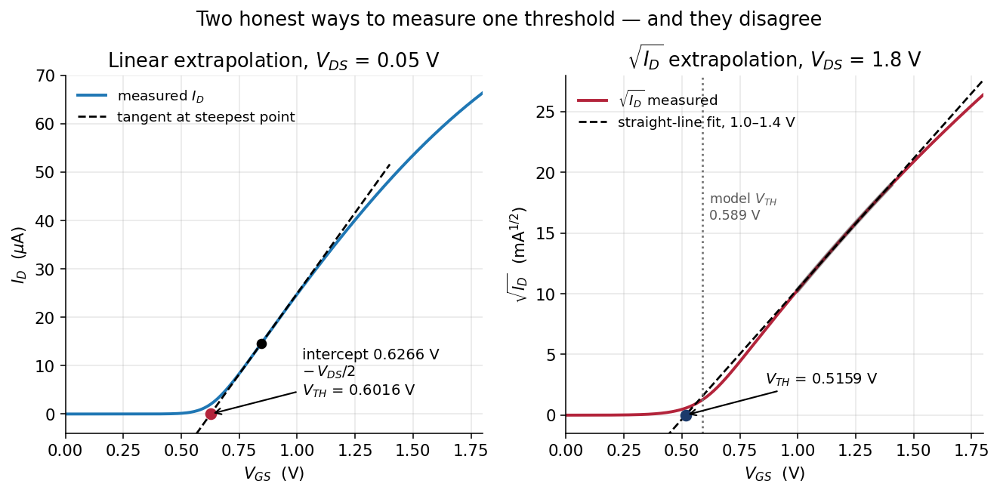
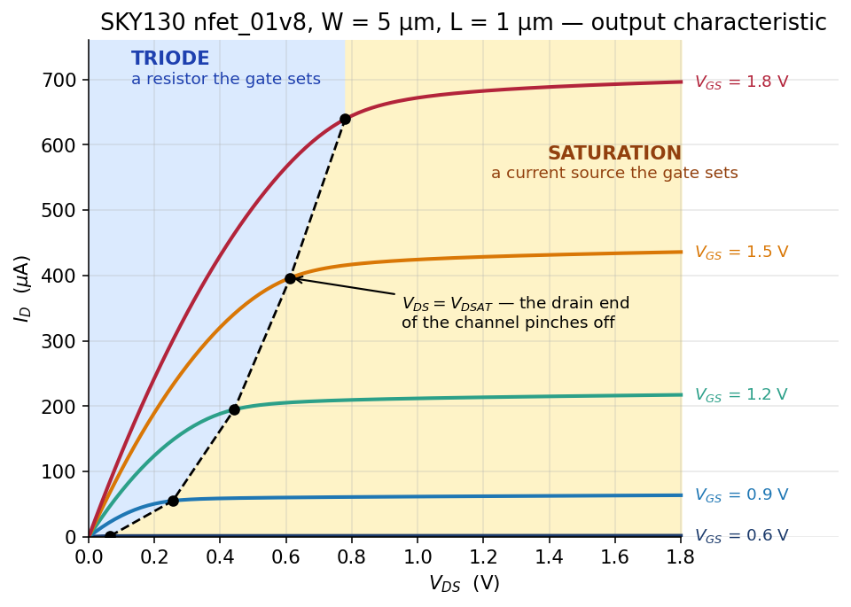
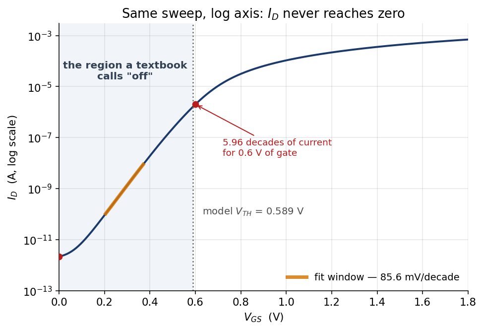
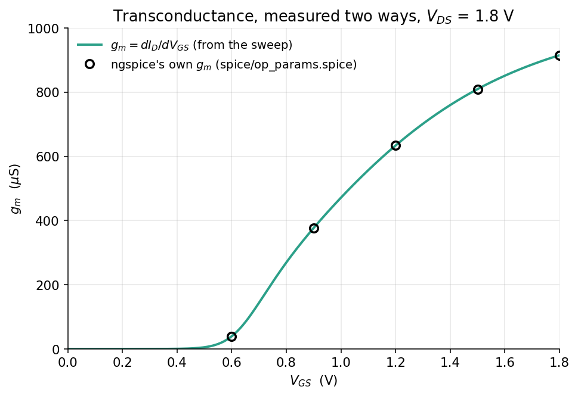
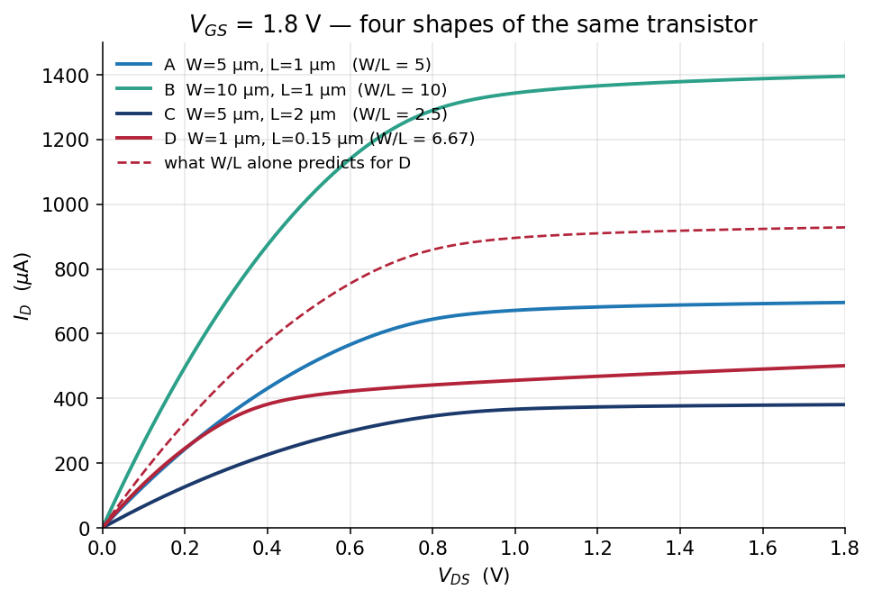
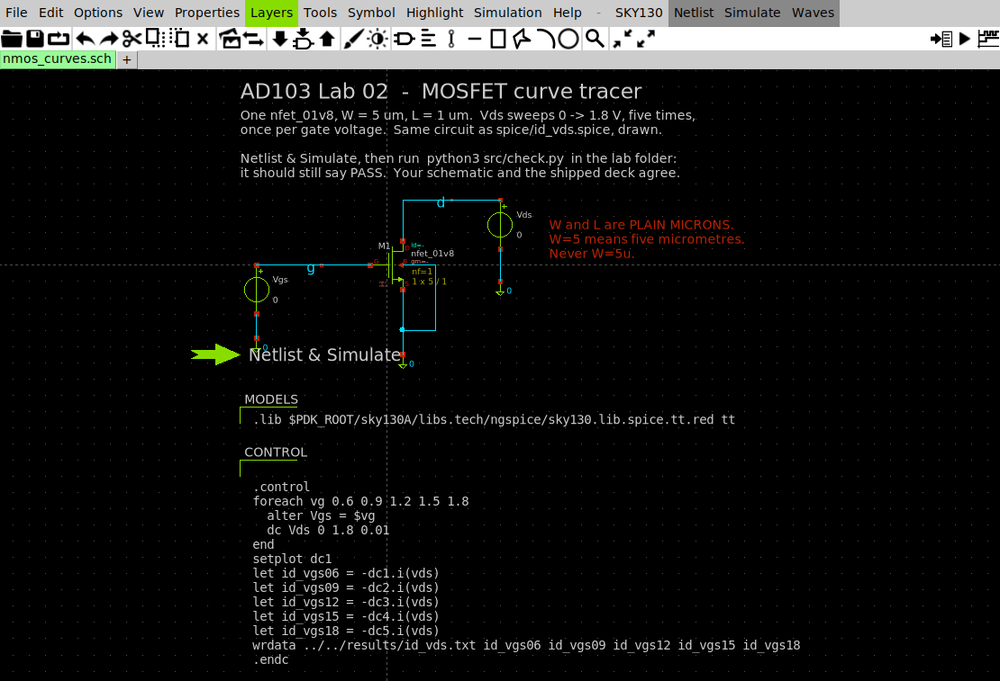

# Lab 03 — MOSFET regions

You'll sweep a real SKY130 `nfet_01v8` and find cutoff, triode, saturation and subthreshold on
your own curves. You'll extract its threshold voltage two ways and see them disagree by 86 mV,
measure $g_m$ as the slope of a curve, and test whether current really scales with $W/L$.

Package: [`labs/lab-03-mosfet-regions/`](https://github.com/uoftasic/ad103/tree/main/labs/lab-03-mosfet-regions)

## Before you start

- Finish [Lab 02](labs/lab-02-diode-iv-overview.md).
- Read [How a MOSFET works](guide/a-mosfet-is-a-valve.md),
  [The four regions](guide/four-regions-not-three.md) and
  [Where saturation starts](guide/where-saturation-starts.md).
- Open a terminal in the workbench and go to the lab folder:

  ```bash
  cd /foss/designs/modules/ad103/labs/lab-03-mosfet-regions
  ```

  The `Makefile` sets `PDK=sky130A` itself, so no other setup is needed. For the optional XSchem
  part at the end, load the environment first (`. /foss/designs/common/.designinit`).

**Time:** about 2 hours. `make` takes about 50 seconds; the other targets take a few seconds each
once `make` has run, or about ten seconds when they run a deck of their own.

The equations from the guide pages, for reference:

$$
I_D^{\text{tri}} = \mu_n C_{ox}\frac{W}{L}\Big[(V_{GS}-V_{TH})V_{DS} - \tfrac{1}{2}V_{DS}^2\Big]
\qquad
I_D^{\text{sat}} = \tfrac{1}{2}\mu_n C_{ox}\frac{W}{L}(V_{GS}-V_{TH})^2
$$

with the boundary at $V_{DS} = V_{ov} = V_{GS} - V_{TH}$. The two slopes are

$$
g_m = \frac{\partial I_D}{\partial V_{GS}}
\qquad
r_o = \left(\frac{\partial I_D}{\partial V_{DS}}\right)^{-1}
$$

and below threshold, where the square law doesn't apply, the subthreshold slope
$S = \partial V_{GS} / \partial (\log_{10} I_D)$, in mV/decade, describes the exponential.

## Part 1: Run the sweeps

1. Run the four sweeps and the operating-point dump, and check the results:

   ```bash
   make
   ```

   ```
   == sweeping spice/id_vds.spice
      wrote results/id_vds.txt
   == sweeping spice/id_vgs.spice
      wrote results/id_vgs.txt
   == sweeping spice/id_vgs_log.spice
      wrote results/id_vgs_log.txt
   == sweeping spice/wl_sweep.spice
      wrote results/wl_sweep.txt
   == operating point   spice/op_params.spice
      wrote results/op_params.log
   == checking
     YOUR NUMBERS
     ok  I_D  from id_vds.txt, V_GS=1.8 V     696.2755 uA      (reference 696.2750)
     ok  I_D  W=5 L=1, V_GS=V_DS=1.8 V        696.2755 uA      (reference 696.2750)
     ok  I_D  W=10 L=1, same bias            1395.3199 uA      (reference 1395.3200)
     ok  I_D  W=5 L=2, same bias              380.7284 uA      (reference 380.7280)
     ok  I_D  W=1 L=0.15, same bias           501.0462 uA      (reference 501.0460)
     ok  V_TH by linear extrapolation           0.6016 V       (reference 0.6016)
     ok  V_TH by sqrt(I_D) extrapolation        0.5159 V       (reference 0.5159)
     ok  g_m at V_GS = 1.8 V                  914.6500 uS      (reference 914.6500)
     ok  subthreshold slope                    85.5629 mV/dec  (reference 85.6000)

   PASS  all nine extracted parameters match the reference run
   ```

   If any line says `XX`, `check.py` tells you which one and lists the four things that most often
   cause it, most frequent first.

2. Draw the plots into `results/`:

   ```bash
   make figures
   ```

   It writes six PNGs and the channel cross-section figure. Open them as you go through the parts
   below.

3. Print every extracted parameter with its working. You'll read this output block by block in
   Parts 2 to 6:

   ```bash
   make extract
   ```

**You should see** `PASS  all nine extracted parameters match the reference run`, and seven PNG
files in `results/`.

## Part 2: Extract the threshold two ways

1. Open `results/ad103-vth-extraction.png`:

   

2. Find the two `V_TH` blocks in the `make extract` output: linear extrapolation at
   $V_{DS}$ = 0.05 V, and $\sqrt{I_D}$ extrapolation at $V_{DS}$ = 1.8 V.

3. Find the model's own threshold for the same device in the operating-point log:

   ```bash
   grep -i 'xma.*\[vth\]' results/op_params.log
   ```

   Compare all three with the `your number vs the model's own number` block near the end of the
   `make extract` output.

**You should see** **0.6016 V** by linear extrapolation, **0.5159 V** by $\sqrt{I_D}$
extrapolation and **0.5895 V** from the model: three answers for one device, 86 mV apart.
[Where saturation starts](guide/where-saturation-starts.md#two-methods-86-mv-apart) explains why.
Use 0.6016 V as $V_{TH}$ for the rest of this lab.

## Part 3: The output characteristic

1. Open `results/ad103-id-vds-family.png`:

   

2. Read the first block of `make extract`, `I_D vs V_DS`. Look at the `channel R at V_DS=10 mV`
   column first: the channel's resistance at each gate voltage.

3. Compare the `knee V_DS` column with $V_{GS} - V_{TH}$, using your $V_{TH}$ of 0.6016 V. Then
   find the `knee of each curve vs the model's vdsat` table at the end of the output.

4. Find the lowest current in the `below threshold` block: $V_{GS}$ = 0 V, with 1.8 V on the
   drain.

**You should see** the channel resistance fall from **26.6 kΩ** to **737 Ω** as $V_{GS}$ goes from
0.6 V to 1.8 V. At $V_{GS}$ = 0.9 V the knee lands at **0.29 V** against a predicted 0.298 V, a
hit; at 1.8 V it lands at **0.89 V** against a predicted 1.198 V, 34 % low. The model's `vdsat` is
below $V_{GS} - V_{TH}$ at every gate voltage. With the gate at 0 V the device still passes
**2.1853 pA**.

## Part 4: Subthreshold conduction

1. Write down what you predicted for $I_D$ at $V_{GS}$ = 0.30 V when you read
   [The four regions](guide/four-regions-not-three.md).
   If you skipped the prediction, make one now.

2. Read the `below threshold` block of `make extract`, and open
   `results/ad103-subthreshold.png`:

   

3. Multiply the $V_{GS}$ = 0 V current by ten million transistors. Then do the same with the
   $V_{GS}$ = 0.30 V current, which is what a device with a threshold 0.3 V lower would carry with
   its gate at ground.

**You should see** **1.3645 nA** at $V_{GS}$ = 0.30 V: not zero, and part of a straight line
**5.96 decades** tall with a slope of **85.6 mV/decade**. Ten million transistors at 2.1853 pA each
is 21.9 µA of leakage; the same ten million with a threshold 0.3 V lower is **13.6 mA**. That
factor of 624 is why threshold control is a discipline of its own.

## Part 5: Measure $g_m$ two ways

1. Open `results/ad103-gm.png`:

   

   The green curve is `numpy.gradient` applied to your sweep. The circles are the $g_m$ that
   ngspice's model reports at five bias points. They are computed by completely different means.

2. Read the `g_m = dI_D/dV_GS` block of `make extract`, and the `g_m` line in the
   `your number vs the model's own number` block.

**You should see** **914.650 µS** from the slope of your sweep against **915.312 µS** from the
model at $V_{GS}$ = 1.8 V, **0.07 %** apart. In the `g_m/I_D` column, 5.90 /V at $V_{GS}$ = 0.9 V
falls to 1.31 /V at 1.8 V. $g_m/I_D$ is transconductance per unit of current burned, a measure of
efficiency: highest near threshold and worst wide open, the opposite of where a beginner tends to
bias an amplifier. [Transconductance and output resistance](guide/gm-and-ro.md), which you read
before Lab 04, picks this up.

## Part 6: Four shapes at one bias

The `W/L is a knob` block puts four devices at $V_{GS} = V_{DS}$ = 1.8 V:

| | $W$ | $L$ | $W/L$ |
|---|---|---|---|
| A | 5 µm | 1 µm | 5 |
| B | 10 µm | 1 µm | 10 |
| C | 5 µm | 2 µm | 2.5 |
| D | 1 µm | 0.15 µm | 6.67 |

1. Before you look, use $W/L$ alone to predict the currents of B, C and D relative to A, which
   carries 696.275 µA. Write the three numbers down.

2. Read the `W/L is a knob` block of `make extract`, and open `results/ad103-wl-sweep.png`:

   

3. For each device, work out how far the measurement is from your prediction, in percent.

**You should see** width behave honestly (B is within **0.20 %** of 2×), doubling $L$ give 9.4 %
more current than $1/L$ predicts, and the minimum-length device D deliver **501.046 µA** against a
predicted 928.367 µA, only **54 %**. [Sizing with W and L](guide/w-and-l-are-a-choice.md), which
you read before Lab 04, closes that 54 % gap in two steps.

## Part 7: The units trap, on purpose

1. Run the deck with units on `W` and `L`:

   ```bash
   make wrong-units
   ```

   ```
   Error on line 56 or its substitute:
     m.xm1.msky130_fd_pr__nfet_01v8 d g 0 0 xm1:sky130_fd_pr__nfet_01v8__model l=    1.000000000000000e-06     w=    5.000000000000000e-06 ...
   could not find a valid modelname
       Simulation interrupted due to error!

   Error: incomplete or empty netlist
          or no ".plot", ".print", or ".fourier" lines in batch mode;
   no simulations run!
   ```

2. Find what changed:

   ```bash
   diff spice/id_vds.spice spice/id_vds_wrong_units.spice
   ```

**You should see** two characters of difference: `L=1u W=5u` instead of `L=1 W=5`. SKY130's models
are binned in microns, so a width with a `u` on it matches no bin, and ngspice stops with a message
that names neither `W` nor units. Reading an error is easiest to practise when you caused it on
purpose.

## Part 8 (optional): Draw it in XSchem



*`xschem/nmos_curves.sch`: the same circuit as `spice/id_vds.spice`, drawn. The `.lib` line and the
`.control` block ride along in two `code_shown` symbols, which is how a testbench keeps its
simulation commands next to its circuit.*

1. Make sure `make` has run at least once, so that `results/` exists for the schematic to write
   into.

2. Open the schematic:

   ```bash
   cd xschem
   PDK=sky130A xschem nmos_curves.sch &
   ```

3. Find the green **Netlist & Simulate** launcher arrow on the canvas. It isn't a toolbar button,
   and a plain left-click on it only selects it: no netlist, no simulation, no message. **Click the
   arrow once to select it, then press `Ctrl-H`** to fire it. (Ctrl-click on the arrow also works,
   but it misses if your hand drifts between press and release. The
   [XSchem cheat sheet](reference/xschem-cheatsheet.md#netlist-and-simulate) has the same note.)

4. Back in the lab folder, rerun the checker on the data the schematic wrote:

   ```bash
   cd ..
   python3 src/check.py
   ```

**You should see** `PASS` again, because the schematic writes the same `results/id_vds.txt`. The
drawn device carries **696.226 µA** rather than 696.275 µA, because the XSchem symbol adds the
diffusion resistances `nrd` and `nrs` that the hand-written deck leaves out. That 50 nA is layout
showing up in an electrical answer.

## Finishing

You're done when `make` prints `PASS  all nine extracted parameters match the reference run` and
you can answer:

- What are the three threshold values for this device, and why do they differ?
- At $V_{GS}$ = 1.8 V, where does the curve knee, and why is it below $V_{GS} - V_{TH}$?
- Which of B, C and D in Part 6 matched the $W/L$ prediction, and which missed?

There is nothing to submit.

## Extensions

The decks work, which makes them a starting point. Three changes worth making, in rising order of
interest. Reference answers are in
[`labs/lab-03-mosfet-regions/solutions/`](https://github.com/uoftasic/ad103/tree/main/labs/lab-03-mosfet-regions/solutions);
try them before you open it.

1. **Add a sixth gate voltage.** Add a $V_{GS}$ = 1.05 V curve to `spice/id_vds.spice`. It takes
   four edits and tests whether you understood how the five columns get written. Nothing in
   `src/` assumes five curves: `extract.py` reads the gate list back out of the deck, so a correct
   edit adds a sixth row to the first table, **131.053 µA at $V_{GS}$ = 1.05 V**, in its proper
   place, and `make` still says `PASS`.
2. **Repeat it for a PMOS.** Do the same measurements for `pfet_01v8` and find out how much of this
   lab is about *n*-channel devices specifically.
3. **Lengthen the short device.** Set device D in `spice/wl_sweep.spice` to `L=0.5`, rerun
   `make extract`, and watch `vth`, `vdsat` and $I_D$ move together. Check whether the two-step
   arithmetic in [Sizing with W and L](guide/w-and-l-are-a-choice.md) still closes.

Next on the [Course path](README.md#course-path): read
[What moves the threshold](guide/threshold-is-not-a-constant.md).
