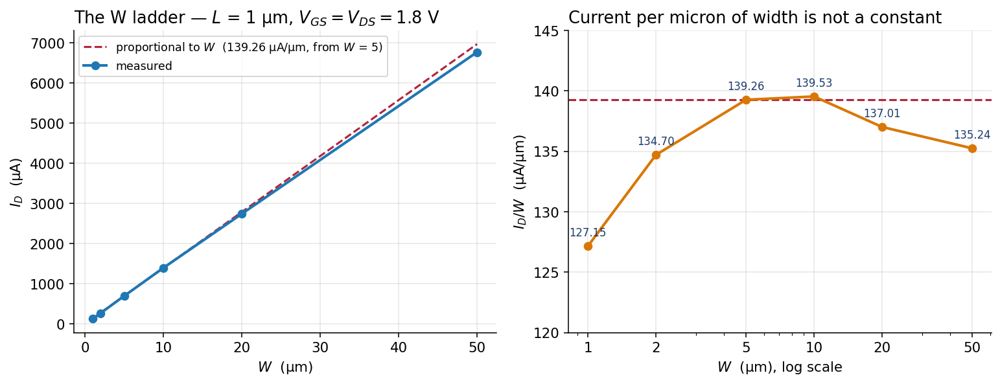
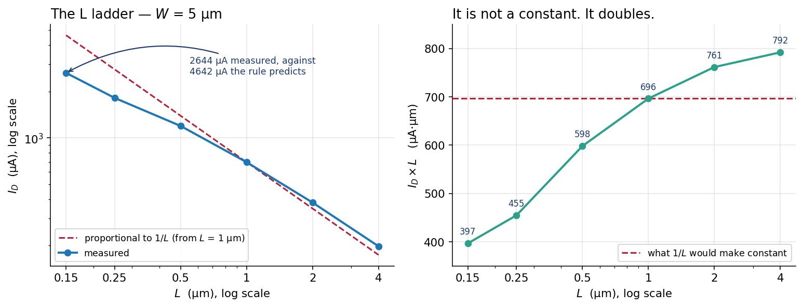
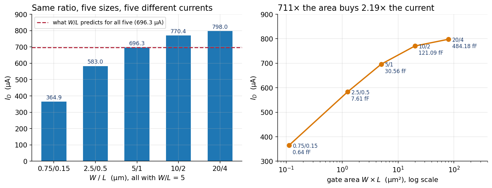

# Lab 04: Testing the W/L rule

The square law says that only the ratio $W/L$ matters:

$$
I_D^{\text{sat}} = \tfrac12\,\mu_n C_{ox}\frac{W}{L}\,(V_{GS}-V_{TH})^2
$$

You'll test that claim on seventeen transistors at one bias point, after first writing down your
own predictions for six of them. The rule gets two of those six right to within 3 % and misses
the other four by up to 91 %, and the signs of those errors follow a pattern you can read straight
off the scoring table. Five of the devices have a $W/L$ of exactly 5, and they carry five
different currents. Between writing the predictions and scoring them, you'll use the Lab 03
package to watch the threshold move and to measure how much gain one transistor can give.

Package: [`labs/lab-04-wl-knob/`](https://github.com/uoftasic/ad103/tree/main/labs/lab-04-wl-knob),
plus three targets in [`labs/lab-03-mosfet-regions/`](https://github.com/uoftasic/ad103/tree/main/labs/lab-03-mosfet-regions)

## Before you start

- Finish [Lab 03](../labs/lab-03-mosfet-regions-overview.md). This lab uses its reference device,
  $W$ = 5 µm, $L$ = 1 µm at **696.2755 µA**, as the anchor for every prediction.
- Read [What moves the threshold](../guide/threshold-is-not-a-constant.md),
  [Transconductance and output resistance](../guide/gm-and-ro.md) and
  [Sizing with W and L](../guide/w-and-l-are-a-choice.md).
- Open a terminal in the workbench. Both `Makefile`s set `PDK=sky130A` themselves, so no other
  setup is needed.

**Time:** about 2 hours. `make` in this lab takes about 40 seconds; each Lab 03 target in Parts 2
and 3 takes about ten. Those wall times depend on your machine, but every other number on this
page is fixed, and the checker enforces it.

## Part 1: Write your predictions

What does the $W/L$ rule predict for six devices? Do this before you run anything. It takes
ninety seconds, and it's the only part of the lab you can't redo afterwards, because once you've
seen the measured currents you can't predict them honestly any more.

1. Go to the lab folder, then open `predictions.txt` in a text editor:

   ```bash
   cd /foss/designs/modules/ad103/labs/lab-04-wl-knob
   ```

2. Read the header. Your one measured anchor is the Lab 03 device: W = 5 µm, L = 1 µm,
   $V_{GS} = V_{DS}$ = 1.8 V, $I_D$ = 696.2755 µA.

3. For each of the six devices, write the current the $W/L$ rule predicts, in microamps, to one
   decimal place, after the `=`. Write only the number, because `make predict` doesn't read a
   line that ends in `uA`. Don't run anything first, and don't go back and change a prediction
   once you've seen the answer.

   ```
   P1  W=10   L=1      =
   P2  W=50   L=1      =
   P3  W=5    L=2      =
   P4  W=5    L=0.15   =
   P5  W=0.75 L=0.15   =
   P6  W=20   L=4      =
   ```

4. Save the file.

**You should see** six numbers in `predictions.txt`. Leave the file alone until Part 4, where
you score them.

## Part 2: Move the threshold

How far do body bias, temperature and channel length move $V_{TH}$? The two decks that answer
this are in the Lab 03 package.

1. Go to the Lab 03 folder and lift the source above the bulk:

   ```bash
   cd ../lab-03-mosfet-regions
   make vth-body
   ```

   ```
   == spice/vth_body.spice
   --- vth and I_D vs V_SB, W = 5 um, L = 1 um, V_GS = 1.8 V, V_DS = 0.05 V ---
   V_SB = 0 V
   @m.xm1.msky130_fd_pr__nfet_01v8[vth] = 5.894596e-01
   i(vds) = -6.63374e-05
   ...
   V_SB = 1.2 V
   @m.xm1.msky130_fd_pr__nfet_01v8[vth] = 8.222507e-01
   i(vds) = -5.15967e-05
   --- and the same device, V_SB = 0, at three temperatures ---
   T = -40 C
   @m.xm1.msky130_fd_pr__nfet_01v8[vth] = 6.499250e-01
   i(vds) = -9.38168e-05
   ...
   T = 125 C
   @m.xm1.msky130_fd_pr__nfet_01v8[vth] = 5.010177e-01
   i(vds) = -4.50650e-05
   ```

   The rows marked `...` here, the 27 °C row among them, are printed in full in your terminal,
   and they're also tabulated on [What moves the threshold](../guide/threshold-is-not-a-constant.md#body-effect).

2. Work out the threshold shift at each $V_{SB}$, relative to $V_{SB}$ = 0, and the drop in drain
   current at $V_{SB}$ = 1.2 V. Check one row against the body-effect formula with
   $\gamma$ = 0.4108 √V and $2\phi_F$ = 0.600 V.

3. From the temperature block, work out the threshold's slope in mV/°C, and the change in current
   from 27 °C to 125 °C. Predict the sign of the current change before you calculate it.

4. Measure the threshold at nine channel lengths:

   ```bash
   make vth-l
   ```

   ```
   == spice/vth_vs_l.spice
      L        model vth
      0.15 um    7.078517e-01 V
      0.2 um     6.872240e-01 V
      0.3 um     6.553824e-01 V
      0.5 um     6.300670e-01 V
      0.8 um     6.003750e-01 V
      1 um       5.894596e-01 V
      1.5 um     5.627056e-01 V
      2 um       5.495175e-01 V
      4 um       5.364102e-01 V
   ```

**You should see** a threshold shift of **+232.791 mV** at $V_{SB}$ = 1.2 V, with **22.2 %** less
current, and the body-effect formula should agree with the measurement to within a fraction of a
millivolt. The threshold's temperature slope is about **−0.9 mV/°C**, and the hot device carries
**32.1 % less** current than the one at 27 °C. As the length shrinks from 4 µm to 0.15 µm, the
threshold *rises* by **171.44 mV**. [What moves the threshold](../guide/threshold-is-not-a-constant.md)
explains each of these.

## Part 3: Efficiency and intrinsic gain

How much voltage gain can one transistor give, and how does that depend on $L$?

1. Predict: as $L$ goes from 0.15 µm to 4 µm, does $g_m r_o$ rise or fall? Write it down.

2. Still in the Lab 03 folder, measure $g_m$ and $g_{ds}$ at four lengths and six gate voltages:

   ```bash
   make gm-ro
   ```

   The first block covers four lengths at $V_{GS} = V_{DS}$ = 1.8 V, and the first of them reads:

   ```
   --- W = 5 um, V_GS = V_DS = 1.8 V, four channel lengths ---
   L = 0.15 um
   i(vda) = -2.64419e-03
   @m.xma.msky130_fd_pr__nfet_01v8[gm] = 2.468806e-03
   @m.xma.msky130_fd_pr__nfet_01v8[gds] = 2.787163e-04
   ```

   The second block steps the gate of the L = 1 µm device from 0.7 V to 1.8 V.

3. For each length, compute $r_o = 1/g_{ds}$ and the intrinsic gain $g_m r_o = g_m/g_{ds}$.

4. In the second block, compute $g_m/I_D$ at $V_{GS}$ = 0.7 V and at 1.8 V. Compare both with the
   ceiling of 26.9 /V from [Transconductance and output resistance](../guide/gm-and-ro.md).

**You should see** an intrinsic gain of **8.86** at L = 0.15 µm rising to **106.11** at L = 4 µm,
even though $g_m$ falls by a factor of nine over the same range. In the second block, $g_m/I_D$
is **13.50 /V** at $V_{GS}$ = 0.7 V, about half the ceiling, against only 1.31 /V with the gate
wide open.

## Part 4: Run the lab and score your predictions

Which of your six predictions land, and is there a pattern in the misses?

1. Go back to the Lab 04 folder and run the four decks:

   ```bash
   cd ../lab-04-wl-knob
   make
   ```

   ```
   == spice/w_ladder.spice
      wrote results/w_ladder.log
   == spice/l_ladder.spice
      wrote results/l_ladder.log
   == spice/same_ratio.spice
      wrote results/same_ratio.log
   == spice/double_w.spice
      wrote results/double_w.log
   == checking
     YOUR NUMBERS
     ok  I_D  W=1  L=1                  127.1470 uA  (reference 127.1470)
     ok  I_D  W=5  L=1                  696.2755 uA  (reference 696.2755)
     ok  I_D  W=10 L=1                 1395.3200 uA  (reference 1395.3200)
     ok  I_D  W=50 L=1                 6762.1370 uA  (reference 6762.1370)
     ok  I_D  W=5  L=0.15              2644.1910 uA  (reference 2644.1910)
     ok  I_D  W=5  L=4                  197.9738 uA  (reference 197.9738)
     ok  I_D  W=0.75 L=0.15             364.9284 uA  (reference 364.9284)
     ok  I_D  W=20 L=4                  798.0193 uA  (reference 798.0193)
     ok  two W=5 in parallel           1392.5510 uA  (reference 1392.5510)
     ok  vth(W=10) - vth(W=5)           -12.8354 mV  (reference -12.8354)

     2 x I_D(W=5)           =    1392.5510 uA
     two W=5 in parallel    =    1392.5510 uA   (difference +0.000000 uA)

   PASS  all ten measured values match the reference run
   ```

   Every run also leaves a three-line `bsim4v5.out` in the lab folder. It's harmless, and
   [Eta0 is negative](../reference/ngspice-errors.md#eta0-is-negative) on the ngspice survival card has
   the details.

2. Score your predictions:

   ```bash
   make predict
   ```

   ```
     device            W/L    the W/L rule       measured       rule err   your guess    your err
     ------------------------------------------------------------------------------------------------
     W=10   L=1      10.00    1392.551 uA   1395.3200 uA     -0.2 %           --         --
     W=50   L=1      50.00    6962.755 uA   6762.1370 uA     +3.0 %           --         --
     W=5    L=2       2.50     348.138 uA    380.7284 uA     -8.6 %           --         --
     W=5    L=0.15   33.33    4641.837 uA   2644.1910 uA    +75.5 %           --         --
     W=0.75 L=0.15    5.00     696.275 uA    364.9284 uA    +90.8 %           --         --
     W=20   L=4       5.00     696.275 uA    798.0193 uA    -12.7 %           --         --
   ```

   The sample above was made with an empty `predictions.txt`, which is why its last two columns
   are `--`. With your file filled in, your own numbers appear there instead. (If
   `make predict` says `predictions.txt still has 6 blank(s)`, you didn't save the file in
   Part 1.)

3. Cover the last two columns and read only `rule err`, top to bottom.

**You should see** your six predictions in the `your guess` column. In `rule err`, the two rows
where only $W$ changed are within 3 %, and the four where $L$ changed are out by 8 to 91 %. That
error is positive every time $L$ got shorter and negative every time it got longer.

Which half of $W/L$ can you use in a hand calculation, and which half can't you?

<details>
<summary>Answer</summary>

You can use $W$, because changing it on its own kept the rule within 3 %. $L$ is the half you
can't trust: the rule over-predicts the current of every shorter device and under-predicts every
longer one, by 8 to 91 %.

</details>

## Part 5: Width

Is current proportional to $W$, and is "twice as wide" the same as "two of them"?

1. Print every table this lab produces, with its working:

   ```bash
   make extract
   ```

2. Read block 1, the W ladder, and open `results/ad103-w-ladder.png`:

   

   ```
      W (um)      I_D           I_D / W        W x I(W=1)     model vth
      1         127.1470 uA  127.1470 uA/um     +0.00 %     615.2253 mV
      2         269.4032 uA  134.7016 uA/um     -5.61 %     603.4546 mV
      5         696.2755 uA  139.2551 uA/um     -8.69 %     589.4596 mV
      10       1395.3200 uA  139.5320 uA/um     -8.88 %     576.6242 mV
      20       2740.1490 uA  137.0075 uA/um     -7.20 %     564.0813 mV
      50       6762.1370 uA  135.2427 uA/um     -5.99 %     556.5815 mV
   ```

   On the left plot, the measurement and the proportional-to-$W$ line lie almost on top of each
   other, so the difference is hard to see there. Look at the right plot instead, which shows the
   same data divided by $W$.

3. Read block 2, six ways of asking for "twice as wide":

   ```
      A   W=5            696.2755 uA   1.0000 x A   the reference
      B   W=10          1395.3200 uA   2.0040 x A   drawn twice as wide
      C   W=5 + W=5     1392.5510 uA   2.0000 x A   two of A, wired in parallel
      D   W=5 m=2       1392.5510 uA   2.0000 x A   ngspice's own multiplier
      E   W=5 mult=2     696.2755 uA   1.0000 x A   the subckt's 'multiplier'
      F   W=10 nf=2     1458.1360 uA   2.0942 x A   folded into two fingers

      A doubled by hand    1392.5510 uA
   ```

   Compare C and D with the last line, digit by digit.

**You should see** current per micron of width climb 9.7 % from $W$ = 1 to $W$ = 10 and then fall
3.1 % by $W$ = 50, while the model's `vth` falls at every step of the ladder, by 58.6438 mV in all.
In block 2, C and D both match the hand-doubled **1392.5510** to every digit, so two 5 µm
transistors in parallel carry exactly twice the current of one, and so does `m=2`.

Over this hundredfold range of width, is "current is proportional to $W$" good enough to use? And
can the falling `vth` explain both the rise and the fall in current per micron?

<details>
<summary>Answer</summary>

Yes, you can use it, because it's wrong by less than 10 % over the whole ladder. The direction of
the `vth` trend makes sense (a wider device has a lower threshold, so it turns on harder), but a
cause that only ever moves one way can't on its own produce a rise and then a fall. Something else
must push the other way beyond $W$ = 10 µm, and this course doesn't claim to know what it is.

</details>

Now work out what each of the other rows in block 2 says.

- B is 2.0040× A rather than 2.0000×. Why isn't one 10 µm device the same as two 5 µm ones?

  <details>
  <summary>Answer</summary>

  One 10 µm device carries 2.7690 µA (+0.199 %) more than two 5 µm ones. The model reports `vth` =
  589.4596 mV for the 5 µm device and 576.6242 mV for the 10 µm one, 12.8354 mV apart even though
  the bias and length are identical. So width enters the model itself rather than only multiplying
  its result, and that makes "twice as wide" and "two of them" different circuits.

  </details>

- E says `mult=2` and carries exactly what A does. Why?

  <details>
  <summary>Answer</summary>

  The SKY130 subcircuit declares a parameter called `mult` and never uses it. You can see this in
  `/foss/pdks/sky130A/libs.ref/sky130_fd_pr/spice/sky130_fd_pr__nfet_01v8__tt.pm3.spice`, where the
  `.subckt`'s `.param` line lists `mult = 1` and the device line inside carries no `m = {mult}`.
  So if you write `mult=2` in a deck by hand, it's accepted and ignored, and nothing tells you so;
  `m=2` is the parameter that works. XSchem's symbol writes `m=` for you whenever `mult` isn't 1.
  If you set `mult=2` in the property editor, the device line comes out `... sd=0 mult=2 m=2`,
  and the current doubles. (At `mult=1` the line ends `... sd=0 mult=1` with no `m=`, because
  there is nothing to multiply.) That's why drawing the schematic gets this right, and copying a
  device line by hand doesn't.

  </details>

- F has the same $W$, $L$ and bias as B, and 4.50 % more current. What is different?

  <details>
  <summary>Answer</summary>

  `nf=2` folds one 10 µm channel into two 5 µm fingers that share a drain diffusion. Nothing in
  $W/L$ describes that, because it's a fact about the layout, and you'll draw it in
  [AD104](https://uoftasic.com/ad104/).

  </details>

> **Don't push `nf` higher to see how far the effect goes.** `W=10 nf=5` aborts the entire run
> with `Fatal: Drout = -1.76308 is negative` and
> `doAnalyses: no such parameter on this device or parameter is missing`. That is a BSIM parameter
> check failing inside one of the model bins, not a mistake you made, and two fingers are enough
> to show the effect.

## Part 6: Length

How badly does $1/L$ fail, and why?

1. Read block 3 of `make extract`, the L ladder, and open `results/ad103-l-ladder.png`:

   

   ```
      L (um)      I_D         I_D x L      vs 1/L from L=1   vth      vdsat
      0.15     2644.1910 uA   396.6287        +75.55 %     707.44   351.92 mV
      0.25     1818.6050 uA   454.6513        +53.14 %     658.63   426.29 mV
      0.5      1196.0170 uA   598.0085        +16.43 %     626.23   628.45 mV
      1         696.2755 uA   696.2755         +0.00 %     589.46   779.46 mV
      2         380.7284 uA   761.4568         -8.56 %     549.52   912.45 mV
      4         197.9738 uA   791.8952        -12.07 %     536.41  1001.27 mV
   ```

2. The $I_D \times L$ column is the one that tests the rule: if current really went as $1/L$,
   that column would show the same number in all six rows.

3. Compare `vdsat` with the overdrive $V_{GS} - V_{TH}$ for the shortest and longest devices
   (1092.6 mV and 1263.6 mV).

4. Read the end of the block, which closes the gap at L = 0.15 µm one effect at a time:

   ```
      Closing the L = 0.15 um gap, one effect at a time:
        1/L alone                                   4641.837 uA
        1/L, with each device's own vth and (V_ov)^2  3781.114 uA
        measured                                    2644.191 uA
      The threshold step closes 43.1 % of the gap.
   ```

**You should see** $I_D \times L$ run from **396.63 to 791.90**, so it doubles across the ladder,
and `vdsat` run from 351.92 mV to 1001.27 mV. Correcting for each device's threshold closes
**less than half** of the gap at 0.15 µm.

The 0.15 µm device stopped responding to its drain at a third of the overdrive the square law
assumed. What does that tell you, and why can't more arithmetic on `vth` close the rest of the gap?

<details>
<summary>Answer</summary>

It tells you the device is velocity saturated, and that's why $1/L$ over-promises on every short
device. No further arithmetic on `vth` can close the rest of the gap, because the square law has
no term for a carrier speed limit. At this point hand calculation runs out, and you need the
simulator.

</details>

## Part 7: Five devices with $W/L$ = 5

Five devices share a $W/L$ of 5 but differ in area. What does the extra area buy?

1. Read block 4 of `make extract`, and open `results/ad103-same-ratio.png`:

   

   ```
      W / L        I_D          gate area      cgg        I_D per um^2
       0.75 / 0.15    364.9284 uA    0.1125 um^2     0.6427 fF    3243.81 uA/um^2
        2.5 / 0.5     582.9524 uA    1.2500 um^2     7.6137 fF     466.36 uA/um^2
          5 / 1       696.2755 uA    5.0000 um^2    30.5632 fF     139.26 uA/um^2
         10 / 2       770.4110 uA   20.0000 um^2   121.0871 fF      38.52 uA/um^2
         20 / 4       798.0193 uA   80.0000 um^2   484.1798 fF       9.98 uA/um^2
   ```

2. Check the ratio in the first column: 0.75/0.15 = 5, 20/4 = 5, and so is every row in between.

3. Work out what the largest device buys over the smallest: the ratio of currents, of gate areas
   and of gate capacitances.

4. Read the two `gds` lines at the end of the block:

   ```
        gds(0.75/0.15) =   38.855 uS  ->  r_o =   25.74 kohm
        gds(20/4)      =    7.435 uS  ->  r_o =  134.50 kohm
   ```

**You should see** currents from **364.9284 µA to 798.0193 µA, a factor of 2.1868**, for
identical $W/L$ at identical bias. The biggest device gets 2.19× the current of the smallest for
**711× the gate area** and **753× the gate capacitance**, so per square micron of gate the small
one is **325× more efficient**. The biggest device's output resistance is **5.23×** the small
one's.

What does the biggest device buy for its 711× area?

<details>
<summary>Answer</summary>

It doesn't buy much current: 2.19× for 711× the area. Area costs money, and gate capacitance
costs time, because whatever drives the gate has to charge it. What the area does buy is 5.23×
the output resistance. An amplifier's gain is $g_m r_o$, so that factor is the whole reason an analog designer pays for a long channel, and the
reason a digital designer doesn't.

</details>

## Part 8: Read a FAIL you caused

What does the checker tell you when one number is 3 % off?

1. Hand the checker a run that is 3 % wrong:

   ```bash
   make broken
   ```

   It copies your W ladder, moves the $W$ = 10 µm current by 3 %, and hands the result to the
   checker. A 3 % error is far too small to see by eye, but it's large enough to mean you
   simulated the wrong device.

   ```
     XX  I_D  W=10 L=1                 1437.1800 uA  (reference 1395.3200)
   ...
   FAIL
     - I_D  W=10 L=1: got 1437.1800, reference 1395.3200 (+3.00 %)

     Three things cause this, in order of how often:
      1. A unit suffix on W or L somewhere in spice/. They are plain
         microns. Check with:  grep -n 'W=[0-9.]*[a-z]' spice/*.spice
   ```

2. Run `make` again to get back to `PASS`.

**You should see** one `XX` row among nine `ok` rows. The `FAIL` section names the number and
gives both values and the percentage, then lists three causes in order of how often they happen,
with a `grep` for the first one.

## Finishing

**You're done when** `make predict` shows your six predictions in the `your guess` column, next to
the measurements, with your own errors in `your err` (Part 4).

### Questions

1. Which half of $W/L$ can you trust in a hand calculation, and by roughly how much? (Part 4.)
2. Why does one 10 µm device differ from two 5 µm devices in parallel? (Part 5, row B.)
3. Five devices with $W/L$ = 5: what does the largest one buy for its 711× area? (Part 7.)

### Submit

Nothing to submit.

## Going further

Three extensions, with reference answers in
[`solutions/`](https://github.com/uoftasic/ad103/tree/main/labs/lab-04-wl-knob/solutions). For each
one, predict first, then run it, and only then read the answer.

1. **Widen further.** Add `W=100` to the W ladder, then `W=200`. One of them tells you where the
   model ends, and the error it gives is one you have already met for a completely different
   reason.
2. **Repeat the ladder in PMOS.** Build the same ladder out of `pfet_01v8`. At $L$ = 1 µm the NMOS
   carries **6.685×** the PMOS; the capstone measures the same ratio at $L$ = 0.15 µm and gets
   **2.496**, so the ratio between the two device types isn't a property of the process alone.
3. **Lower the gate.** Re-run the L ladder at $V_{GS}$ = 0.9 V. If velocity saturation is really
   what breaks $1/L$, the short-channel error should shrink at the lower gate voltage, and it
   does, from +75.5 % to +29.5 %. Then look at what happens at the long end.

Next on the [Course path](../index.md#course-path): read
[The CMOS inverter](../guide/the-inverter-is-an-amplifier.md).
