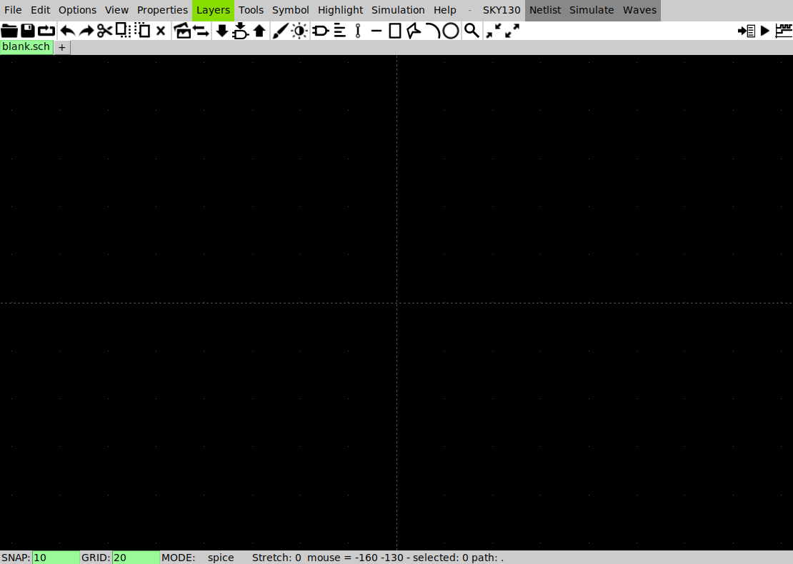
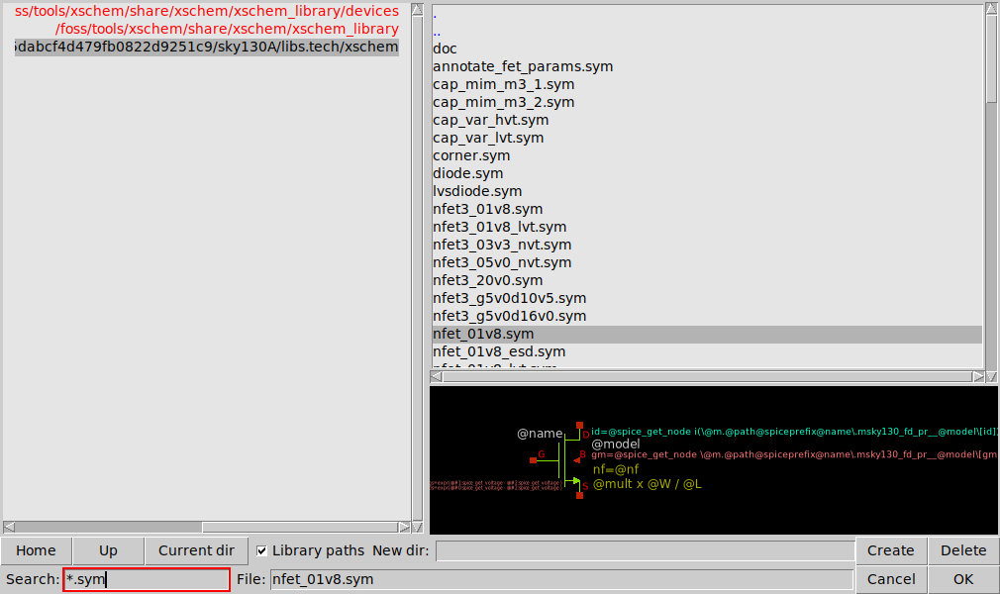
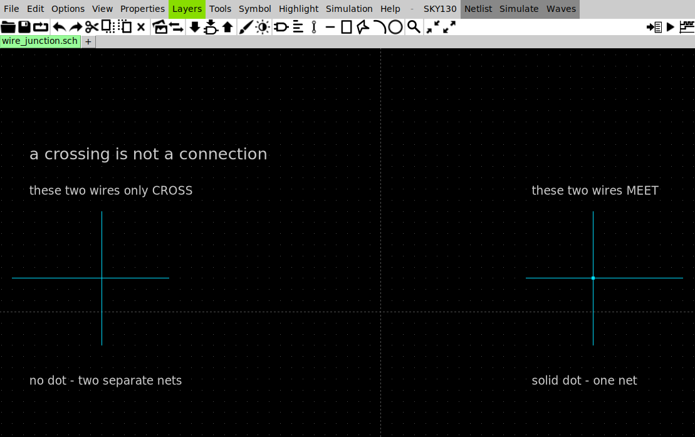
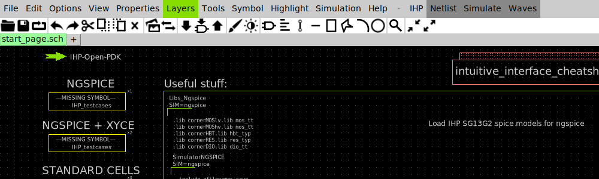

# XSchem cheat sheet

This page collects the XSchem keys you need, sorted by when you'll need them.

XSchem ships 154 key bindings and 16 mouse bindings (`keys.help` in the image lists them), and most
of them are a single keystroke. You'll use only eleven of them for almost all of AD103, so this page
lists those eleven first, then the rest grouped by task, and then the four keys that don't do what
you'd expect.

## Where these keys come from

Every key on this page comes from two files inside the course image, and a key appears here only
if both files agree on it. This command prints the XSchem version and then the first file,
`keys.help`:

```bash
docker run --rm --user "$(id -u):$(id -g)" hpretl/iic-osic-tools:2026.08 --skip \
  bash -c 'xschem --version; cat /foss/tools/xschem/share/xschem/keys.help'
```

```
XSCHEM V3.4.8RC
Copyright (C) 1998-2026 Stefan Schippers
```

- `/foss/tools/xschem/share/xschem/keys.help`: the binding list XSchem itself shows.
- `/foss/tools/xschem/share/xschem/xschem.tcl`: the menu definitions, each carrying an
  `-accelerator` label.

The two files disagree in exactly one place: **Delete files** is `Ctrl-D` in `keys.help` but
`Shift-D` in the menu, so we left that key off this sheet. Inside XSchem, <kbd>?</kbd> opens the
help window and <kbd>/</kbd> shows the whole binding list full-screen.

## The XSchem window



Three parts of that window are worth knowing:

| Where | What it tells you |
|---|---|
| **`SKY130`** in the menu bar | which PDK `xschemrc` loaded. If it says `IHP`, stop and see [Wrong PDK](#wrong-pdk) below. |
| **`Netlist` / `Simulate` / `Waves`** | the three buttons that let you netlist, simulate and look at results without going to a terminal. The menu shows no accelerator label for them, but the keys are `n` and `s`, and for waves you use the `Waves` menu. |
| **status bar** | `SNAP: 10  GRID: 20  MODE: spice`. `MODE: spice` means the netlister will write SPICE rather than Verilog. `SNAP` is the grid your clicks land on, and a wire end that misses that grid point by one step is the most common reason a wire looks connected when it isn't. |

### Windows that open off screen

- **The status bar is hidden.** On the default 1280×800 desktop, XSchem opens its window 764 px
  tall and 29 px down from the top of the screen, which puts the bottom 24 px of it behind the
  Xfce taskbar. Drag the window's bottom edge up a little, or start the desktop bigger
  (`VNC_RESOLUTION=1920x1080 ./scripts/start_vnc.sh`).
- **The symbol chooser (<kbd>Shift</kbd>+<kbd>I</kbd>) opens partly off screen.** XSchem
  positions it relative to the main window, and because that window is nearly as wide as the
  screen, on a 1280-wide desktop the chooser lands mostly off the right edge. The library pane,
  the file list, the Search box and **OK** can all be out of view. Drag it back by the part of the
  title bar you can see (or Alt-drag anywhere in it), and it will stay where you put it for the
  rest of the session. The chooser also remembers the directory you were last in, so click
  **Home** to jump back to the top of the tree.
- The **Edit Properties** window that <kbd>q</kbd> opens behaves the same way.

## The eleven keys you need

| Do this | Key |
|---|---|
| Zoom to fit the whole schematic | <kbd>f</kbd> |
| Place a symbol from the library | <kbd>Shift</kbd>+<kbd>I</kbd> |
| Draw a wire | <kbd>w</kbd> |
| Edit the selected object's properties (`W`, `L`, `value`, `name`) | <kbd>q</kbd> |
| Move the selection | <kbd>m</kbd> |
| Duplicate the selection | <kbd>c</kbd> |
| Rotate the selection | <kbd>Shift</kbd>+<kbd>R</kbd> |
| Get out of whatever mode you are in | <kbd>Escape</kbd> |
| Undo | <kbd>u</kbd> |
| Save | <kbd>Ctrl</kbd>+<kbd>S</kbd>, then **Yes** in the `save file?` box it always raises |
| Write the SPICE netlist | <kbd>n</kbd> |

Those eleven are enough to draw every schematic in AD103. The rest of the page is detail you can
look up when you need it.

## View

| Action | Key |
|---|---|
| Zoom to fit | <kbd>f</kbd> |
| Zoom in / out | <kbd>Shift</kbd>+<kbd>Z</kbd> / <kbd>Ctrl</kbd>+<kbd>Z</kbd>, or the scroll wheel |
| Zoom to a box you drag | <kbd>z</kbd> |
| Pan | hold <kbd>Space</kbd> and drag, or drag with the middle button |
| Redraw / abort / unselect | <kbd>Escape</kbd> |
| Light ↔ dark colour scheme | <kbd>Shift</kbd>+<kbd>O</kbd> |
| Halve / double the snap grid | <kbd>g</kbd> / <kbd>Shift</kbd>+<kbd>G</kbd> |
| Help window | <kbd>?</kbd> |
| Full-screen picture of every binding | <kbd>/</kbd> |

## Place

| Action | Key |
|---|---|
| Insert symbol | <kbd>Shift</kbd>+<kbd>I</kbd>, or <kbd>Insert</kbd>, or **Tools → Insert symbol** |
| Insert symbol, browser stays open | <kbd>Ctrl</kbd>+<kbd>I</kbd> (also <kbd>Shift</kbd>+<kbd>Insert</kbd>) |
| Wire | <kbd>w</kbd> |
| Wire whose **start** snaps to the nearest pin | <kbd>Shift</kbd>+<kbd>W</kbd> |
| Wire whose **far end** snaps too | <kbd>Shift</kbd>+<kbd>W</kbd>, then hold <kbd>Shift</kbd> for the closing click |
| Text label (a comment, not a net name) | <kbd>t</kbd> |
| Line / rectangle / polygon (drawing, not circuitry) | <kbd>l</kbd> / <kbd>r</kbd> / <kbd>p</kbd> |
| Net label (name a wire) | <kbd>Alt</kbd>+<kbd>l</kbd> places `lab_pin.sym` |
| Schematic input port | <kbd>Ctrl</kbd>+<kbd>P</kbd> |
| Schematic output port | <kbd>Ctrl</kbd>+<kbd>Shift</kbd>+<kbd>P</kbd> |

Most laptops have no <kbd>Insert</kbd> key, so use <kbd>Shift</kbd>+<kbd>I</kbd> instead.



*<kbd>Shift</kbd>+<kbd>I</kbd> opens this chooser. Here we have clicked the `sky130A` line on the
left and opened `sky130_fd_pr`, so it shows the PDK's whole symbol library with no filter
applied. The **Search** box takes a glob rather than a substring (`nfet_01v8*.sym`, not `nfet`),
and the pane at the bottom previews whichever file is selected.*

## Select and edit

| Action | Key |
|---|---|
| Select | click; <kbd>Shift</kbd>-click adds to the selection |
| Select by area | drag with the left button |
| Select every connected wire, label and pin | <kbd>Shift</kbd>+right-click |
| Select all | <kbd>Ctrl</kbd>+<kbd>A</kbd> |
| Unselect the object under the pointer | <kbd>d</kbd> |
| Edit properties | <kbd>q</kbd> |
| Edit properties in a text editor | <kbd>Shift</kbd>+<kbd>Q</kbd> |
| Move | <kbd>m</kbd> |
| Move, stretching the wires that are attached | <kbd>Ctrl</kbd>+<kbd>M</kbd> |
| Duplicate | <kbd>c</kbd> |
| Delete | <kbd>Delete</kbd> |
| Rotate 90° | <kbd>Shift</kbd>+<kbd>R</kbd> |
| Flip left–right / top–bottom | <kbd>Shift</kbd>+<kbd>F</kbd> / <kbd>Shift</kbd>+<kbd>V</kbd> |
| Rotate or flip **in place**, each object about its own anchor | <kbd>Alt</kbd>+<kbd>r</kbd> / <kbd>Alt</kbd>+<kbd>f</kbd> / <kbd>Alt</kbd>+<kbd>v</kbd> |
| Undo / redo | <kbd>u</kbd> / <kbd>Shift</kbd>+<kbd>U</kbd> |
| Descend into a symbol's schematic | <kbd>e</kbd> |
| Descend into a symbol's *drawing* | <kbd>i</kbd> |
| Come back up | <kbd>Ctrl</kbd>+<kbd>E</kbd> or <kbd>Backspace</kbd> |
| Find by name or regexp | <kbd>Ctrl</kbd>+<kbd>F</kbd> |
| Tcl console | <kbd>=</kbd> |

## Keys that surprise you

Your hands learned what these four keys do in other editors, but in XSchem each of them does
something else.

| You press | You expect | XSchem does |
|---|---|---|
| <kbd>r</kbd> | rotate | starts drawing a **rectangle** |
| <kbd>x</kbd> | flip in x | **starts a second XSchem process**, with a whole new window |
| <kbd>c</kbd> | copy to clipboard | **duplicates** the selection immediately, attached to the pointer |
| <kbd>p</kbd> | plot this net | starts drawing a **polygon** |

<kbd>x</kbd> is the worst of the four, because the second window looks exactly like your first,
and you can spend a minute editing the wrong copy. We checked this with a scripted run under Xvfb
that starts one XSchem, sends it a single key, and then counts the XSchem processes:

```
### rect    : xschem processes now = 1     (key 'r')
### poly    : xschem processes now = 1     (key 'p')
### copy    : xschem processes now = 1     (keys ctrl+a, 'c')
### newsess : xschem processes now = 2     (key 'x')
```

A single press of <kbd>x</kbd> started one extra process. The other three rows are the control,
and they show that none of those keys starts a second editor.

The rotate you want is <kbd>Shift</kbd>+<kbd>R</kbd>, the flip is <kbd>Shift</kbd>+<kbd>F</kbd>,
the clipboard copy is <kbd>Ctrl</kbd>+<kbd>C</kbd>, and the way to look at a waveform is the
**Waves** menu. If you land in rectangle or polygon mode by accident, <kbd>Escape</kbd> gets
you out and <kbd>u</kbd> removes anything you drew.

## Checking wire connections

How XSchem draws a wire end or a symbol pin tells you how many connections it has:

| What you see | What it means |
|---|---|
| hollow square | connected to nothing |
| nothing drawn | exactly one connection |
| solid dot | two or more connections |



*On the left, two wires cross and XSchem draws nothing at the crossing. On the right, four wire
ends land on one grid point and XSchem draws the dot. The dot is the only difference between the
two pictures.*

**Crossing wires do not connect.** Two wires connect only where one wire's *endpoint* lands on
the other wire or on a pin, and "lands on" means on the same snap grid point, which is why the
`SNAP: 10` in the status bar matters. A wire end that stops one grid step short looks identical
to a connected one at normal zoom, so press <kbd>f</kbd>, zoom in on every junction, and look for
hollow squares.

You can also connect by name: two `lab_pin` symbols carrying the same label are one net,
however far apart they are drawn. AD103's testbenches use this for supplies and gates.

## Netlist and simulate

| Action | How |
|---|---|
| Write the SPICE netlist for this schematic and everything under it | <kbd>n</kbd>, or the **Netlist** button |
| Netlist only this level, no hierarchy | <kbd>Shift</kbd>+<kbd>N</kbd> |
| Run the simulator | <kbd>s</kbd> (it asks `Run circuit simulation?` first), or the **Simulate** button (which runs without asking) |
| Look at results | the **Waves** menu: `Op`, `Dc`, `Ac`, `Tran` |
| Annotate DC operating point onto the schematic | **Waves → Op Annotate** |
| Fire a launcher (one of the green arrows on a testbench) | click it once, then <kbd>Ctrl</kbd>+<kbd>H</kbd> |

XSchem documents launchers as Ctrl-click, and Ctrl-click does work, but it misses if your hand
drifts, because the launcher fires only if the selection is exactly one object *and* the pointer
did not move between press and release. If the pointer drifts by three pixels, nothing happens and
XSchem gives no message. Clicking the arrow to select it and then pressing
<kbd>Ctrl</kbd>+<kbd>H</kbd> doesn't depend on a steady hand, so the labs use that instead.

## Netlisting from a terminal

```bash
export PDK=sky130A
cd labs/lab-01-first-schematic/xschem
xschem -n -q -x nmos_probe.sch
```

The flags are `-n` to write the netlist, `-q` to quit when it's done, and `-x` to run without
graphics, and this is the command every AD103 `Makefile` runs. **The `export` is required**: if
you leave it out, you get [the silent failure described below](#wrong-pdk). The command writes
`simulation/nmos_probe.spice` next to the schematic:

```
** sch_path: /work/xschem/nmos_probe.sch
**.subckt nmos_probe
XM1 d g 0 0 sky130_fd_pr__nfet_01v8 L=0.15 W=1 nf=1 ad=0.29 as=0.29 pd=2.58 ps=2.58 nrd=0.29 nrs=0.29 sa=0 sb=0 sd=0 mult=1
Vgs g 0 1.8
Vds d 0 1.8
**.ends
.end
```

Notice the parameters the symbol added that you never typed: `ad`, `as`, `pd`, `ps`, `nrd` and
`nrs`. They describe the source and drain diffusion geometry, which the symbol computes from `W`
and `nf`. The junction capacitances that come from that geometry are part of the delay, so a deck
you write by hand without them simulates faster than the real circuit, and its delays are
optimistic.

**`-o OUTDIR` is ignored** when `xschemrc` contains `set local_netlist_dir 1`, and every AD103
lab's `xschemrc` does, as this run shows:

```
$ xschem -n -s -q -o out nmos_probe.sch ; echo "exit=$?"
exit=0
$ ls out
$ ls simulation
nmos_probe.spice
```

XSchem exits with status 0 and leaves `out/` empty, because the netlist went somewhere else. Look for it
in `simulation/`, next to the schematic.

## Failures that exit 0

XSchem exits with status 0 even when the netlist it wrote is broken, so its exit status doesn't
tell you whether it worked. Check the netlist itself instead of `$?`.

### Wrong PDK

```bash
docker run --rm ... hpretl/iic-osic-tools:2026.08 --skip bash -c 'echo "PDK=$PDK"'
```

```
PDK=ihp-sg13g2
```

The image ships with the IHP SG13G2 PDK selected rather than SKY130. XSchem reads `$PDK` at
launch to decide which symbol library to load, and if it picks the wrong one, every `sky130_fd_pr`
symbol resolves to nothing. XSchem still exits with status 0, and the netlist looks like this:

```
** sch_path: /work/xschem/nmos_probe.sch
**.subckt nmos_probe
*  M1 -  nfet_01v8  IS MISSING !!!!
Vgs g 0 1.8
Vds d 0 1.8
**.ends
.end
```

The menu bar tells you before the netlist does, showing `IHP` instead of `SKY130`:



**`docker run -e PDK=sky130A` does not fix it**, because the image's entrypoint sets `PDK`
after Docker does and overwrites the value you passed with `-e`. We checked:

```bash
docker run --rm -e PDK=sky130A ... --skip bash -c 'echo "PDK=$PDK"'
```

```
PDK=ihp-sg13g2
```

Instead, set it *inside* the container's command: run `export PDK=sky130A`, or set it on the
command itself (`PDK=sky130A xschem -n -q -x nmos_probe.sch`), or let the lab `Makefile` do it.
Every AD103 lab that ships a schematic already does this, with `export PDK := sky130A` near the
top of the `Makefile` in `lab-01-first-schematic`, `lab-02-diode-iv`, `lab-03-mosfet-regions` and
`capstone-inverter`. `lab-02-diode-iv` goes further and pins `PDK` inside its own
`xschem/xschemrc`, because that lab promises to run with no environment set up at all and its
bench has to keep that promise when you open it by hand. (`lab-04-wl-knob` and `survival-card`
ship no schematic and never launch XSchem; `survival-card` pins only `PDK_ROOT`, which is all
its `.lib` lines need.)

Make this check a reflex: `grep -c 'IS MISSING' xschem/simulation/*.spice` must print `0`.

### The others

| Symptom | Cause |
|---|---|
| `IS MISSING !!!!` and no devices in the netlist | XSchem can't find the symbol, either because `$PDK` is wrong or because the symbol is not on `XSCHEM_LIBRARY_PATH`. |
| netlist looks right, ngspice says `could not find a valid modelname` | a `u` suffix on `W` or `L`. See [Reading a SKY130 device model](../reference/sky130-device-guide.md). |
| a net you were sure you drew is missing from the netlist | a wire endpoint that stops one snap step from the pin. Zoom in and look for a hollow square. |
| ports wired to the wrong nets in a hierarchical cell | the `.sym` pin order does not match the order the `ipin`/`opin`/`iopin` symbols appear in the schematic. |
| `can't create directory ".../sky130_tests/simulation": permission denied` on **Netlist** | the open schematic is the PDK's own start page, `sky130_tests/top.sch`, which lives inside the read-only PDK. With `local_netlist_dir 1` the netlist goes next to the schematic, and XSchem can't write anything there. Open a schematic in your own directory. The AD103 lab `xschemrc` files also set `XSCHEM_START_WINDOW {}` so a bare `xschem &` never lands there. |
| `file opening for write failed!` on save | the same cause: you're editing a file in a read-only directory. Your drawing is still in the window, so use **File → Save as** to save it into your own folder. |
| `net1`, `net2`, … in the netlist | a pin that touches nothing. XSchem invents a name for it and exits 0, and Lab 01, Part 7 shows what ngspice does with one. You can check for them with `grep 'net[0-9]' simulation/*.spice`. |
| a blank rectangle with a name instead of a circuit | an unexpanded subcell. Descend into it with <kbd>e</kbd>, come back with <kbd>Ctrl</kbd>+<kbd>E</kbd>. |
| XSchem opens the wrong start page, or symbols vanish after it worked yesterday | you started it from a different directory, so it read a different `./xschemrc`. |
| `make mine` says `FAIL - the netlist has no nfet_01v8` right after you drew one | you didn't press **Yes** in the **Ask Save** window, so `make mine` netlisted the last version you saved. |

## Where files land

| Thing | Path |
|---|---|
| Netlists, with `set local_netlist_dir 1` | `simulation/` beside the schematic |
| Netlists, without it | `~/.xschem/simulations/`, inside the container, so it is gone when the container is removed. This default is documented on line 62 of the PDK's own `xschemrc`. |
| XSchem's own config | XSchem looks for `--rcfile FILE`, then `./xschemrc` in the launch directory, then `~/.xschem/xschemrc`, and reads only the first one it finds, so a project `./xschemrc` replaces the home one rather than adding to it |
| The window XSchem opens with no filename | `XSCHEM_START_WINDOW`, which the PDK's `xschemrc` sets to `sky130_tests/top.sch` (read-only). If you set it to `{}`, you get a blank `untitled.sch` in the launch directory |
| SKY130 symbols | `/foss/pdks/sky130A/libs.tech/xschem/sky130_fd_pr/` |
| Generic symbols (`gnd`, `vsource`, `lab_pin`, `ipin`) | `/foss/tools/xschem/share/xschem/xschem_library/devices/` |

There is no `XSCHEMRC` environment variable (the string doesn't appear once in XSchem's
`xschem.tcl`), so setting one does nothing.

---

Next comes the other half of the loop, [The ngspice survival card](../reference/ngspice-errors.md),
which covers what happens after you press <kbd>n</kbd>.
