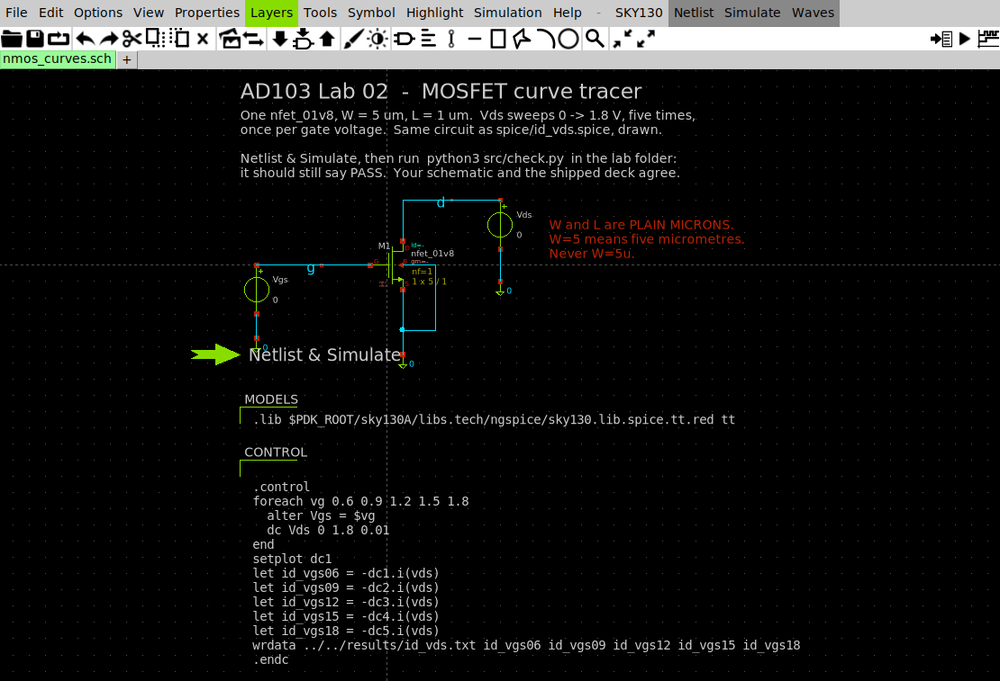

# Lab 03: MOSFET regions

Writeup: [uoftasic.com/ad103 → Lab 03](https://uoftasic.com/ad103/#/labs/lab-03-mosfet-regions-overview).
The steps, expected output and explanations are there; this file is a quick reference.

Five ngspice sweeps of a SKY130 `nfet_01v8`, a plotting script, and extractions that turn those
sweeps into $V_{TH}$, $g_m$, a subthreshold slope and a knee voltage. Lab 04 also runs three of the
targets here (`vth-body`, `vth-l`, `gm-ro`).

## Run it

```bash
cd labs/lab-03-mosfet-regions
make
```

No environment setup is needed. The `Makefile` sets `PDK=sky130A` itself, so this runs in a bare
container even if `.designinit` failed. It takes about 50 seconds and ends with:

```
PASS  all nine extracted parameters match the reference run
```

## Targets

| Command | What it does |
|---|---|
| `make` | sweep, extract, and print a verdict |
| `make curves` | just the four ngspice sweeps → `results/*.txt` |
| `make op` | just the operating-point parameter dump → `results/op_params.log` |
| `make extract` | print every parameter this lab teaches, with its working |
| `make figures` | redraw the six plots and the channel cross-sections into `results/` |
| `make vth-l` | the model's `vth` at nine channel lengths |
| `make vth-body` | the model's `vth` at five source-to-bulk voltages, and at three temperatures |
| `make gm-ro` | $g_m$, $g_{ds}$ and the gain one transistor can give, at four lengths and six gate voltages |
| `make netlist` | netlist `xschem/nmos_curves.sch`, and warn about unconnected pins |
| `make wrong-units` | the same circuit with `W` and `L` written in metres; **fails on purpose** |
| `make clean` | delete `results/` and `xschem/simulation/` |

## Files

| Path | What it is |
|---|---|
| `spice/id_vds.spice` | $I_D$ vs $V_{DS}$, five gate voltages: the output characteristic |
| `spice/id_vgs.spice` | $I_D$ vs $V_{GS}$ at $V_{DS}$ = 0.05 V and 1.8 V: the transfer characteristic |
| `spice/id_vgs_log.spice` | the same saturation sweep, for reading on a log axis |
| `spice/wl_sweep.spice` | four geometries at one bias |
| `spice/op_params.spice` | what BSIM itself reports for `vth`, `vdsat`, `gm` and `gds` |
| `spice/vth_vs_l.spice` | `vth` at nine channel lengths, at low $V_{DS}$ |
| `spice/vth_body.spice` | `vth` and $I_D$ with the source lifted above the bulk, and at three temperatures |
| `spice/gm_ro.spice` | `gm` and `gds` at four lengths, and at six gate voltages for L = 1 µm |
| `spice/id_vds_wrong_units.spice` | identical to `id_vds.spice` except `L=1u W=5u` |
| `src/mosfit.py` | reads `wrdata` files; the three extraction functions |
| `src/extract.py` | prints every parameter, showing its working |
| `src/plot_curves.py` | the six figures on the guide pages |
| `src/channel_picture.py` | the four channel cross-sections |
| `src/check.py` | recomputes the extracted numbers and prints `PASS` or `FAIL` with a reason |
| `xschem/nmos_curves.sch` | the same curve tracer as `id_vds.spice`, drawn |
| `xschem/xschemrc` | project-local XSchem config: SKY130 symbols, netlists into `simulation/` |
| `solutions/` | reference answers to the three extensions in the writeup |

## The drawn version



```bash
cd xschem
PDK=sky130A xschem nmos_curves.sch &
```

Select the green **Netlist & Simulate** launcher arrow with one click, then press `Ctrl-H`. Then
run `python3 src/check.py` from the lab folder; it should still say `PASS`.

The schematic's device line comes out as

```
XM1 d g 0 0 sky130_fd_pr__nfet_01v8 L=1 W=5 nf=1 ad=1.45 as=1.45 pd=10.58 ps=10.58 nrd=0.058 nrs=0.058 sa=0 sb=0 sd=0 mult=1
```

while `spice/id_vds.spice` says only `L=1 W=5 nf=1 m=1`. The XSchem symbol computes the
source/drain diffusion geometry from `W`; `nrd` and `nrs` are diffusion resistances in squares, and
they add a little series resistance. The result is **696.226 µA** from the schematic against
**696.275 µA** from the hand deck, 0.007 % apart and well inside `check.py`'s tolerance.

## Reference number

**696.275 µA**: a SKY130 `nfet_01v8`, W = 5 µm, L = 1 µm, with $V_{GS} = V_{DS} = 1.8$ V. The
MOSFET pages check their predictions against it. The row directly above it in `make extract`'s
first table, **436.080 µA**, is the same device with the gate at 1.5 V. If you ever see 436.080 µA
printed under a **1.80 V** label, the label is wrong, not the current: some tool has paired a
hard-coded list of gate voltages with a column count that changed. Nothing here does that;
`extract.py` reads its labels from `spice/id_vds.spice`.
